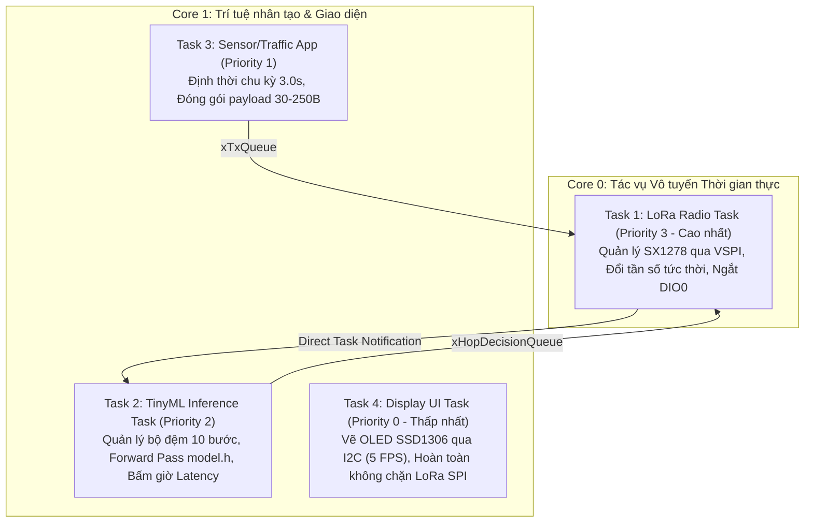

# Tối ưu hóa kênh truyền LoRa với TinyML (Channel Hopping Optimization)

Hệ thống nhảy kênh thông minh dựa trên học máy siêu nhẹ (TinyML) trên vi điều khiển ESP32 và Gateway Raspberry Pi CM4 lắng nghe đa kênh thời gian thực (Dải tần 433 MHz).

---

## 1. Cấu trúc thư mục dự án

```text
LoRa_TinyML_Hopping/
├── MCUCode/                             # Firmware nạp cho các End-Node (PlatformIO)
│   ├── LoRaEN_CommTest/                 # Firmware kiểm tra truyền thông 2 chiều & đo PDR
│   │   ├── platformio.ini
│   │   └── src/main.cpp
│   ├── LoRaEN_DataCollection/           # Firmware thu thập dữ liệu (FreeRTOS Đa nhiệm)
│   │   ├── platformio.ini
│   │   └── src/main.cpp
│   └── LoRaEN_TinyMLHopping/            # Firmware nhảy kênh thông minh TinyML (FreeRTOS Dual-Core)
│       ├── platformio.ini
│       └── src/
│           ├── main.cpp
│           └── model.h                  # Header chứa mô hình nơ-ron nhúng (FlatBuffer byte array)
├── GatewayCode/                         # Mã nguồn Gateway trên Raspberry Pi CM4 (WiringPi C++)
│   ├── Makefile                         # Biên dịch bằng g++ với -lwiringPi -lpthread
│   ├── setup_webserver.sh               # Script tự động cấu hình Nginx Port 80 & Web Dashboard
│   ├── nginx/
│   │   └── loragw.conf                  # File cấu hình Nginx Reverse Proxy (Port 80 -> Daemon 8080)
│   ├── web/                             # Giao diện Web Dashboard Router-style
│   │   ├── index.html                   # Giao diện quản trị, điều khiển phát, OTA Tuning
│   │   ├── style.css                    # Giao diện hiện đại, tối ưu hiển thị
│   │   └── app.js                       # Logic REST API, trạng thái sóng & console real-time
│   ├── include/
│   │   ├── config.h                     # Cấu hình chân GPIO & tần số 3 kênh 433 MHz
│   │   ├── http_server.h                # Khai báo REST/HTTP server nhúng
│   │   └── sx1278_wiringpi.h            # Driver SX1278
│   └── src/
│       ├── http_server.cpp              # Web Server API đa luồng phục vụ điều khiển và OTA
│       ├── sx1278_wiringpi.cpp          # Driver điều khiển SX1278 qua SPI
│       ├── test_comm.cpp                # Chương trình kiểm tra đường truyền RF & phản hồi ACK
│       └── main_gw.cpp                  # Luồng lắng nghe đồng thời 3 module Ra-02 & bộ lọc Control
├── TinyML/                              # Pipeline AI và phân tích dữ liệu (Python)
│   ├── LoRa_TinyML_Pipeline.ipynb       # Jupyter Notebook hoàn chỉnh, tách riêng từng cặp plaintext+code
│   ├── requirements.txt                 # Thư viện: TensorFlow, Scikit-learn, Pandas, Matplotlib, Seaborn
│   ├── data/                            # Kiến trúc dữ liệu đa tầng chuẩn hóa
│   │   ├── logs/                        # File log thô (.txt) thu thập trực tiếp từ Gateway
│   │   ├── parsed/                      # Output bước 1: CSV bóc tách 7 trường dữ liệu chuẩn
│   │   ├── imputed/                     # Output bước 2: Đã phát hiện và bù nhãn gói mất (-1000 dBm)
│   │   ├── MLData/                      # Phân chia theo Node (A, B, C) và tách riêng theo kênh tần số
│   │   ├── MLdataready/                 # Gom nhóm theo kênh (A, B, C, ABC) với 8 cột chuẩn
│   │   └── ready/                       # Cửa sổ trượt chuỗi thời gian (dataset_ready.csv, ts = 10 bước)
│   ├── scripts/
│   │   ├── 01_data_parser.py            # Trích xuất và chuẩn hóa log Gateway sang CSV (1-to-1)
│   │   ├── 02_add_missed_packets.py     # Phát hiện va chạm & điền nhãn phạt gói mất (RSSI/SNR = -1000)
│   │   ├── 03_generate_dataset.py       # Tạo cấu trúc MLData, MLdataready và Sliding Window
│   │   ├── 04_train_model.py            # Huấn luyện đa thuật toán (FCNN, 1D-CNN, GRU, SepCNN, ResNet)
│   │   ├── 05_evaluate_comparison.py    # Đánh giá so sánh: Fixed vs Random vs TinyML Hopping
│   │   ├── 06_benchmark_models.py       # Phân tích chuyên sâu Trade-off phần cứng và tối ưu hóa vi điều khiển
│   │   ├── 07_evaluate_best_model.py    # Đánh giá toàn diện mô hình tốt nhất (Confusion Matrix, Latency)
│   │   ├── 08_pdr_calculation.py        # Thống kê chi tiết PDR và chất lượng kênh thu theo Node & Payload
│   │   ├── 09_plot_hopping_comparison.py# Vẽ biểu đồ cột đa chiều so sánh SNR, RSSI, PDR qua 6 mức tải
│   │   ├── 10_plot_model_sizes.py       # Phân tích dung lượng bộ nhớ (Flash/RAM Footprint) trên MCU
│   │   ├── 11_export_latex_tables.py    # Tự động xuất toàn bộ bảng số liệu sang mã LaTeX Table (.tex)
│   │   └── build_notebook.py            # Trình sinh tự động Jupyter Notebook từ các scripts
│   ├── models/                          # Chứa mô hình tflite, model.h và bảng so sánh benchmark
│   └── figures/                         # Biểu đồ huấn luyện, ma trận nhầm lẫn, biểu đồ đối sánh PDR/RSSI/SNR
├── docs/                                # Tài liệu kỹ thuật, kịch bản thực nghiệm & kiến trúc hệ thống
│   ├── KICH_BAN_THU_THAP_DU_LIEU.md     # Danh mục 21 kịch bản đo kiểm đa Node và phân bổ tần số
│   ├── PIPELINE_THUC_HIEN_DU_AN.md      # Quy trình tổng thể 6 giai đoạn của Đồ án Tốt nghiệp
│   ├── SO_DO_KET_NOI_PHAN_CUNG_VA_FIRMWARE.md # Sơ đồ đấu nối phần cứng & nguyên lý firmware
│   ├── KIEN_TRUC_FREERTOS_FIRMWARE.md   # Thiết kế Đa nhiệm FreeRTOS trên ESP32 Dual-Core
│   └── tables/                          # Mã nguồn bảng LaTeX (.tex) tự động sinh sẵn sàng cho Báo cáo
├── img/                                 # Hình ảnh sơ đồ phần cứng thực tế (Fritzing Breadboard)
│   ├── LoRa Node_bb.png                 # Sơ đồ đấu nối End-Node ESP32
│   └── LoRa GW_bb.png                   # Sơ đồ đấu nối Gateway CM4 3 kênh
└── README.md
```

---

## 2. Sơ đồ đấu nối phần cứng

### A. 3 End-Nodes (ESP32 DevKit V1 + Ra-02 433MHz + OLED SSD1306)

<p align="center">
  
  <br><em>Hình 1: Sơ đồ đấu nối phần cứng chi tiết của LoRa End-Node (ESP32 DevKit V1 + Module LoRa SX1278 Ra-02 + Màn hình OLED 0.96" SSD1306)</em>
</p>

| Thiết bị ngoại vi | Chân Module | Chân ESP32 (GPIO) | Ghi chú kỹ thuật |
| :--- | :--- | :--- | :--- |
| **LoRa Ra-02 (SX1278)** | `MOSI` | **GPIO 27** | Bus SPI cứng (VSPI) |
| | `MISO` | **GPIO 19** | Bus SPI cứng |
| | `SCK` | **GPIO 18** | Bus SPI cứng |
| | `NSS` (CS) | **GPIO 5** | Chip Select |
| | `RST` | **GPIO 14** | Reset module LoRa |
| | `DIO0` | **GPIO 26** | Ngắt thu/phát gói tin |
| | `VCC` | **3.3V** | Dòng đỉnh khi phát ~120mA |
| | `GND` | **GND** | Nối chung mass |
| **OLED 0.96" SSD1306** | `SDA` | **GPIO 21** | Bus I2C |
| | `SCL` | **GPIO 22** | Bus I2C |
| | `VCC` | **3.3V** | Nguồn màn hình |
| | `GND` | **GND** | Mass chung |
| **Trạng thái LED** | `LED` | **GPIO 2** | Onboard LED báo truyền gói tin |

---

### B. Gateway (Raspberry Pi CM4 / Pi 4 + 3 Module Ra-02 433MHz)

<p align="center">
  
  <br><em>Hình 2: Sơ đồ đấu nối phần cứng trạm Gateway 3 kênh (Raspberry Pi CM4 / Pi 4 + 3 Module LoRa SX1278 Ra-02 433 MHz)</em>
</p>

Được cấu hình chuẩn xác trong [`GatewayCode/include/config.h`](file:///e:/DATN/LoRa_TinyML_Hopping/GatewayCode/include/config.h):

#### 1. Bus SPI0 dùng chung cho cả 3 Module:
- **MOSI**: BCM GPIO 10 (WiringPi 12 / Chân vật lý Pin 19)
- **MISO**: BCM GPIO 9  (WiringPi 13 / Chân vật lý Pin 21)
- **SCLK**: BCM GPIO 11 (WiringPi 14 / Chân vật lý Pin 23)
- **Nguồn**: Chân vật lý 3.3V (Pin 1, Pin 17) và GND (Pin 6, 9, 14, 20, 25)

#### 2. Phân bố chân điều khiển độc lập cho từng Module:

| Module Ra-02 | Kênh tần số | Tín hiệu | BCM GPIO | WiringPi Pin (trong Code) | Chân vật lý (40-Pin Header) |
| :--- | :--- | :--- | :--- | :--- | :--- |
| **Module 1** | **433.175 MHz** | **CS (NSS)** | GPIO 8 (CE0) | **10** | **Pin 24** |
| | (Kênh 1) | **RST** | GPIO 27 | **2** | **Pin 13** |
| | | **DIO0** | GPIO 22 | **3** | **Pin 15** |
| **Module 2** | **433.375 MHz** | **CS (NSS)** | GPIO 7 (CE1) | **11** | **Pin 26** |
| | (Kênh 2) | **RST** | GPIO 17 | **0** | **Pin 11** |
| | | **DIO0** | GPIO 18 | **1** | **Pin 12** |
| **Module 3** | **433.575 MHz** | **CS (NSS)** | GPIO 25 | **6** | **Pin 22** |
| | (Kênh 3) | **RST** | GPIO 24 | **5** | **Pin 18** |
| | | **DIO0** | GPIO 23 | **4** | **Pin 16** |

---

## 3. Kiến trúc Đa nhiệm FreeRTOS trên ESP32

Để đảm bảo tính thời gian thực cao và tận dụng tối đa vi xử lý 2 nhân của ESP32, toàn bộ firmware được tái cấu trúc theo mô hình **FreeRTOS SMP Dual-Core** (chi tiết xem tại [`docs/KIEN_TRUC_FREERTOS_FIRMWARE.md`](file:///e:/DATN/LoRa_TinyML_Hopping/docs/KIEN_TRUC_FREERTOS_FIRMWARE.md)):



- **Core 0 (PRO_CPU):** Làm chủ module RF SX1278, bảo đảm phát sóng và lắng nghe Downlink chính xác đến micro-giây.
- **Core 1 (APP_CPU):** Đảm nhận tính toán suy luận mạng nơ-ron và quét màn hình OLED qua I2C mà hoàn toàn không gây trễ hoặc nghẽn bus SPI của LoRa.

---

## 4. Quy trình Thực hiện Đồ án Từng bước

### Bước 1: Thu thập dữ liệu thực tế (Data Collection)
1. **Nạp firmware cho các Node**:
   - Mở [`MCUCode/LoRaEN_DataCollection/src/main.cpp`](file:///e:/DATN/LoRa_TinyML_Hopping/MCUCode/LoRaEN_DataCollection/src/main.cpp).
   - Đặt `#define NODE_ID 'A'`, nạp cho Node 1 qua cổng COM tương ứng.
   - Đổi thành `#define NODE_ID 'B'`, nạp cho Node 2; đổi thành `#define NODE_ID 'C'`, nạp cho Node 3.
2. **Khởi động Gateway Daemon & Web Dashboard trên Raspberry Pi CM4**:
   ```bash
   cd ~/LoRa_TinyML_Hopping/GatewayCode
   make clean && make
   sudo ./lora_gw_3ch
   ```
3. **Kích hoạt phiên đo từ Web Dashboard**:
   - Truy cập `http://<IP_CM4>/` từ trình duyệt.
   - Chọn kịch bản phát: Đơn Node (A, B, C) hoặc Đa Node đồng thời (A+B, A+B+C).
   - Mỗi phiên đo tự động phát 6 mức kích thước payload: `30B -> 74B -> 118B -> 162B -> 206B -> 250B` $\times$ 100 gói/mức (= 600 gói/phiên).

---

### Bước 2: Huấn luyện mô hình TinyML trên Python
1. **Cài đặt môi trường**:
   ```bash
   cd TinyML
   pip install -r requirements.txt
   ```
2. **Chuyển dữ liệu log thực tế vào pipeline**:
   - Copy các file log thu được từ Gateway vào thư mục [`TinyML/data/logs/`](file:///e:/DATN/LoRa_TinyML_Hopping/TinyML/data/logs).
3. **Chạy chuỗi script tiền xử lý và huấn luyện đa thuật toán**:
   ```bash
   # Bước 1: Trích xuất log Gateway thành CSV chuẩn (1-to-1)
   python scripts/01_data_parser.py

   # Bước 2: Phát hiện va chạm & bù nhãn gói mất (RSSI = -1000 dBm, SNR = -1000 dB)
   python scripts/02_add_missed_packets.py

   # Bước 3: Phân tách MLData theo Node/Kênh và tạo cửa sổ trượt Sliding Window (ts = 10)
   python scripts/03_generate_dataset.py

   # Bước 4: Tổng hợp huấn luyện đa thuật toán (FCNN, 1D-CNN, GRU, SepCNN, ResNet)
   python scripts/04_train_model.py
   ```
   - Script 04 tự động huấn luyện và đánh giá đối sánh 5 thuật toán, xuất bảng tổng hợp ra `models/models_benchmark_summary.csv` và biểu đồ đường cong học tập `figures/multi_model_training_comparison.png`.
   - Mô hình tối ưu được tự động chọn, chuyển đổi sang TensorFlow Lite `models/channel_model.tflite` và xuất mã mảng C byte `models/model.h`, đồng thời đồng bộ thẳng sang firmware ESP32.

4. **Sử dụng Jupyter Notebook Trực quan**:
   - Mở file [`TinyML/LoRa_TinyML_Pipeline.ipynb`](file:///e:/DATN/LoRa_TinyML_Hopping/TinyML/LoRa_TinyML_Pipeline.ipynb).
   - Toàn bộ quá trình huấn luyện từng thuật toán được chia thành **các cặp plaintext + code độc lập**, giúp dễ dàng theo dõi và trực quan hóa từng mô hình.

---

### Bước 3: Đánh giá Đối sánh, Phân tích Bộ nhớ & Xuất Bảng LaTeX
1. **Đánh giá so sánh 3 cơ chế quản lý kênh**:
   ```bash
   python scripts/05_evaluate_comparison.py
   ```
   Tính toán và vẽ biểu đồ đối chứng qua 6 mức kích thước tải:
   - **Fixed Channel (Kênh cố định):** Thấy rõ hiện tượng nghẽn mạng và sụt giảm PDR.
   - **Random Hopping (Nhảy ngẫu nhiên):** Tỷ lệ nhận cải thiện vừa phải nhưng vẫn có xác suất trùng kênh.
   - **TinyML Predictive Hopping:** Dự đoán né kênh nghẽn thành công, nâng PDR lên $> 90\%$.

2. **Benchmark Trade-off phần cứng & Đánh giá chuyên sâu mô hình tốt nhất**:
   ```bash
   python scripts/06_benchmark_models.py
   python scripts/07_evaluate_best_model.py
   ```
   - Xuất Confusion Matrix (Ma trận nhầm lẫn), Precision, Recall, F1-Score cho từng kênh.
   - Phân tích chi tiết độ trễ suy luận thời gian thực ($\mu s$) và mức độ tiêu thụ bộ nhớ.

3. **Thống kê PDR chi tiết, Vẽ đồ thị đa panel & Xuất mã LaTeX**:
   ```bash
   python scripts/08_pdr_calculation.py
   python scripts/09_plot_hopping_comparison.py
   python scripts/10_plot_model_sizes.py
   python scripts/11_export_latex_tables.py
   ```
   - Tự động xuất toàn bộ bảng số liệu sang các file mã nguồn LaTeX Table (`.tex`) lưu tại `docs/tables/`, sẵn sàng đưa trực tiếp vào Luận văn Tốt nghiệp.

---

### Bước 4: Triển khai Kiểm chứng Thời gian thực trên Node
1. Mở project [`MCUCode/LoRaEN_TinyMLHopping`](file:///e:/DATN/LoRa_TinyML_Hopping/MCUCode/LoRaEN_TinyMLHopping) trên PlatformIO.
2. Kiểm tra file `src/model.h` (đã được sinh tự động từ Bước 2).
3. Nạp firmware vào ESP32 để kích hoạt chế độ nhảy kênh thông minh TinyML thời gian thực và theo dõi kết quả PDR, số lần nhảy kênh (Hops), độ trễ suy luận AI ($\mu s$) trực tiếp trên màn hình OLED SSD1306.
