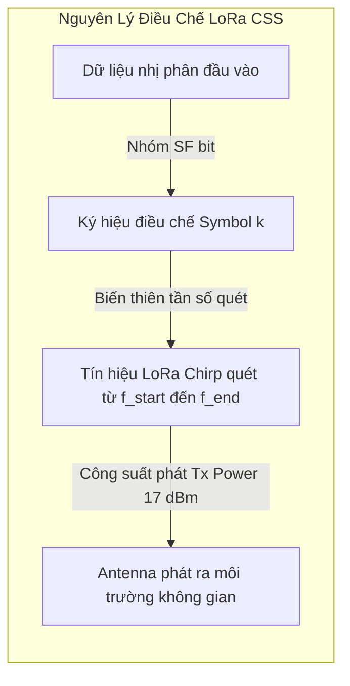
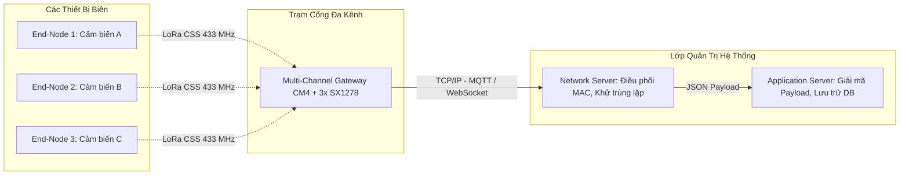
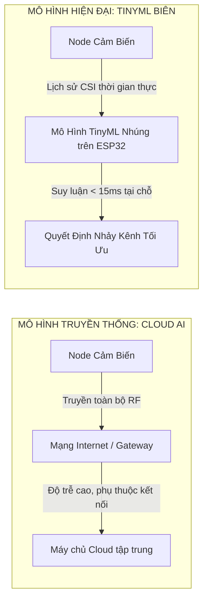

# CHƯƠNG 1: TỔNG QUAN VỀ HỆ THỐNG LORAWAN

---

## 1.1. Sự Ra Đời Của LoRaWAN

### 1.1.1. Giới thiệu hệ thống IoT
Hệ thống Internet of Things (IoT - Mạng lưới vạn vật kết nối Internet) là một hệ thống mạng phân tán kết nối hàng tỷ thiết bị vật lý, từ các cảm biến vi mô, cơ cấu chấp hành đến các máy móc công nghiệp phức tạp, cho phép chúng thu thập, trao đổi dữ liệu và phối hợp hoạt động thông qua hạ tầng mạng viễn thông toàn cầu [1]. Kiến trúc tổng quát của một hệ sinh thái IoT tiêu chuẩn thường được chia thành 4 lớp chức năng chính:

1. **Lớp cảm nhận (Perception Layer):** Chịu trách nhiệm đo lường các đại lượng vật lý (nhiệt độ, độ ẩm, áp suất, độ rung, nồng độ khí, lưu lượng) và số hóa chúng thành các tín hiệu điện thông qua các bộ chuyển đổi tương tự - số (ADC).
2. **Lớp truyền dẫn mạng (Network Transmission Layer):** Chuyển tiếp các gói dữ liệu từ lớp cảm nhận về các trung tâm xử lý trung gian hoặc trạm cổng thông qua các công nghệ không dây và có dây.
3. **Lớp trung gian và xử lý dữ liệu (Middleware & Cloud Processing Layer):** Quản lý kết nối thiết bị, lưu trữ dữ liệu lớn (Big Data), tiền xử lý và cung cấp các dịch vụ tính toán phân tán.
4. **Lớp ứng dụng (Application Layer):** Cung cấp giao diện tương tác người dùng, trực quan hóa dữ liệu thời gian thực và tự động hóa các kịch bản điều khiển thông minh trong các lĩnh vực như Smart Agriculture, Smart City, Logistics và Công nghiệp 4.0.

Trong giai đoạn đầu phát triển, các giải pháp kết nối không dây cho IoT chủ yếu dựa vào các công nghệ vô tuyến tầm ngắn (Short-Range Wireless) như Wi-Fi (IEEE 802.11), Bluetooth/BLE (IEEE 802.15.1) và ZigBee (IEEE 802.15.4), hoặc các mạng di động truyền thống như 2G/3G/4G GSM/LTE. Tuy nhiên, các ứng dụng giám sát diện rộng phân tán trên phạm vi hàng chục kilômét đặt ra những bài toán hóc búa về cân bằng năng lượng và chi phí hạ tầng mà các công nghệ truyền thống không thể giải quyết trọn vẹn.

---

### 1.1.2. Công nghệ mạng diện rộng công suất thấp (LPWAN)
Để giải quyết mâu thuẫn cố hữu giữa **khoảng cách truyền dẫn xa**, **tiêu thụ năng lượng cực thấp** và **chi phí triển khai tối thiểu**, nhóm công nghệ Mạng diện rộng công suất thấp (Low Power Wide Area Network - LPWAN) đã ra đời [2]. Khác với các mạng truyền thông băng rộng tập trung vào thông lượng dữ liệu cao (như 4G/5G hay Wi-Fi), LPWAN được tối ưu hóa đặc thù cho các gói tin có dung lượng nhỏ (từ vài byte đến vài trăm byte), tần suất truyền thưa thớt, nhưng đòi hỏi thiết bị đầu cuối có khả năng hoạt động liên tục từ 5 đến 10 năm chỉ với một viên pin dung lượng tiêu chuẩn.

Bảng 1.1 so sánh các đặc tính kỹ thuật cốt lõi giữa các công nghệ truyền thông không dây phổ biến trong hệ sinh thái IoT:

*Bảng 1.1: So sánh tổng quan giữa các công nghệ không dây trong hệ thống IoT [2], [3]*

| Tiêu chí kỹ thuật | Wi-Fi (IEEE 802.11ax) | Bluetooth Low Energy (BLE) | NB-IoT (3GPP Cat-NB1) | Sigfox | LoRa / LoRaWAN |
| :--- | :---: | :---: | :---: | :---: | :---: |
| **Băng tần hoạt động** | $2.4\text{ GHz} / 5\text{ GHz}$ | $2.4\text{ GHz}$ | Cấp phép (Licensed LTE) | Không cấp phép (ISM) | **Không cấp phép (ISM)** |
| **Cự ly truyền tối đa** | $50 - 100\text{ m}$ | $10 - 50\text{ m}$ | $10 - 15\text{ km}$ | $10 - 40\text{ km}$ | **$5 - 15\text{ km}$ (ngoại ô)** |
| **Tốc độ truyền dữ liệu** | Lên tới hàng trăm Mbps | $1 - 2\text{ Mbps}$ | $20 - 250\text{ kbps}$ | $100\text{ bps}$ | **$0.3 - 50\text{ kbps}$** |
| **Thời lượng pin thiết bị** | Vài giờ đến vài ngày | Vài tuần đến vài tháng | $5 - 10\text{ năm}$ | $5 - 10\text{ năm}$ | **$5 - 10\text{ năm}$** |
| **Chi phí thuê bao / Hạ tầng**| Không phí thuê bao | Không phí thuê bao | Cần SIM & cước nhà mạng | Thuê bao mạng Sigfox | **Hoàn toàn tự chủ mạng riêng** |
| **Khả năng xuyên thấu** | Kém | Kém | Tốt (MCL $164\text{ dB}$) | Cao (Ultra Narrow Band) | **Rất cao (Link Budget $> 150\text{ dB}$)** |

Từ bảng so sánh trên, có thể thấy LoRaWAN và Sigfox đại diện cho nhóm công nghệ sử dụng băng tần ISM không cấp phép, giúp doanh nghiệp và nhà nghiên cứu có thể tự do triển khai mạng riêng (Private Network) mà không phụ thuộc vào hạ tầng viễn thông công cộng hay phát sinh chi phí vận hành hàng tháng như NB-IoT.

---

### 1.1.3. Vai trò của LoRaWAN trong IoT
Trong bức tranh toàn cảnh của cuộc cách mạng IoT công nghiệp và dân dụng, LoRaWAN đóng vai trò là "xương sống kết nối" cho các kịch bản đo đạc phân tán cự ly xa [4]:

* **Tự chủ hoàn toàn về hạ tầng mạng (Network Ownership):** Người sử dụng có thể tự thiết lập hệ thống gồm các End-Nodes, các Gateway trung gian và máy chủ quản trị mạng riêng biệt (On-Premise Network Server) với mức chi phí đầu tư ban đầu rất thấp, đảm bảo tuyệt đối tính bảo mật và quyền riêng tư của dữ liệu.
* **Ngân sách đường truyền (Link Budget) vượt trội:** Nhờ kỹ thuật trải phổ chirp, LoRa đạt được ngân sách đường truyền lên đến hơn $150 - 157\text{ dB}$, cho phép tín hiệu vô tuyến xuyên qua các kết cấu bê tông dày, tầng hầm đô thị hoặc tán cây rậm rạp trong nông nghiệp.
* **Chuẩn hóa mở và cộng đồng hỗ trợ toàn cầu:** LoRaWAN được duy trì và phát triển bởi liên minh mở LoRa Alliance, đảm bảo tính tương thích phần cứng giữa hàng nghìn nhà sản xuất vi mạch và cảm biến trên thế giới.

---

## 1.2. Cấu Trúc Và Hoạt Động Của LoRaWAN

### 1.2.1. Công nghệ LoRa
Cần phân biệt rõ ràng giữa hai khái niệm: **LoRa** và **LoRaWAN**. LoRa (Long Range) là công nghệ truyền thông thuộc **Lớp vật lý (Physical Layer - PHY)** được cấp bằng sáng chế bởi Semtech Corporation, trong khi LoRaWAN là giao thức thuộc **Lớp điều khiển truy cập môi trường (MAC Layer)** và kiến trúc mạng hệ thống được chuẩn hóa bởi LoRa Alliance [3].

#### Kỹ thuật điều chế trải phổ Chirp (Chirp Spread Spectrum - CSS)
Khác với các phương pháp điều chế số truyền thống như FSK (Frequency Shift Keying) hay PSK (Phase Shift Keying) vốn rất nhạy cảm với can nhiễu đa đường (multipath fading) và hiệu ứng Doppler, công nghệ LoRa sử dụng kỹ thuật điều chế trải phổ Chirp (CSS). Trong điều chế CSS, sóng mang liên tục biến đổi tần số theo thời gian một cách tuyến tính trên toàn bộ băng thông xác định ($BW$), tạo thành các xung tần số quét gọi là "chirp" [4].

Tần số tức thời $f(t)$ của một tín hiệu chirp tuyến tính cơ sở (up-chirp) trong khoảng thời gian một ký hiệu $T_s$ được biểu diễn bằng công thức:
$$f(t) = f_0 + \mu t, \quad -\frac{T_s}{2} \le t \le \frac{T_s}{2}$$
Trong đó:
* $f_0$ là tần số trung tâm vô tuyến (ví dụ: $433.175\text{ MHz}$).
* $\mu = \frac{BW}{T_s}$ là tốc độ quét tần số (Chirp Rate).
* $T_s$ là thời gian kéo dài của một ký hiệu (Symbol Duration).

Mối quan hệ mật thiết giữa các tham số vật lý của sóng LoRa được định lượng bởi các phương trình toán học sau:

1. **Số lượng chip trên mỗi ký hiệu (Chips per Symbol):**
   $$N_{chips} = 2^{SF}$$
   với $SF$ (Spreading Factor) là hệ số trải phổ, nhận giá trị nguyên từ $7$ đến $12$. Mỗi ký hiệu mang chính xác $SF$ bit thông tin.
2. **Thời gian của một ký hiệu ($T_s$):**
   $$T_s = \frac{2^{SF}}{BW}$$
3. **Tốc độ chip (Chip Rate - $R_c$):**
   $$R_c = BW \quad (\text{chips/giây})$$
4. **Tốc độ truyền dữ liệu thô (Bitrate - $R_b$):**
   $$R_b = SF \times \frac{BW}{2^{SF}} \times CR \quad (\text{bps})$$
   với $CR = \frac{4}{4 + n}$ (với $n \in \{1, 2, 3, 4\}$) là tốc độ mã hóa kênh sửa lỗi Forward Error Correction (FEC).

#### Độ nhạy máy thu và mức nhiễu nền vô tuyến (Noise Floor)
Mức công suất nhiễu nhiệt nền vô tuyến $N$ được xác định theo định luật Nyquist-Johnson:
$$N = -174\text{ dBm/Hz} + 10 \log_{10}(BW) + NF\text{ (dBm)}$$
Với băng thông chuẩn $BW = 125\text{ kHz}$ và hệ số tạp âm máy thu $NF \approx 6\text{ dB}$, mức nhiễu nền của hệ thống là:
$$N = -174 + 10 \log_{10}(125000) + 6 = -174 + 51 + 6 = -117\text{ dBm}$$
Đặc tính vượt trội nhất của kỹ thuật điều chế CSS là khả năng giải điều chế tín hiệu thành công ngay cả khi tín hiệu thu được nằm sâu **dưới mức nhiễu nền** (SNR âm). Cụ thể, với $SF = 7$, máy thu có thể giải mã tín hiệu tại ngưỡng $\text{SNR} \ge -7.5\text{ dB}$; với $SF = 12$, ngưỡng này có thể đạt tới $-20\text{ dB}$, mang lại độ nhạy máy thu lên tới $-137\text{ dBm}$.

---

### 1.2.2. Các thành phần trong hệ thống LoRaWAN
Kiến trúc mạng LoRaWAN được cấu trúc theo cấu hình hình sao lồng nhau (Star-of-Stars Topology), bao gồm các thực thể chức năng chính được mô tả trong Hình 1.1:

1. **Thiết bị đầu cuối (End-Nodes):** Các thiết bị nhúng công suất thấp (như vi điều khiển ESP32, STM32) kết nối trực tiếp với cảm biến vật lý và module RF LoRa (SX1276/SX1278). Các node này chủ động thu thập dữ liệu và điều chế sóng LoRa để truyền tin đến các Gateway lân cận.
2. **Trạm cổng chuyển tiếp (Gateways):** Đóng vai trò là cầu nối trong suốt giữa môi trường vô tuyến RF và mạng IP có dây/không dây (Ethernet, Wi-Fi, 4G). Gateway tiếp nhận đồng thời nhiều gói tin trên các tần số khác nhau, đóng gói thành các bản tin TCP/UDP (thường là gói tin JSON theo chuẩn Semtech Packet Forwarder) và đẩy về máy chủ mạng.
3. **Máy chủ mạng (Network Server - NS):** Trung tâm điều hành thông minh của toàn bộ hệ thống. NS chịu trách nhiệm loại bỏ các bản tin trùng lặp khi nhiều Gateway cùng thu một gói, kiểm tra tính toàn vẹn xác thực (MIC - Message Integrity Code), điều phối các cửa sổ nhận (Receive Windows), và quản lý cơ chế thích ứng tốc độ dữ liệu (Adaptive Data Rate - ADR).
4. **Máy chủ ứng dụng (Application Server - AS):** Giải mã dữ liệu người dùng (User Payload) bằng khóa phiên ứng dụng (AppSKey), lưu trữ vào cơ sở dữ liệu chuỗi thời gian và cung cấp giao diện hiển thị cho người dùng cuối.

#### Phân lớp thiết bị trong LoRaWAN (Device Classes)
Chuẩn LoRaWAN phân loại các thiết bị đầu cuối thành 3 lớp hoạt động dựa trên sự đánh đổi giữa độ trễ đường xuống (Downlink Latency) và mức tiêu thụ năng lượng:

*Bảng 1.2: So sánh đặc tính hoạt động của các lớp thiết bị trong LoRaWAN [3]*

| Lớp thiết bị | Cơ chế nhận tín hiệu đường xuống | Mức tiêu thụ năng lượng | Ứng dụng tiêu biểu |
| :---: | :--- | :---: | :--- |
| **Class A** | Chỉ mở 2 cửa sổ nhận ngắn ($RX1, RX2$) sau mỗi lần phát đường lên (Uplink). Thiết bị ngủ sâu phần lớn thời gian. | **Thấp nhất** (Pin $> 5 - 10\text{ năm}$) | Cảm biến môi trường, đồng hồ thông minh, nông nghiệp |
| **Class B** | Mở thêm các cửa sổ nhận định kỳ đồng bộ theo tín hiệu mốc thời gian (Beacon) từ Gateway. | **Trung bình** | Đo đạc điều khiển lưới điện, van tưới tiêu tự động |
| **Class C** | Bộ thu vô tuyến mở liên tục gần như $100\%$ thời gian, chỉ tắt khi đang phát sóng. | **Cao nhất** (Cần nguồn điện lưới) | Chiếu sáng công cộng, giám sát khẩn cấp thời gian thực |

---

### 1.2.3. Cơ chế truyền dữ liệu và quản lý kênh
Ở tầng MAC, LoRaWAN Class A sử dụng cơ chế đa truy cập ngẫu nhiên **Pure ALOHA**. Khi một node phát sinh dữ liệu, nó lập tức kích hoạt bộ phát vô tuyến và đẩy gói tin lên kênh truyền mà không cần kiểm tra xem môi trường xung quanh đang rảnh hay bận.

#### Tính toán thời gian truyền sóng trên không (Time-on-Air - ToA)
Tổng thời gian một gói tin LoRa chiếm dụng môi trường truyền dẫn vô tuyến $ToA$ được cấu thành từ thời gian truyền chuỗi đồng bộ mào đầu ($T_{preamble}$) và thời gian truyền tải trọng ($T_{payload}$):
$$ToA = T_{preamble} + T_{payload}$$
Trong đó:
* Thời gian mào đầu:
  $$T_{preamble} = (N_{preamble} + 4.25) \times T_s$$
  với $N_{preamble}$ là số lượng ký hiệu preamble (thường mặc định là $8$).
* Số lượng ký hiệu tải trọng ($N_{payload}$):
  $$N_{payload} = 8 + \max\left(\left\lceil \frac{8 PL - 4 SF + 28 + 16 - 20 H}{4(SF - 2 DE)} \right\rceil (CR + 4), 0\right)$$
  với:
  * $PL$: Độ dài tải trọng gói tin tính bằng Bytes ($30\text{B} - 250\text{B}$).
  * $H$: Bật ($H=0$) hoặc tắt ($H=1$) tiêu đề Implicit Header.
  * $DE$: Bật ($DE=1$) hoặc tắt ($DE=0$) cơ chế tối ưu hóa tốc độ dữ liệu thấp (Low Data Rate Optimization, bắt buộc khi $SF=11, 12$ với $BW=125\text{ kHz}$).
  * $CR$: Tốc độ mã hóa kênh ($CR=1$ tương ứng $4/5$).

Do đó:
$$T_{payload} = N_{payload} \times T_s$$

Khi kích thước tải trọng $PL$ tăng từ $30\text{ Bytes}$ lên $250\text{ Bytes}$, giá trị $ToA$ kéo dài gấp nhiều lần (từ vài chục mili-giây lên đến hơn $400\text{ ms}$). Điều này tác động trực tiếp và nghiêm trọng đến xác suất xung đột gói tin trên toàn mạng.

---

## 1.3. Chất Lượng Kênh Truyền LoRaWAN

### 1.3.1. Các yếu tố ảnh hưởng đến kênh truyền
Chất lượng truyền thông không dây trên băng tần $433\text{ MHz}$ phụ thuộc sâu sắc vào các yếu tố vật lý và giao thức mạng:

1. **Hiện tượng suy hao truyền sóng trong không gian (Path Loss) và bóng râm (Shadowing):** Khi khoảng cách giữa máy phát và máy thu tăng, năng lượng điện từ trường suy giảm tỷ lệ nghịch với bình phương hoặc bậc 4 của khoảng cách theo mô hình Log-distance Path Loss:
   $$PL(d) = PL(d_0) + 10 \gamma \log_{10}\left(\frac{d}{d_0}\right) + X_\sigma$$
   với $\gamma$ là hệ số suy hao môi trường ($2.0 - 4.0$) và $X_\sigma \sim \mathcal{N}(0, \sigma^2)$ là biến ngẫu nhiên Gauss mô tả hiện tượng bóng râm do vật cản địa hình.
2. **Can nhiễu đồng kênh và lân kênh (Co-Channel & Adjacent Channel Interference):** Xuất hiện khi nhiều thiết bị phát sóng trên cùng một tần số hoặc trên các tần số lân cận mà bộ lọc thông dải RF không triệt tiêu hoàn toàn. Khoảng cách bảo vệ kênh (Guard Band) tối thiểu $200\text{ kHz}$ là yếu tố kỹ thuật bắt buộc để phân tách các kênh $433.175\text{ MHz}$, $433.375\text{ MHz}$ và $433.575\text{ MHz}$.
3. **Va chạm gói tin do cơ chế Pure ALOHA (Packet Collisions):** Khoảng thời gian xung đột nguy hiểm (Vulnerable Period - $T_v$) của cơ chế Pure ALOHA bằng đúng hai lần thời gian truyền gói:
   $$T_v = 2 \times ToA$$
   Nếu có bất kỳ một node nào khác phát sóng trong khoảng thời gian $[t - ToA, t + ToA]$, hai tín hiệu sẽ chồng lấn trên không gian sóng, phá hủy dạng sóng điều chế và dẫn đến mất gói hoàn toàn tại Gateway. Xác suất va chạm gói tin $P_{coll}$ dưới tải lưu lượng mạng Poisson với mật độ $G$ (erlangs) tuân theo công thức kinh điển:
   $$P_{coll} = 1 - e^{-2G}$$
   Thông lượng hữu ích (Throughput $S$) của giao thức Pure ALOHA bị giới hạn lý thuyết nghiêm ngặt ở mức tối đa chỉ:
   $$S_{max} = \frac{1}{2e} \approx 18.4\%$$

---

### 1.3.2. Các chỉ số đánh giá chất lượng kênh
Để định lượng trạng thái kênh truyền vô tuyến thời gian thực, hệ thống trích xuất 3 chỉ số then chốt từ tầng vật lý Semtech SX1278:

1. **Chỉ số cường độ tín hiệu thu (Received Signal Strength Indicator - RSSI):** Đo lường tổng công suất tín hiệu thu được tại đầu vào anten máy thu (bao gồm cả công suất tín hiệu hữu ích, công suất can nhiễu và nhiễu nhiệt), tính bằng đơn vị $\text{dBm}$:
   $$\text{RSSI} = -157 + \text{RegRssiValue} \quad (\text{đối với băng tần High Frequency})$$
   $$\text{RSSI} = -164 + \text{RegRssiValue} \quad (\text{đối với băng tần } 433\text{ MHz Low Frequency})$$
   Giá trị RSSI càng gần $0\text{ dBm}$ (ví dụ $-60\text{ dBm}$ đến $-75\text{ dBm}$) thể hiện tín hiệu thu được càng mạnh; các giá trị thấp hơn $-110\text{ dBm}$ tiến gần đến ngưỡng nhạy của máy thu.
2. **Tỷ số tín hiệu trên tạp âm (Signal-to-Noise Ratio - SNR):** Tỷ lệ giữa công suất tín hiệu mong muốn thu được $P_{signal}$ và công suất tạp âm nền $P_{noise}$:
   $$\text{SNR (dB)} = 10 \log_{10}\left(\frac{P_{signal}}{P_{noise}}\right) = \frac{\text{RegPacketSnrValue}}{4}$$
   Do công nghệ LoRa có thể giải mã dưới mức nhiễu nền, giá trị SNR có thể nhận giá trị dương (tín hiệu mạnh hơn tạp âm, ví dụ $+8\text{ dB}$ đến $+10\text{ dB}$) hoặc giá trị âm (tín hiệu chìm dưới tạp âm, ví dụ $-5\text{ dB}$ đến $-10\text{ dB}$).
3. **Tỷ lệ phân phối gói tin thành công (Packet Delivery Ratio - PDR):** Tỷ số phần trăm giữa số lượng gói tin Gateway thu nhận toàn vẹn không lỗi CRC ($N_{received}$) và tổng số lượng gói tin mà các End-Nodes đã phát đi ($N_{transmitted}$):
   $$\text{PDR (\%)} = \frac{N_{received}}{N_{transmitted}} \times 100\%$$
   PDR là chỉ số chất lượng dịch vụ (QoS) tối thượng phản ánh tính ổn định và độ tin cậy của toàn bộ mạng không dây.

---

### 1.3.3. Các phương pháp lựa chọn kênh truyền
Trong các mạng vô tuyến đa kênh, việc lựa chọn kênh truyền được chia thành ba trường phái kỹ thuật chính:

*Bảng 1.3: So sánh các phương pháp lựa chọn kênh truyền trong hệ thống LoRa/LoRaWAN*

| Phương pháp lựa chọn kênh | Cơ chế vận hành | Ưu điểm | Nhược điểm chí mạng |
| :--- | :--- | :--- | :--- |
| **Kênh cố định (Fixed Channel)** | Toàn bộ các node chỉ truyền trên 1 tần số duy nhất được gán cứng ban đầu. | Firmware cực kỳ đơn giản, không cần logic chuyển kênh. | Rất dễ tắc nghẽn, PDR sụt giảm nghiêm trọng khi có va chạm hoặc can nhiễu liên tục. |
| **Nhảy kênh ngẫu nhiên (Random Hopping)** | Node bốc thăm ngẫu nhiên đều 1 trong các kênh cho phép trước mỗi lần phát. | Phân tán lưu lượng đều về mặt lý thuyết, giảm tải tập trung. | **Mù va chạm (Collision-blind)**; các node vẫn đụng độ ngẫu nhiên khi lưu lượng tăng cao. |
| **Nhảy kênh thích ứng thông minh (TinyML Hopping)** | Node quan sát lịch sử CSI ($RSSI, SNR, ToA$) qua cửa sổ trượt và dự đoán kênh sạch. | **Triệt tiêu va chạm**, PDR duy trì $95\% - 100\%$, tự thích nghi với môi trường. | Đòi hỏi thuật toán tối ưu bộ nhớ Flash/RAM để thực thi trên vi điều khiển biên. |

---

## 1.4. Ứng Dụng TinyML Trong Lựa Chọn Kênh Truyền LoRaWAN

### 1.4.1. Giới thiệu về Edge AI
Trí tuệ nhân tạo tại biên (Edge AI) là sự chuyển dịch mô hình tính toán từ điện toán đám mây tập trung (Cloud Computing) về các thiết bị cục bộ nằm ngay sát nguồn sinh dữ liệu [5]. Thay vì gửi toàn bộ dữ liệu thô chưa qua xử lý lên máy chủ từ xa qua các kênh truyền vô tuyến băng hẹp, Edge AI cho phép thiết bị tự trích xuất đặc trưng, tự đưa ra quyết định thông minh ngay tại chỗ trong thời gian thực. Điều này mang lại 4 lợi ích mang tính sống còn:
1. **Độ trễ phản hồi cực thấp (Ultra-low Latency):** Ra quyết định trong vài mili-giây mà không bị phụ thuộc vào trễ truyền thông mạng.
2. **Tiết kiệm năng lượng truyền thông (Energy Efficiency):** Năng lượng tiêu tốn cho tính toán tại chỗ thấp hơn từ 10 đến 100 lần so với năng lượng kích hoạt mạch phát cao tần RF để đẩy dữ liệu lên mây.
3. **Bảo mật và riêng tư (Privacy & Security):** Dữ liệu thô không bao giờ rời khỏi thiết bị cục bộ.
4. **Khả năng hoạt động tự chủ (Offline Autonomy):** Hệ thống vẫn vận hành hoàn hảo ngay cả khi mất hoàn toàn kết nối Internet.

---

### 1.4.2. Khả năng triển khai học máy trên vi điều khiển (TinyML)
TinyML (Tiny Machine Learning) là một lĩnh vực chuyên sâu của Edge AI, tập trung vào việc thu nhỏ, lượng tử hóa và thực thi các mô hình học máy (Machine Learning / Deep Learning) trên các vi điều khiển cấp thấp có nguồn tài nguyên phần cứng cực kỳ giới hạn: bộ nhớ RAM tính bằng kilobyte ($< 512\text{ KB}$), bộ nhớ Flash tính bằng megabyte ($< 4\text{ MB}$) và công suất tiêu thụ dưới vài mili-watt [6].

Nhờ sự xuất hiện của các khung phần mềm nhúng chuyên biệt như **TensorFlow Lite for Microcontrollers (TFLM)**, các phép toán ma trận tensor phức tạp đã được tối ưu hóa ở mức mã máy assembly cho các tập lệnh kiến trúc ARM Cortex-M hoặc Xtensa LX6/LX7, cho phép thực thi suy luận mạng nơ-ron sâu mà không cần đến sự hỗ trợ của hệ điều hành đầy đủ hay bộ xử lý số thực phần cứng cao cấp.

---

### 1.4.3. Tiềm năng của TinyML trong tối ưu hóa kênh truyền vô tuyến
Việc tích hợp TinyML vào thiết bị đầu cuối LoRa End-Node tạo nên một bước nhảy vọt về nhận thức ngữ cảnh vô tuyến:
* **Học quy luật ẩn của môi trường truyền sóng:** Dữ liệu kênh truyền (CSI) theo thời gian thực mang đậm tính quy luật cục bộ (chu kỳ hoạt động của các node xung quanh, sự suy giảm RSSI theo khoảng cách, các xung nhiễu ngẫu nhiên). Mạng nơ-ron học sâu có khả năng nắm bắt các mối liên hệ phi tuyến phức tạp này qua chuỗi thời gian mà các thuật toán heuristic đơn giản không thể nhận diện được.
* **Tự động hóa hoàn toàn ở mức thiết bị (Autonomous Edge Hopping):** Node tự đưa ra quyết định chuyển kênh tối ưu ngay trước khoảnh khắc phát sóng mà không cần trao đổi thêm bất kỳ bản tin báo hiệu (handshake) nào với Gateway, bảo toàn triệt để chu kỳ phát và dung lượng pin của hệ thống.

---

## 1.5. Kết Luận Chương 1

Chương 1 đã thiết lập một nền tảng lý thuyết vững chắc về công nghệ mạng không dây diện rộng công suất thấp LoRa/LoRaWAN, làm rõ nguyên lý điều chế trải phổ CSS, kiến trúc phân tầng mạng và cơ chế đa truy cập Pure ALOHA. Phân tích toán học đã chỉ ra rằng điểm nghẽn nghiêm trọng nhất của hệ thống LoRa truyền thống chính là xác suất va chạm xung đột gói tin tăng cao khi kích thước tải trọng gói tin mở rộng, xuất phát từ việc các node phát sóng thụ động trên các kênh cố định hoặc nhảy kênh ngẫu nhiên không có nhận thức môi trường. 

Từ đó, việc ứng dụng học máy siêu nhẹ TinyML trực tiếp trên vi điều khiển biên ESP32 được xác định là hướng tiếp cận mang tính đột phá và khả thi cao, mở đường cho việc thiết kế mô hình toán học và triển khai thực nghiệm chi tiết trong các chương tiếp theo.
