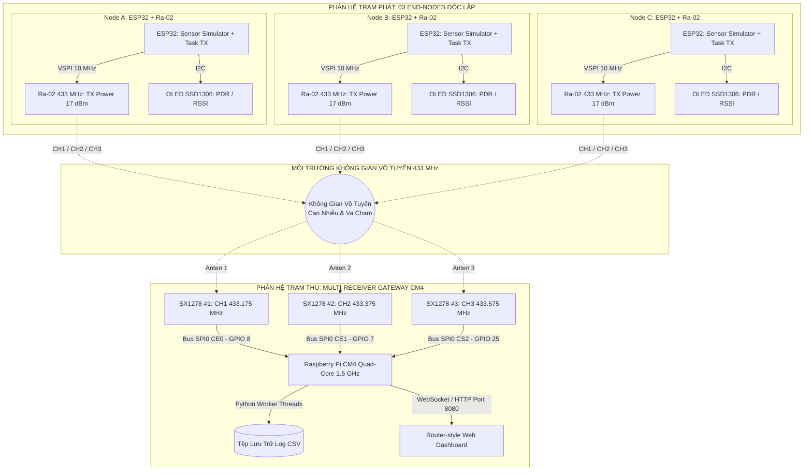
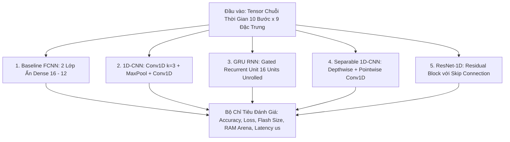

# CHƯƠNG 2: MÔ HÌNH HỌC MÁY TINYML CHO HỆ THỐNG LORAWAN

---

## 2.1. Bài Toán Lựa Chọn Kênh

### 2.1.1. Mục tiêu bài toán
Trong môi trường mạng không dây đa kênh gồm $M = 3$ kênh tần số trực giao ($CH1 = 433.175\text{ MHz}$, $CH2 = 433.375\text{ MHz}$, $CH3 = 433.575\text{ MHz}$), mục tiêu trọng tâm của bài toán là: **Trước mỗi lần phát một gói tin mới, thiết bị đầu cuối (End-Node) phải tự động dự đoán và lựa chọn kênh truyền vật lý có xác suất va chạm thấp nhất và chất lượng truyền dẫn cao nhất dựa trên chuỗi thông tin trạng thái kênh (CSI) đã quan sát trong quá khứ gần.**

Về mặt toán học, bài toán được mô hình hóa dưới dạng bài toán phân loại đa lớp theo chuỗi thời gian (Multi-Class Time-Series Classification):
* Giả sử tại mốc thời gian phát thứ $t$, thiết bị lưu trữ một cửa sổ trượt lịch sử (Sliding Window) gồm $W = 10$ mốc truyền nhận gần nhất.
* Tại mỗi bước thời gian $\tau \in \{t - W + 1, \dots, t\}$, trạng thái kênh được biểu diễn bởi một vector đặc trưng gồm $F = 9$ thuộc tính vật lý:
  $$\mathbf{x}_\tau = \left[ CH1_\tau, CH2_\tau, CH3_\tau, \text{SNR}_\tau, \text{RSSI}_\tau, \text{Size}_\tau, \text{PacketID}_\tau, \text{Freq}_\tau, \text{ActiveCH}_\tau \right]^T \in \mathbb{R}^9$$
* Toàn bộ dữ liệu đầu vào của mô hình là một ma trận tensor chuỗi thời gian hai chiều $\mathbf{X}_t \in \mathbb{R}^{W \times F} = \mathbb{R}^{10 \times 9}$ (hoặc một vector phẳng hóa $\mathbf{x}_{flat} \in \mathbb{R}^{90}$).
* Mục tiêu của hàm ánh xạ học máy $f_\theta(\mathbf{X}_t)$ (với $\theta$ là bộ trọng số nơ-ron) là ước lượng phân phối xác suất tiên nghiệm trên $M = 3$ kênh mục tiêu:
  $$\hat{\mathbf{y}}_t = f_\theta(\mathbf{X}_t) = \left[ P(y=0 \mid \mathbf{X}_t), P(y=1 \mid \mathbf{X}_t), P(y=2 \mid \mathbf{X}_t) \right]^T$$
* Kênh được lựa chọn để phát sóng tức thời $\hat{c}_t$ là kênh đạt xác suất lớn nhất (ArgMax):
  $$\hat{c}_t = \arg\max_{k \in \{0, 1, 2\}} P(y=k \mid \mathbf{X}_t)$$

```mermaid
graph LR
    subgraph INPUT_WINDOW [Cửa Sổ Trượt Lịch Sử W = 10 Mốc]
        W1[Mốc t-9: CSI]
        W2[Mốc t-8: CSI]
        DOTS[...]
        W10[Mốc t: CSI]
    end

    subgraph TINYML_ENGINE [Mạng Nơ-ron TinyML trên ESP32]
        NORM[Chuẩn hóa Z-Score Vector 90D] --> NET[Mạng Nơ-ron Sâu: Separable 1D-CNN / FCNN]
        NET --> SOFTMAX[Softmax: [P0, P1, P2]]
    end

    subgraph DECISION [Hành Động Chuyển Kênh RF]
        SOFTMAX --> ARGMAX[ArgMax: Chọn Kênh Tối Ưu]
        ARGMAX --> HOP[Ra-02 chuyển sang tần số 433.x MHz]
        HOP --> TX[Kích hoạt PA phát sóng LoRa]
    end

    W1 --- NORM
    W2 --- NORM
    DOTS --- NORM
    W10 --- NORM
```

---

### 2.1.2. Yêu cầu của hệ thống
Để triển khai thành công mô hình học máy trên vi điều khiển biên ESP32, hệ thống phải đáp ứng đồng thời 4 ràng buộc kỹ thuật khắt khe sau:

1. **Ràng buộc về tài nguyên tính toán và bộ nhớ (Memory Constraints):**
   * *Bộ nhớ Flash:* Vi điều khiển ESP32 DevKit V1 có $4\text{ MB}$ Flash, nhưng phần lớn không gian dành cho Bootloader, bảng phân vùng (Partition Table), mã nguồn FreeRTOS và ngăn xếp Wi-Fi/Bluetooth. Mô hình mạng nơ-ron sau khi nén bằng TensorFlow Lite FlatBuffer phải có dung lượng nhỏ gọn ($< 50\text{ KB}$), lý tưởng nhất là dưới $15\text{ KB}$.
   * *Bộ nhớ RAM (SRAM):* Bộ nhớ RAM tĩnh khả dụng cho người dùng trên ESP32 là khoảng $320\text{ KB}$ (trong tổng số $520\text{ KB}$ SRAM). Không gian cấp phát động cho vùng đệm chứa tensor trung gian (Tensor Arena) phải được khống chế nghiêm ngặt dưới **$15\text{ KB}$** (thiết lập chuẩn $10\text{ KB}$), tránh làm cạn kiệt bộ nhớ ngăn xếp của các tác vụ FreeRTOS khác.
2. **Ràng buộc về độ trễ suy luận thời gian thực (Inference Latency):**
   * Thời gian thực thi một lượt suy luận (Forward Pass) từ khi tiếp nhận dữ liệu cửa sổ trượt đến khi xuất ra quyết định kênh phải nhỏ hơn **$20\text{ ms}$** trên tần số xung nhịp CPU $240\text{ MHz}$. Độ trễ này phải không ảnh hưởng đến chu kỳ phát tin và không làm trễ hạn mức phát sóng của tầng ứng dụng.
3. **Ràng buộc về tính tự chủ và tiết kiệm năng lượng (Energy & Autonomy):**
   * Quá trình suy luận phải diễn ra hoàn toàn cục bộ trên End-Node mà không cần gửi bản tin yêu cầu hỗ trợ tính toán lên Gateway (Offloading), triệt tiêu hoàn toàn năng lượng vô tuyến dư thừa.
4. **Ràng buộc về độ tin cậy và phân phối gói tin (Reliability & PDR):**
   * Hệ thống phải duy trì tỷ lệ nhận gói thành công **$\text{PDR} \ge 95\%$** xuyên suốt mọi kích thước tải trọng từ $30\text{ Bytes}$ đến $250\text{ Bytes}$, vượt trội rõ rệt so với cơ chế nhảy kênh ngẫu nhiên (Random Hopping).

---

## 2.2. Xây Dựng Hệ Thống Thu Thập Dữ Liệu

### 2.2.1. Sơ đồ khối hệ thống
Hệ thống thực nghiệm được thiết kế theo kiến trúc phân tán gồm 3 End-Nodes độc lập và 1 trạm Gateway tập trung đa kênh, được minh họa chi tiết trong sơ đồ khối Hình 2.1:



---

### 2.2.2. Triển khai phần cứng hệ thống

#### Cấu hình phần cứng End-Node (ESP32 DevKit V1)
Mỗi thiết bị phát đầu cuối (End-Node) bao gồm:
* **Khối xử lý trung tâm:** Vi điều khiển ESP32 DevKit V1 (30 chân), sử dụng chip ESP32-D0WDQ6 kiến trúc Xtensa Dual-Core 32-bit LX6, xung nhịp hoạt động cấu hình tại $240\text{ MHz}$, $520\text{ KB}$ SRAM nội, $4\text{ MB}$ external QSPI Flash.
* **Khối vô tuyến (RF Frontend):** Module Semtech SX1278 (Ai-Thinker Ra-02) hoạt động tại băng tần $433\text{ MHz}$, giao tiếp với ESP32 thông qua bus phần cứng VSPI (`MOSI=GPIO 27, MISO=GPIO 19, SCK=GPIO 18`). Tần số xung nhịp bus SPI được cấu hình tại $10\text{ MHz}$ nhằm tối ưu hóa tốc độ đọc ghi thanh ghi FIFO.
* **Khối hiển thị trực quan (HMI):** Màn hình OLED $0.96\text{ inch}$ độ phân giải $128 \times 64$ điểm ảnh sử dụng chip điều khiển SSD1306, giao tiếp qua bus I2C (`SDA=GPIO 21, SCL=GPIO 22`) với tốc độ $400\text{ kHz}$ (I2C Fast Mode).

*Bảng 2.1: Sơ đồ đấu nối chân tín hiệu chi tiết trên thiết bị End-Node ESP32*

| Chân trên ESP32 | Chân trên Module Ra-02 | Chân trên OLED SSD1306 | Chức năng kỹ thuật |
| :---: | :---: | :---: | :--- |
| **GPIO 27** | **MOSI** | — | Master Out Slave In (Dữ liệu cấu hình & Payload TX) |
| **GPIO 19** | **MISO** | — | Master In Slave Out (Đọc trạng thái thanh ghi) |
| **GPIO 18** | **SCK** | — | SPI Serial Clock ($10\text{ MHz}$) |
| **GPIO 5** | **NSS (CS)** | — | Chip Select chọn module LoRa (Active Low) |
| **GPIO 14** | **RST** | — | Chân Reset cứng phần cứng SX1278 |
| **GPIO 26** | **DIO0** | — | Chân ngắt ngoài (External Interrupt) báo hoàn tất phát (TxDone) |
| **GPIO 21** | — | **SDA** | Tuyến dữ liệu I2C màn hình hiển thị |
| **GPIO 22** | — | **SCL** | Tuyến xung đồng hồ I2C màn hình hiển thị |
| **3V3** | **VCC** | **VCC** | Nguồn cung cấp $3.3\text{V}$ (Đã hàn tụ lọc $100\mu\text{F} + 100\text{nF}$) |
| **GND** | **GND** | **GND** | Nối đất chung toàn hệ thống |

> [!IMPORTANT]
> **Giải pháp kỹ thuật ổn định nguồn phát RF:** Khi module SX1278 kích hoạt mạch khuếch đại công suất nội (Power Amplifier - PA_BOOST) phát ở mức tối đa $+17\text{ dBm}$, dòng điện tức thời tăng đột biến lên tới $120 - 130\text{ mA}$. Để ngăn chặn hiện tượng sụt áp trên đường nguồn $3.3\text{V}$ gây khởi động lại vi điều khiển (Brownout Reset), hệ thống bổ sung một tụ hóa $100\mu\text{F}$ song song với một tụ gốm $100\text{nF}$ đặt sát chân $V_{CC}$ của module Ra-02.

#### Cấu hình phần cứng trạm Gateway đa kênh (Raspberry Pi CM4)
Để thu thập dữ liệu với tính toàn vẹn cao nhất mà không bị mất gói do máy thu đang bận (Receiver Blindness), Gateway được thiết kế với cấu trúc **đa thu song song (Multi-Receiver Architecture)** sử dụng bo mạch Raspberry Pi Compute Module 4 (CM4) Quad-Core Cortex-A72 @ $1.5\text{ GHz}$, $2\text{ GB}$ LPDDR4:
* Trang bị đồng thời **03 module thu SX1278 độc lập**, mỗi module được gán cứng một kênh tần số vật lý riêng biệt ($CH1 = 433.175\text{ MHz}$, $CH2 = 433.375\text{ MHz}$, $CH3 = 433.575\text{ MHz}$).
* Cả 3 module chia sẻ chung các đường bus phần cứng `SPI0` (`MOSI=GPIO 10, MISO=GPIO 9, SCLK=GPIO 11`), nhưng được định tuyến tới 3 chân Chip Select (CS) và 3 chân ngắt DIO0 riêng biệt trên đầu cắm GPIO 40 chân của Raspberry Pi:
  * Module 1 (Kênh 1): `CS = GPIO 8` (SPI0 CE0), `DIO0 = GPIO 24`.
  * Module 2 (Kênh 2): `CS = GPIO 7` (SPI0 CE1), `DIO0 = GPIO 23`.
  * Module 3 (Kênh 3): `CS = GPIO 25` (Software CS), `DIO0 = GPIO 22`.

Kiến trúc này cho phép Gateway bắt trọn $100\%$ các gói tin phát ra từ cả 3 node bất kể chúng phát trên cùng một kênh hay phân tán trên 3 kênh khác nhau, tạo tiền đề để ghi nhận chính xác dữ liệu thực nghiệm.

Hình 2.2 và Hình 2.3 minh họa phần cứng thực tế của trạm Gateway đa kênh và toàn bộ hệ thống thực nghiệm được chế tạo:

<p align="center">
  
  <br><em>Hình 2.2: Phần cứng thực tế trạm Gateway đa kênh (Raspberry Pi CM4 Baseboard gắn kèm 3 module thu LoRa SX1278 Ra-02 và anten 433 MHz).</em>
</p>

<p align="center">
  
  <br><em>Hình 2.3: Toàn cảnh phần cứng hệ sinh thái thực nghiệm LoRa TinyML Hopping (Trạm thu Gateway CM4 3 kênh và 3 thiết bị đầu cuối End-Nodes ESP32 tích hợp màn hình OLED).</em>
</p>

---

### 2.2.3. Định dạng gói tin dữ liệu
Để phục vụ việc trích xuất đặc trưng và đồng bộ dữ liệu, cấu trúc khung truyền LoRa (Payload) được thiết kế tuần tự theo định dạng chuỗi nhị phân đóng gói chặt chẽ (Struct Packing):

*Bảng 2.2: Định dạng cấu trúc gói tin phát từ End-Node lên Gateway*

| Trường dữ liệu | Kích thước | Kiểu dữ liệu | Ý nghĩa kỹ thuật |
| :--- | :---: | :---: | :--- |
| `Node_ID` | $1\text{ Byte}$ | `uint8_t` | Định danh trạm phát (`0x41`='A', `0x42`='B', `0x43`='C') |
| `Packet_ID` | $2\text{ Bytes}$ | `uint16_t` | Số thứ tự gói tin tăng dần tuần tự ($0 - 65,535$) |
| `Current_CH` | $1\text{ Byte}$ | `uint8_t` | Kênh tần số mà node đang sử dụng để phát ($0, 1, 2$) |
| `Payload_Size`| $1\text{ Byte}$ | `uint8_t` | Kích thước tải trọng gói tin đang phát ($30 - 250\text{ Bytes}$) |
| `Timestamp` | $4\text{ Bytes}$ | `uint32_t` | Mốc thời gian hệ thống tính bằng mili-giây từ khi khởi động |
| `Dummy_Data` | Biến thiên | `uint8_t[]` | Mảng dữ liệu đệm mở rộng gói tin đạt kích thước thử nghiệm ($30\text{B} - 250\text{B}$) |
| `CRC` | $2\text{ Bytes}$ | Hardware | Mã kiểm tra độ dư thừa tuần hoàn tầng vật lý của SX1278 |

Khi một gói tin đến, Gateway giải mã các trường trong payload, đồng thời đọc thanh ghi phần cứng của SX1278 để lấy giá trị `RSSI_pkt` và `SNR_pkt`. Gateway ghi lại vào tệp log với 9 trường thông tin tiêu chuẩn:
$$\text{Record} = \langle \text{Timestamp, Node\_ID, Packet\_ID, Frequency, RSSI, SNR, Size, Current\_CH, CRC\_Status} \rangle$$

---

### 2.2.4. Kịch bản thu thập dữ liệu
Nhằm tạo ra tập dữ liệu phản ánh toàn diện các trạng thái vô tuyến thực tế từ điều kiện lý tưởng đến trạng thái xung đột gay gắt, kịch bản thu thập dữ liệu được thiết kế theo quy trình quét kích thước tải trọng (Payload Sweeping Protocol) [7]:

* **Phân bổ không gian thực nghiệm:** 03 End-Nodes A, B, C được đặt tại 3 vị trí phân tán xung quanh Gateway trong khuôn viên trường đại học, cự ly thực tế từ $20\text{ m}$ đến $120\text{ m}$ đi qua các tầng tường ngăn và hành lang bê tông.
* **Kịch bản bước nhảy kích thước gói tin:** Kích thước gói tin được tăng dần tuần tự qua 6 nấc:
  $$\text{Payload Steps} \in \{ 30\text{ Bytes}, 74\text{ Bytes}, 118\text{ Bytes}, 162\text{ Bytes}, 206\text{ Bytes}, 250\text{ Bytes} \}$$
* **Số lượng mẫu đo đạc:** Tại mỗi nấc kích thước tải trọng, mỗi node phát chính xác $1,200\text{ gói tin}$ với khoảng thời gian nghỉ giữa 2 lần phát (Inter-Packet Interval) là $1.5\text{ giây}$.
  * Tổng số gói tin mỗi node phát: $1,200 \times 6 = 7,200\text{ gói}$.
  * Tổng số gói tin toàn hệ sinh thái 3 node: $7,200 \times 3 = \mathbf{21,600\text{ gói tin}}$.
* **Hai giai đoạn đo đạc đối chứng:**
  1. *Giai đoạn 1 (Thu thập dữ liệu cơ sở):* Các node phát trên các kênh mặc định ban đầu để đo đạc thông lượng, tính toán tỷ lệ mất gói tự nhiên do va chạm ALOHA.
  2. *Giai đoạn 2 (Đo đạc kiểm thử mô hình):* Các node lần lượt áp dụng cơ chế nhảy kênh ngẫu nhiên (Random Hopping) và nhảy kênh thích ứng thông minh (TinyML Hopping) để đo đạc và so sánh trực tiếp.

---

## 2.3. Các Thuật Toán Học Máy TinyML Phù Hợp Cho Lựa Chọn Kênh Tối Ưu

Việc lựa chọn kiến trúc mạng nơ-ron cho bài toán lựa chọn kênh trên thiết bị nhúng là một bài toán thỏa hiệp đa mục tiêu (Multi-Objective Trade-off) giữa **độ chính xác dự đoán**, **kích thước mô hình trên bộ nhớ Flash** và **thời gian suy luận (Latency)**. Đề tài tập trung nghiên cứu, xây dựng và đánh giá 5 kiến trúc đại diện:



---

### 2.3.1. Thuật toán 1: Baseline Multi-Layer Perceptron (FCNN)
* **Nguyên lý kiến trúc:** Mạng truyền thẳng nhiều lớp Fully-Connected Neural Network (FCNN). Ma trận đầu vào chuỗi thời gian $(10, 9)$ được phẳng hóa (flatten) thành một vector một chiều gồm $90$ phần tử:
  $$\mathbf{z}_0 = \text{vec}(\mathbf{X}_t) \in \mathbb{R}^{90}$$
* **Cấu trúc lớp mạng:**
  $$\mathbf{z}_1 = \text{ReLU}\left( \mathbf{W}_1 \mathbf{z}_0 + \mathbf{b}_1 \right), \quad \mathbf{W}_1 \in \mathbb{R}^{16 \times 90}, \mathbf{b}_1 \in \mathbb{R}^{16}$$
  $$\mathbf{z}_2 = \text{Dropout}_{0.15}(\mathbf{z}_1)$$
  $$\mathbf{z}_3 = \text{ReLU}\left( \mathbf{W}_2 \mathbf{z}_2 + \mathbf{b}_2 \right), \quad \mathbf{W}_2 \in \mathbb{R}^{12 \times 16}, \mathbf{b}_2 \in \mathbb{R}^{12}$$
  $$\hat{\mathbf{y}} = \text{Softmax}\left( \mathbf{W}_3 \mathbf{z}_3 + \mathbf{b}_3 \right), \quad \mathbf{W}_3 \in \mathbb{R}^{3 \times 12}, \mathbf{b}_3 \in \mathbb{R}^{3}$$
* **Ưu điểm & Nhược điểm:**
  * *Ưu điểm:* Cực kỳ gọn nhẹ ($1,699\text{ tham số}$), thời gian suy luận nhanh bậc nhất ($\approx 5\text{ ms}$), đóng vai trò mốc đối sánh chuẩn (Baseline).
  * *Nhược điểm:* Việc phẳng hóa làm mất mát trật tự liên kết không gian - thời gian giữa các bước liên tiếp của chuỗi dữ liệu.

---

### 2.3.2. Thuật toán 2: Temporal Convolutional Neural Network (1D-CNN)
* **Nguyên lý kiến trúc:** Áp dụng phép toán tích chập một chiều (1D Convolution) trượt trên trục thời gian để tự động trích xuất các mẫu hình biến thiên cục bộ (như xu hướng tụt giảm liên tục của RSSI hoặc các xung nhiễu đột ngột) [8].
* **Phép toán tích chập 1D:**
  $$(x * w)[t] = \sum_{\tau = -K/2}^{K/2} x[t - \tau] \cdot w[\tau]$$
  với kích thước kernel $K = 3$.
* **Cấu trúc lớp mạng:**
  `Input(10, 9)` $\rightarrow$ `Conv1D(16, k=3, padding='same', ReLU)` $\rightarrow$ `BatchNormalization` $\rightarrow$ `MaxPooling1D(pool_size=2)` $\rightarrow$ `Conv1D(32, k=3, ReLU)` $\rightarrow$ `GlobalAveragePooling1D` $\rightarrow$ `Dense(16, ReLU)` $\rightarrow$ `Dense(3, Softmax)`.
* **Ưu điểm:** Khai thác hiệu quả đặc trưng cục bộ theo thời gian, tính toán song song tốt, khả năng tổng quát hóa cao ($2,659\text{ tham số}$).

---

### 2.3.3. Thuật toán 3: Gated Recurrent Unit (GRU RNN)
* **Nguyên lý kiến trúc:** Mạng nơ-ron hồi quy với cấu trúc tế bào có cổng (Gated Recurrent Unit) [9]. GRU được thiết kế để nắm bắt sự phụ thuộc phụ thuộc xa trong chuỗi thời gian mà không bị triệt tiêu gradient (Vanishing Gradient) như RNN truyền thống, đồng thời có cấu trúc tính toán tinh gọn hơn mạng LSTM (chỉ sử dụng 2 cổng thay vì 3 cổng).
* **Phương trình động lực học GRU:**
  * *Cổng cập nhật (Update Gate):*
    $$\mathbf{z}_t = \sigma\left( \mathbf{W}_z \mathbf{x}_t + \mathbf{U}_z \mathbf{h}_{t-1} + \mathbf{b}_z \right)$$
  * *Cổng xóa (Reset Gate):*
    $$\mathbf{r}_t = \sigma\left( \mathbf{W}_r \mathbf{x}_t + \mathbf{U}_r \mathbf{h}_{t-1} + \mathbf{b}_r \right)$$
  * *Trạng thái ứng viên (Candidate Hidden State):*
    $$\tilde{\mathbf{h}}_t = \tanh\left( \mathbf{W}_h \mathbf{x}_t + \mathbf{U}_h (\mathbf{r}_t \odot \mathbf{h}_{t-1}) + \mathbf{b}_h \right)$$
  * *Trạng thái ẩn đầu ra (Hidden State):*
    $$\mathbf{h}_t = (1 - \mathbf{z}_t) \odot \mathbf{h}_{t-1} + \mathbf{z}_t \odot \tilde{\mathbf{h}}_t$$
* **Tối ưu hóa nhúng:** Thiết lập thuộc tính `unroll=True` để duỗi thẳng vòng lặp thời gian trong bộ thông dịch TFLite Micro, loại bỏ hoàn toàn các toán tử điều khiển nhánh vòng lặp phức tạp vốn không được hỗ trợ tối ưu trên vi điều khiển.
* **Nhược điểm:** Độ trễ suy luận cao nhất trong các mô hình ($\approx 60\text{ ms}$) do các phép tính tuần tự không thể song song hóa hoàn toàn.

---

### 2.3.4. Thuật toán 4: Depthwise Separable 1D-CNN (MobileNet-style)
* **Nguyên lý kiến trúc:** Kỹ thuật then chốt mang lại hiệu quả vượt bậc cho mạng MobileNet [10] được tùy biến cho chuỗi thời gian 1D. Phép tích chập tiêu chuẩn được phân rã thành hai giai đoạn tính toán độc lập:
  1. *Tích chập chiều sâu (Depthwise Convolution):* Mỗi kênh đầu vào được nhân chập độc lập với một bộ lọc 1D riêng biệt kích thước $K \times 1$.
  2. *Tích chập điểm (Pointwise Convolution):* Phép tích chập $1 \times 1$ kết hợp tuyến tính các đặc trưng giữa tất cả các kênh với nhau.
* **Phân tích hiệu quả giảm độ phức tạp tính toán (Computational Complexity Gain):**
  * Chi phí tính toán phép tích chập 1D chuẩn:
    $$\text{FLOPs}_{standard} = L \times K \times D_{in} \times D_{out}$$
  * Chi phí tính toán tích chập tách chiều:
    $$\text{FLOPs}_{separable} = L \times K \times D_{in} + L \times 1 \times D_{in} \times D_{out}$$
  * Tỷ số chi phí tính toán:
    $$\text{Ratio} = \frac{\text{FLOPs}_{separable}}{\text{FLOPs}_{standard}} = \frac{L \cdot D_{in}(K + D_{out})}{L \cdot K \cdot D_{in} \cdot D_{out}} = \frac{1}{D_{out}} + \frac{1}{K}$$
  Với $K = 3$ và $D_{out} = 32$, tỷ số này xấp xỉ:
  $$\text{Ratio} \approx \frac{1}{32} + \frac{1}{3} \approx 0.031 + 0.333 \approx \mathbf{36.4\%}$$
  Nghĩa là Separable 1D-CNN giúp **tiết kiệm tới hơn $63\%$ số phép toán dấu phẩy động** so với tích chập tiêu chuẩn, giảm số tham số xuống chỉ còn **$878\text{ trọng số}$** và kích thước tệp TFLite xuống chỉ **$8.65\text{ KB}$**, cực kỳ lý tưởng cho vi điều khiển ESP32.

---

### 2.3.5. Thuật toán 5: Residual Neural Network (ResNet-1D)
* **Nguyên lý kiến trúc:** Kế thừa ý tưởng từ mạng ResNet kinh điển [11], mạng tích hợp khối Residual Block với đường truyền tắt (Skip Connection / Shortcut Connection) bắc qua các lớp tích chập.
* **Toán học khối Residual 1D:**
  $$\mathbf{y} = \mathcal{F}(\mathbf{x}, \{\mathbf{W}_i\}) + \mathbf{x}$$
  Trong đó $\mathbf{x}$ và $\mathbf{y}$ lần lượt là vector đầu vào và đầu ra của khối nơ-ron; $\mathcal{F}(\mathbf{x}, \{\mathbf{W}_i\})$ là hàm biểu diễn các phép biến đổi phi tuyến (gồm 2 lớp `Conv1D(16, k=3, ReLU)`).
* **Ý nghĩa cơ chế Skip Connection:**
  Khi thực hiện đạo hàm lan truyền ngược (Backpropagation), gradient của hàm mất mát $\mathcal{E}$ theo đầu vào $\mathbf{x}$ tuân theo quy tắc chuỗi:
  $$\frac{\partial \mathcal{E}}{\partial \mathbf{x}} = \frac{\partial \mathcal{E}}{\partial \mathbf{y}} \frac{\partial \mathbf{y}}{\partial \mathbf{x}} = \frac{\partial \mathcal{E}}{\partial \mathbf{y}} \left( \frac{\partial \mathcal{F}}{\partial \mathbf{x}} + 1 \right)$$
  Số hạng $+1$ đảm bảo dòng gradient luôn có thể truyền thẳng trực tiếp về các lớp trước đó mà không bị triệt tiêu, giúp mạng hội tụ nhanh và ổn định cao trên dữ liệu chuỗi thời gian thực nghiệm.

---

## 2.4. Kết Luận Chương 2

Chương 2 đã hoàn thành việc mô hình hóa toán học bài toán lựa chọn kênh truyền tối ưu dưới dạng bài toán phân loại chuỗi thời gian dựa trên thông tin trạng thái kênh (CSI). Đề tài đã thiết kế và hiện thực hóa thành công hệ thống phần cứng thực nghiệm gồm 03 End-Nodes ESP32 kết hợp màn hình OLED SSD1306 và trạm Gateway đa thu Zero-Blindness trên nền tảng Raspberry Pi CM4 tích hợp 3 module SX1278 độc lập. 

Đồng thời, chương 2 đã phân tích sâu sắc cấu trúc gói tin, quy trình thu thập $21,600\text{ mẫu dữ liệu}$ qua các nấc kích thước gói từ $30\text{B}$ đến $250\text{B}$, và đặt nền móng lý thuyết cho 5 kiến trúc mạng nơ-ron TinyML. Đây là cơ sở cốt lõi để tiến hành huấn luyện, tối ưu hóa và đánh giá thực nghiệm toàn diện trong Chương 3.
