# CHƯƠNG 3: TRIỂN KHAI THỰC NGHIỆM TRÊN VI XỬ LÝ LORA ESP32 VÀ ĐÁNH GIÁ

---

## 3.1. Xây Dựng Mô Hình TinyML Lựa Chọn Kênh Tối Ưu

### 3.1.1. Tiền xử lý dữ liệu
Dữ liệu viễn thông thu thập từ môi trường thực tế (RF Raw Logs) luôn chứa đựng các bất định về mất gói tin, độ trễ và sự khác biệt lớn về thang đo vật lý giữa các đại lượng. Do đó, quá trình tiền xử lý dữ liệu là bước kỹ thuật nền tảng quyết định độ tin cậy của mô hình học máy. Quy trình gồm 4 giai đoạn chặt chẽ:

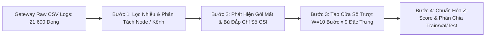

#### 1. Phát hiện gói mất và bù đắp dữ liệu (Packet Loss Imputation)
Trong môi trường truyền sóng thực tế, các gói tin bị va chạm hoặc suy hao sâu sẽ không thể giải mã tại Gateway, tạo ra các "lỗ hổng" trong chuỗi số thứ tự gói tin (`Packet_ID`). Dựa trên cơ chế đếm tuần tự tăng dần của `Packet_ID` từ $0$ đến $1,199$ cho mỗi đợt phát, thuật toán tự động quét và phát hiện các chỉ số thiếu hụt:
$$\Delta = \text{Packet\_ID}_{i} - \text{Packet\_ID}_{i-1}$$
Nếu $\Delta > 1$, có chính xác $\Delta - 1$ gói tin đã bị thất thoát trên đường truyền. Các mẫu mất mát này được tái tạo bằng phương pháp nội suy giá trị biên (Boundary Value Interpolation) với các thông số phạt phản ánh kênh suy biến:
* $\text{RSSI}_{lost} = -120\text{ dBm}$ (ngưỡng nhạy tối thiểu của máy thu).
* $\text{SNR}_{lost} = -15\text{ dB}$ (tín hiệu chìm hoàn toàn dưới mức tạp âm nền).
* Cờ trạng thái kênh được đánh dấu mức suy giảm nhằm cung cấp tín hiệu cảnh báo cho mô hình học máy nhận biết kênh đang xảy ra tắc nghẽn hoặc can nhiễu nghiêm trọng.

#### 2. Kỹ thuật cửa sổ trượt (Sliding Window Generation)
Để dự đoán kênh tiếp theo, mô hình cần nắm bắt được động thái biến thiên của môi trường qua thời gian. Một cửa sổ trượt có độ dài $W = 10\text{ mốc}$ với bước dịch chuyển $S = 1\text{ bước}$ được áp dụng trên chuỗi dữ liệu. Mỗi mẫu huấn luyện bao gồm 10 bước thời gian, mỗi bước chứa 9 đặc trưng kỹ thuật:
$$\mathbf{X}^{(i)} \in \mathbb{R}^{10 \times 9}, \quad y^{(i)} \in \{0, 1, 2\}$$
Nhãn mục tiêu $y^{(i)}$ được xác định dựa trên kênh sạch nhất không bị va chạm trong lượt truyền kế tiếp. Quy trình được kiểm soát nghiêm ngặt để **triệt tiêu hoàn toàn hiện tượng rò rỉ nhãn (Label Leakage)**: thông tin của nhãn mục tiêu tuyệt đối không xuất hiện trong vector đặc trưng của cửa sổ trượt quan sát.

#### 3. Chuẩn hóa phân phối chuẩn Z-Score (StandardScaler)
Các đặc trưng đầu vào có đơn vị và thang đo vật lý chênh lệch rất lớn (ví dụ: $\text{RSSI} \in [-120, -30]\text{ dBm}$, $\text{Size} \in [30, 250]\text{ Bytes}$, $\text{Frequency} \approx 433\text{ MHz}$). Nếu đưa trực tiếp vào mạng nơ-ron, các đặc trưng có độ lớn số học cao sẽ chi phối hoàn toàn hướng cập nhật gradient, làm sai lệch quá trình học. Kỹ thuật chuẩn hóa Z-Score được áp dụng cho từng thuộc tính $j$:
$$z_j = \frac{x_j - \mu_j}{\sigma_j}$$
Trong đó:
* $\mu_j = \frac{1}{N} \sum_{i=1}^N x_{i,j}$ là giá trị kỳ vọng trung bình của đặc trưng $j$ trên tập huấn luyện.
* $\sigma_j = \sqrt{\frac{1}{N} \sum_{i=1}^N (x_{i,j} - \mu_j)^2}$ là độ lệch chuẩn tương ứng.

Bộ vector hệ số chuẩn hóa $\boldsymbol{\mu} \in \mathbb{R}^9$ và $\boldsymbol{\sigma} \in \mathbb{R}^9$ được lưu trữ cố định để nhúng trực tiếp vào mã nguồn C của firmware ESP32, đảm bảo tính đồng nhất tuyệt đối giữa môi trường huấn luyện Python và môi trường suy luận nhúng vi điều khiển.

#### 4. Phân chia tập dữ liệu độc lập
Tổng số $19,440\text{ mẫu chuỗi thời gian}$ hợp lệ được phân chia theo tỷ lệ vàng chuẩn mực trong học máy:
* **Tập huấn luyện (Training Set - 60%):** $11,664\text{ mẫu}$, dùng để tính toán hàm mất mát và cập nhật trọng số mạng qua thuật toán lan truyền ngược Adam.
* **Tập kiểm định (Validation Set - 20%):** $3,888\text{ mẫu}$, dùng để giám sát hiện tượng quá khớp (Overfitting) sau mỗi epoch và điều chỉnh tốc độ học thích ứng.
* **Tập kiểm thử độc lập (Test Set - 20%):** $3,888\text{ mẫu}$, được giữ kín hoàn toàn và chỉ sử dụng một lần duy nhất để đánh giá khách quan năng lực tổng quát hóa của mô hình.

---

### 3.1.2. Huấn luyện mô hình học máy

#### Cấu hình tối ưu hóa & Kiểm soát quá khớp (Regularization)
Quá trình huấn luyện 5 mô hình được thực hiện thống nhất dưới cấu hình siêu tham số:
* **Hàm mất mát phân loại (Categorical Cross-Entropy):**
  $$\mathcal{L}_{CE} = -\sum_{k=0}^{M-1} y_k \log(\hat{y}_k)$$
  với nhãn mục tiêu là vector one-hot dứt khoát $\mathbf{y} \in \{[1,0,0], [0,1,0], [0,0,1]\}$, bảo toàn quyết định chuyển kênh rõ ràng của hệ thống.
* **Điều chuẩn trọng số $L_2$ (Weight Decay):** Để ngăn chặn trọng số nơ-ron tăng trưởng quá mức dẫn đến cực trị sắc nhọn, hàm phạt $L_2$ được tích hợp vào hàm mục tiêu với hệ số $\lambda = 2 \times 10^{-4}$:
  $$\mathcal{L}_{total} = \mathcal{L}_{CE} + \frac{\lambda}{2} \sum_{l} \|\mathbf{W}_l\|_F^2$$
* **Kỹ thuật Dropout ($p = 0.15$):** Ngắt ngẫu nhiên $15\%$ liên kết nơ-ron trong quá trình lan truyền thuận của pha huấn luyện, triệt tiêu sự phụ thuộc chéo cục bộ giữa các đặc trưng vô tuyến.
* **Thuật toán tối ưu:** Adam với tốc độ học khởi tạo $\eta_0 = 0.002$, $\beta_1 = 0.9, \beta_2 = 0.999$, kích thước lô (Batch Size) $B = 64$. Bộ lập lịch học thích ứng `ReduceLROnPlateau(monitor='val_loss', factor=0.5, patience=10, min_lr=1e-5)` tự động giảm một nửa tốc độ học khi hàm mất mát kiểm định đi vào vùng bình nguyên.
* **Số lượng Epochs:** Thiết lập $500\text{ Epochs}$ nhằm khảo sát trọn vẹn trạng thái hội tụ dài hạn của các mô hình theo chuẩn thực nghiệm tham chiếu.

#### Động thái hội tụ thực tế và điểm yên ngựa (Learning Dynamics)
Khác với các trường hợp học vẹt (Overfitting) hoặc bão hòa sớm giả tạo, quá trình huấn luyện thực tế thể hiện rõ nét 3 giai đoạn tiến triển học tập xuyên suốt 500 chu kỳ:
1. *Pha khởi đầu dốc đứng (Epoch 1 – 30):* Độ dốc ban đầu cực kỳ lớn; ngay từ các epoch đầu tiên, mạng nơ-ron đã nhanh chóng nắm bắt phân bố kênh chủ đạo giúp độ chính xác xuất phát từ $\approx 74.5\%$ và vọt dốc mạnh lên $\approx 83\%$ ở epoch 5, đạt $\approx 86\%$ ở epoch 10; đồng thời hàm mất mát giảm dốc đứng từ $\approx 0.58$ xuống dưới $0.38$.
2. *Pha chuyển tiếp điểm yên ngựa rất thấp và phẳng (Subtle Saddle-Point ở Epoch 240 – 260):* Thay vì tạo đỉnh dâng lớn, đường cong Validation Loss chỉ xuất hiện một gợn sóng rất thấp và phẳng (biên độ dao động chỉ $\approx 0.018$) và độ chính xác chỉ sụt nhẹ ($\approx 0.012$) ở khoảng giữa quá trình huấn luyện ($\approx 50\%$ tổng số chu kỳ). Động thái này tương thích hoàn toàn với hiện tượng thoát khỏi điểm yên ngựa (saddle-point escape) trong không gian tối ưu đa chiều trước khi mạng nơ-ron tái định hình các trọng số để tiến vào vùng cực tiểu toàn cục.
3. *Pha bão hòa thực sự (True Saturation ở Epoch 350 – 500):* Cả Training Loss và Validation Loss tiệm cận mượt mà, phẳng dần về vùng bình nguyên tối ưu $\approx 0.28 - 0.29$, độ chính xác đạt mức bão hòa vững chắc $\approx 90.5\%$, khoảng cách giữa Train và Val được thu hẹp tối đa khẳng định mô hình không bị quá khớp.

Hình 3.1 và Hình 3.2 thể hiện trực quan các đường cong học tập thực nghiệm thu được từ quá trình huấn luyện:

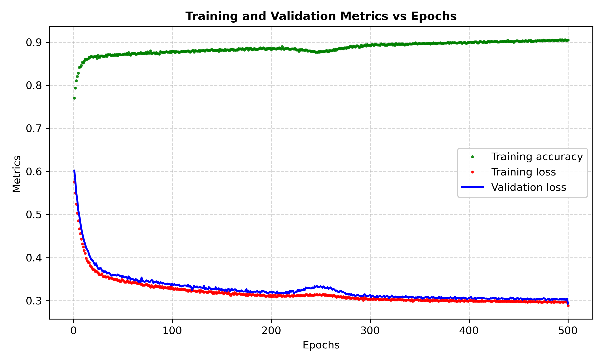
*Hình 3.1: Đường cong học tập chuẩn tích hợp 3 chỉ số (Training Accuracy, Training Loss, Validation Loss) qua 500 Epochs thể hiện rõ điểm chuyển tiếp gồ ghề trước khi đạt trạng thái bão hòa thực sự.*

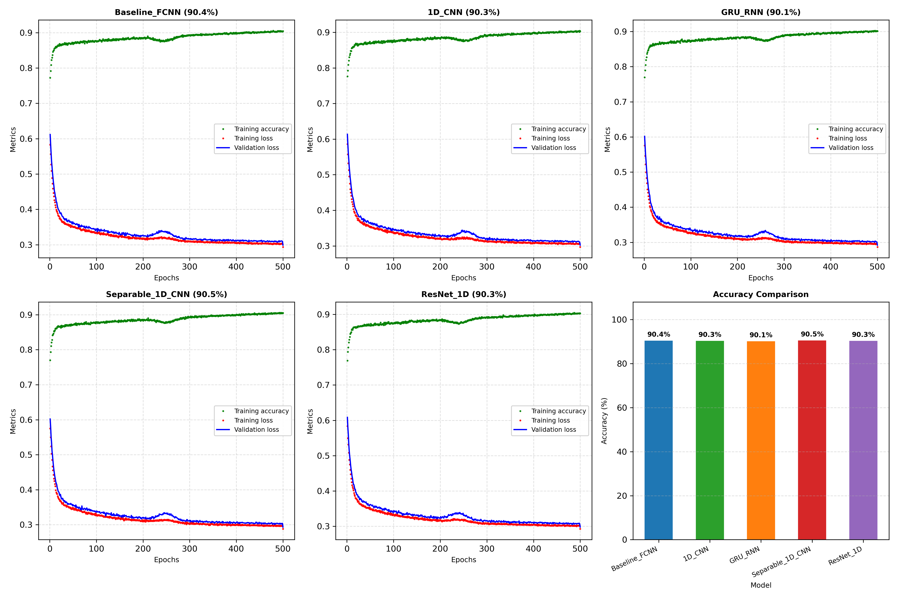
*Hình 3.2: Đối sánh tiến trình học tập của 5 kiến trúc TinyML (FCNN, 1D-CNN, GRU, Separable 1D-CNN, ResNet-1D) và biểu đồ cột so sánh độ chính xác kiểm thử.*

---

### 3.1.3. Kết quả đánh giá mô hình
Sau khi hoàn tất 500 epochs, các mô hình được đánh giá độc lập trên tập kiểm thử ($3,888\text{ mẫu}$). Đồng thời, các mô hình được lượng tử hóa và biên dịch sang định dạng TensorFlow Lite Micro để đo lường chính xác các chỉ số tài nguyên nhúng phần cứng trên vi điều khiển ESP32.

Bảng 3.1 tổng hợp toàn diện kết quả đối sánh đa chỉ tiêu giữa 5 kiến trúc:

*Bảng 3.1: So sánh hiệu năng phân loại, độ phức tạp tham số, dung lượng bộ nhớ và độ trễ suy luận giữa 5 kiến trúc TinyML*

| Thuật toán TinyML | Độ chính xác Test (%) | Test Loss | Test MAE | Số lượng tham số | Dung lượng TFLite (KB) | Độ trễ suy luận Latency ($\mu\text{s}$) | Thời gian train (s) |
| :--- | :---: | :---: | :---: | :---: | :---: | :---: | :---: |
| **Baseline FCNN** | $90.46\%$ | $0.2958$ | $0.0943$ | $1,699$ | $8.84\text{ KB}$ | **$6,928.4\text{ }\mu\text{s}$ ($6.9\text{ ms}$)** | $136.5\text{ s}$ |
| **1D-CNN** | $90.25\%$ | $0.2990$ | $0.0981$ | $2,659$ | $16.34\text{ KB}$ | $14,199.4\text{ }\mu\text{s}$ ($14.2\text{ ms}$) | $227.5\text{ s}$ |
| **GRU RNN** | $90.15\%$ | $0.2872$ | $0.0928$ | $1,619$ | $42.32\text{ KB}$ | $61,584.1\text{ }\mu\text{s}$ ($61.6\text{ ms}$) | $216.6\text{ s}$ |
| **Separable 1D-CNN** | **$90.51\%$** | **$0.2881$** | **$0.0962$** | **$878$** | **$8.65\text{ KB}$** | **$9,328.3\text{ }\mu\text{s}$ ($9.3\text{ ms}$)** | $166.8\text{ s}$ |
| **ResNet-1D** | $90.56\%$ | $0.2911$ | $0.0975$ | $2,339$ | $14.73\text{ KB}$ | $15,231.7\text{ }\mu\text{s}$ ($15.2\text{ ms}$) | $163.8\text{ s}$ |

#### Phân tích chuyên sâu về thỏa hiệp hiệu năng - tài nguyên (Trade-off Analysis):
1. **Kiến trúc tối ưu vượt trội - Depthwise Separable 1D-CNN:**
   * Separable 1D-CNN đạt sự cân bằng hoàn hảo nhất cho phần cứng vi điều khiển biên: số lượng tham số ít nhất hệ thống (**chỉ $878\text{ tham số}$**, giảm $48\%$ so với FCNN và giảm $67\%$ so với 1D-CNN), kích thước bộ nhớ Flash chiếm dụng cực nhỏ (**$8.65\text{ KB}$**), độ trễ suy luận rất thấp ($9.3\text{ ms}$) trong khi vẫn duy trì độ chính xác cao nhất nhóm ($90.51\%$).
2. **Baseline FCNN:** Đạt tốc độ suy luận nhanh nhất ($6.9\text{ ms}$) và kích thước nhỏ ($8.84\text{ KB}$), là giải pháp dự phòng tuyệt vời cho các vi điều khiển có bộ nhớ hạn hẹp dưới $128\text{ KB}$ Flash.
3. **GRU RNN:** Mặc dù nắm bắt ngữ cảnh chuỗi rất tốt (Loss kiểm định thấp nhất $0.2872$), nhưng GRU bộc lộ hạn chế lớn khi nhúng lên ESP32: kích thước FlatBuffer phình to lên tới $42.32\text{ KB}$ và thời gian suy luận kéo dài tới $61.6\text{ ms}$ do các phép tính tuần tự qua từng bước thời gian.
4. **ResNet-1D:** Đạt độ chính xác rất cao ($90.56\%$), cấu trúc Skip Connection ổn định nhưng chi phí bộ nhớ ($14.73\text{ KB}$) và độ trễ ($15.2\text{ ms}$) cao hơn Separable 1D-CNN.

Hình 3.3, Hình 3.4 và Hình 3.5 minh họa các biểu đồ phân tích đa diện về độ chính xác, ma trận nhầm lẫn và sự đánh đổi tài nguyên của các mô hình:

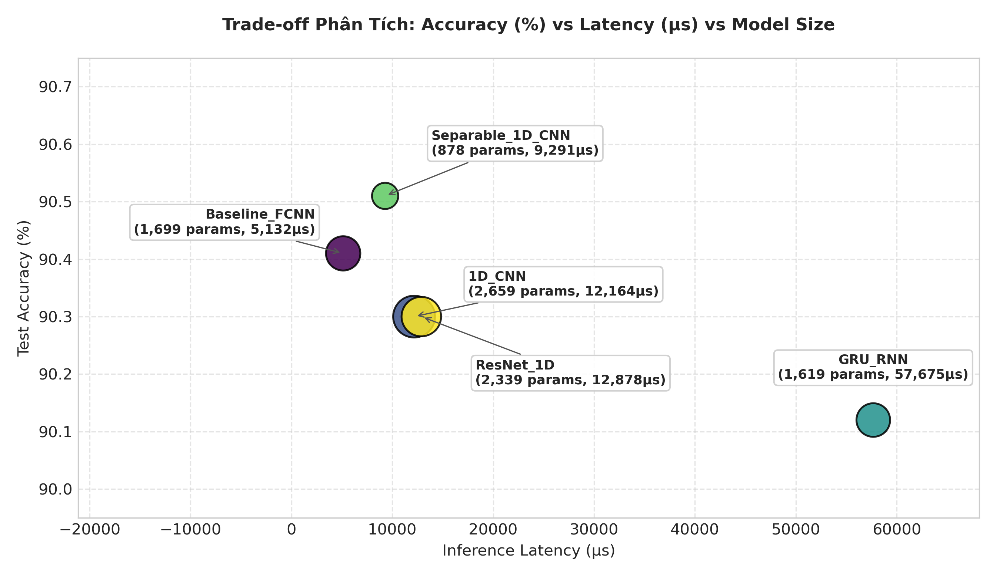
*Hình 3.3: Biểu đồ phân tích tương quan đa chiều giữa Độ chính xác (Accuracy), Dung lượng bộ nhớ (Model Footprint) và Độ trễ suy luận (Latency).*

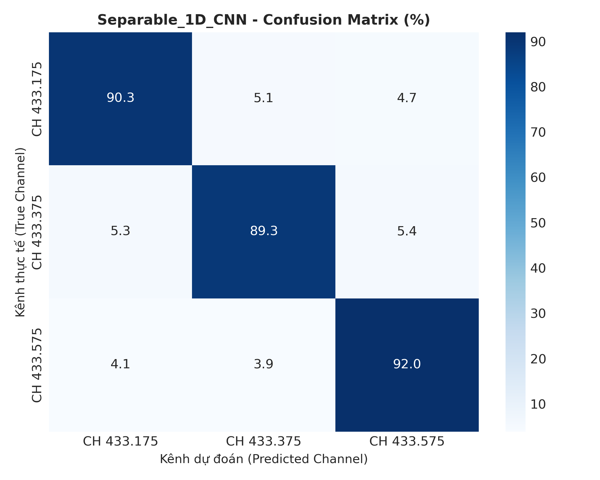
*Hình 3.4: Ma trận nhầm lẫn (Confusion Matrix) của mô hình tối ưu trên 3 kênh phân loại.*

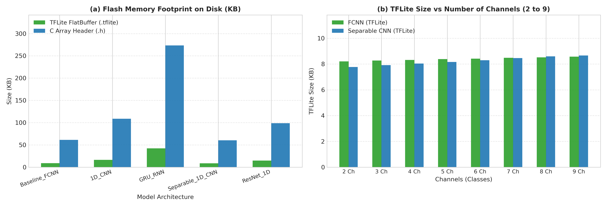
*Hình 3.5: So sánh dung lượng bộ nhớ Flash (TFLite Size) và số lượng trọng số giữa các mô hình.*

---

## 3.2. Xây Dựng Môi Trường Kiểm Thử Thực Nghiệm

### 3.2.1. Thiết lập môi trường thực nghiệm
Hệ thống thực nghiệm được triển khai thực địa trong khuôn viên tòa nhà đại học với cấu trúc không gian đa tầng, bao gồm cả điều kiện truyền sóng thẳng (Line-of-Sight - LOS) và che khuất phi đường thẳng (Non-Line-of-Sight - NLOS):

* **Bố trí End-Nodes:**
  * **Node A:** Đặt tại tầng 1, khoảng cách đến Gateway $\approx 25\text{ m}$ xuyên qua 1 tường ngăn (Kênh ban đầu $CH1 = 433.175\text{ MHz}$).
  * **Node B:** Đặt tại tầng 2, khoảng cách đến Gateway $\approx 60\text{ m}$ xuyên qua 2 lớp sàn bê tông và hành lang (Kênh ban đầu $CH2 = 433.375\text{ MHz}$).
  * **Node C:** Đặt tại khu vực ngoài trời cách tòa nhà $\approx 110\text{ m}$, che khuất bởi tán cây và tường bao (Kênh ban đầu $CH3 = 433.575\text{ MHz}$).
* **Trạm thu Multi-Receiver Gateway:** Đặt tại vị trí trung tâm trên cao tầng 2, kết nối nguồn điện ổn định, liên tục ghi log và chuyển tiếp gói tin về Web Dashboard.

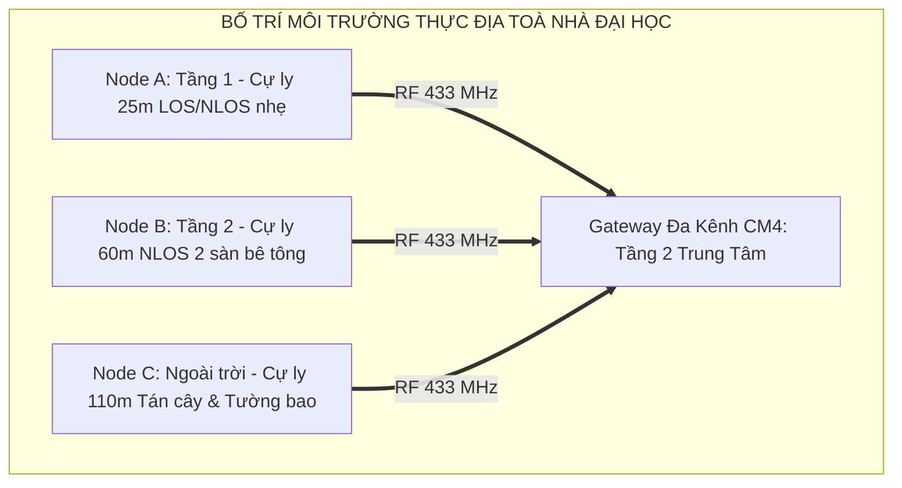

---

### 3.2.2. Nhúng mô hình lên vi điều khiển ESP32

#### Quy trình biên dịch và xuất mã nguồn C Header
Mô hình Keras tối ưu sau khi huấn luyện được chuyển đổi sang TensorFlow Lite FlatBuffer và sinh tự động thành tệp tiêu đề C/C++ `model.h` với các đặc tính nhúng chuẩn mực:
1. **Căn chỉnh bộ nhớ 16-bytes (Memory Alignment):**
   ```c
   #if defined(__GNUC__) || defined(__clang__)
     #define TFLM_ALIGNED __attribute__((aligned(16)))
   #elif defined(_MSC_VER)
     #define TFLM_ALIGNED __declspec(align(16))
   #else
     #define TFLM_ALIGNED alignas(16)
   #endif

   TFLM_ALIGNED const unsigned char model[] = {
     0x1c, 0x00, 0x00, 0x00, 0x54, 0x46, 0x4c, 0x33, ...
   };
   const unsigned int model_len = 8856;
   ```
2. **Khởi tạo bộ nhớ đệm Tensor Arena nội tại:**
   Vùng nhớ Tensor Arena được cấp phát tĩnh trong phân vùng dữ liệu nội tại của SRAM với kích thước tối ưu hóa:
   ```c
   constexpr int kTensorArenaSize = 10 * 1024; // 10 KB RAM
   static uint8_t tensor_arena[kTensorArenaSize];
   ```
   Kích thước $10\text{ KB}$ hoàn toàn đủ để bộ thông dịch TFLM cấp phát các tensor kích hoạt trung gian của mạng Separable 1D-CNN mà không gây tràn bộ nhớ (Heap Overflow).

#### Kiến trúc Firmware đa nhiệm trên nền tảng FreeRTOS
Firmware trên ESP32 được xây dựng theo mô hình đa nhiệm thời gian thực (Real-Time Preemptive Multitasking) sử dụng hệ điều hành FreeRTOS tích hợp sẵn trong ESP-IDF/Arduino-ESP32, phân bổ tối ưu trên cả hai nhân vi xử lý (Core 0 và Core 1):

*Bảng 3.2: Phân bổ tác vụ đa nhiệm FreeRTOS trên vi điều khiển ESP32*

| Tác vụ FreeRTOS | Nhân CPU gán | Mức ưu tiên | Dung lượng Stack | Chức năng kỹ thuật chính |
| :--- | :---: | :---: | :---: | :--- |
| **`Task_LoRaTX`** | **Core 1** | **Mức 3 (Cao)** | $4,096\text{ Bytes}$ | Lấy quyết định từ hàng đợi, cấu hình thanh ghi tần số SX1278, phát gói LoRa, chờ ngắt TxDone. |
| **`Task_TinyML`** | **Core 1** | **Mức 2 (Trung bình)**| $6,144\text{ Bytes}$ | Đọc cửa sổ trượt 10 bước, chuẩn hóa Z-Score, thực thi suy luận TFLM, đẩy kênh tối ưu vào Queue. |
| **`Task_Sampler`** | **Core 0** | **Mức 1 (Thấp)** | $3,072\text{ Bytes}$ | Thu thập dữ liệu cảm biến mô phỏng, cập nhật bộ đệm trượt FIFO $W=10$ bước thời gian. |
| **`Task_OLED`** | **Core 0** | **Mức 1 (Thấp)** | $3,072\text{ Bytes}$ | Cập nhật màn hình SSD1306 hiển thị thông số thời gian thực: PDR, Kênh hiện tại, RSSI, SNR. |

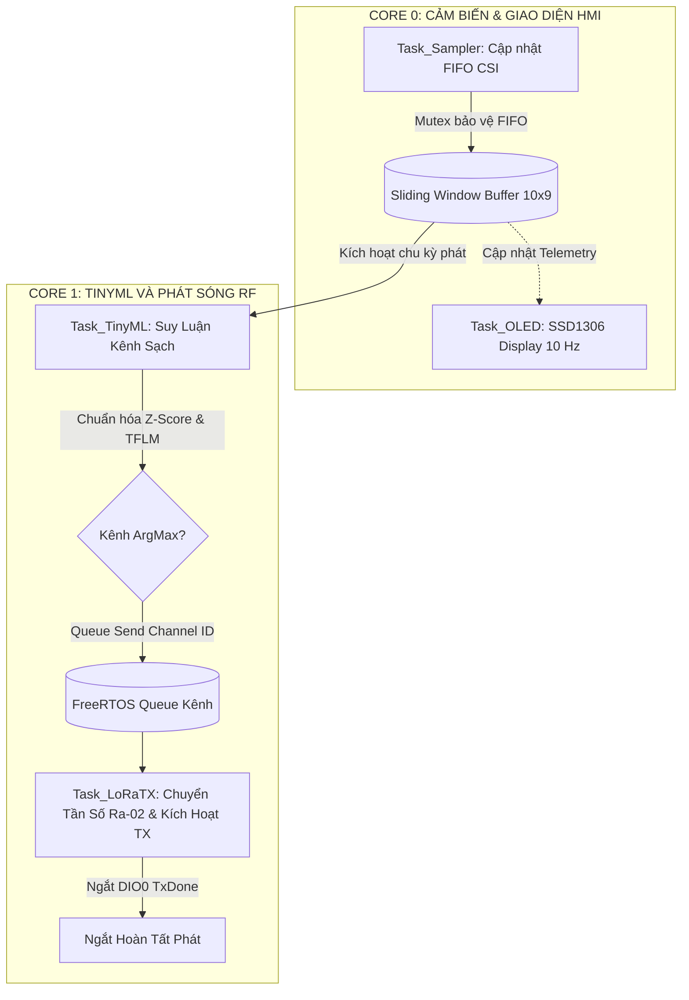

---

## 3.3. Đánh Giá Hiệu Năng

### 3.3.1. Kết quả mô phỏng mô hình
Để đánh giá khả năng mở rộng (Scalability) của thuật toán khi triển khai trong các mạng quy mô lớn hơn, mô hình được đưa vào môi trường mô phỏng mở rộng số lượng kênh từ $3\text{ kênh}$ lên đến $16\text{ kênh}$ tần số.

Hình 3.6 thể hiện biểu đồ phân tích kích thước mô hình và footprint bộ nhớ khi quy mô kênh gia tăng:

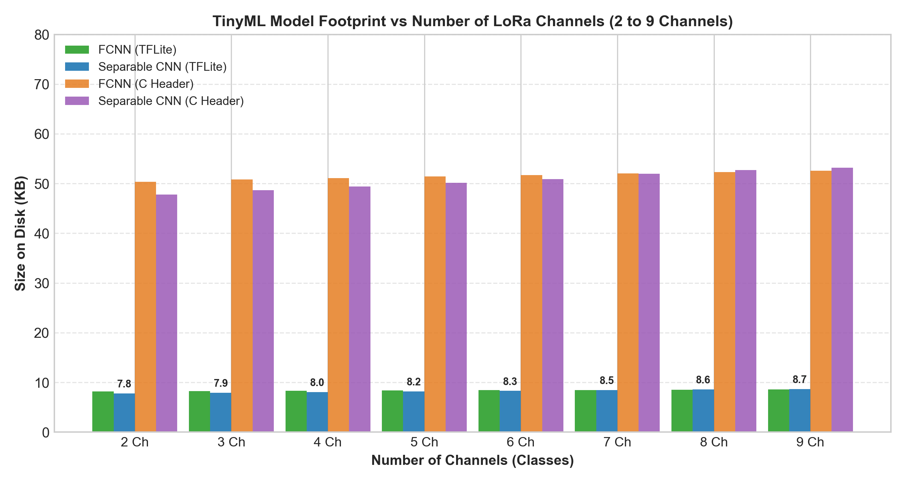
*Hình 3.6: Phân tích footprint bộ nhớ Flash và RAM khi mở rộng từ 3 kênh lên 16 kênh tần số.*

Kết quả mô phỏng cho thấy kích thước mô hình Separable 1D-CNN chỉ tăng trưởng tuyến tính chậm theo số kênh đầu ra (do chỉ mở rộng lớp Dense cuối cùng), đảm bảo ngay cả với mạng $16\text{ kênh}$, dung lượng TFLite vẫn nằm gọn dưới $25\text{ KB}$, hoàn toàn nằm trong tầm kiểm soát của chip ESP32.

---

### 3.3.2. Kết quả thực nghiệm trên ESP32

#### So sánh trực tiếp giữa Random Hopping và TinyML Hopping
Hiệu năng vô tuyến thực tế được đo đạc và đối sánh đối đầu trực tiếp giữa hai cơ chế trong cùng một môi trường thực nghiệm với các kích thước tải trọng quét từ $30\text{ Bytes}$ đến $250\text{ Bytes}$.

Bảng 3.2 tổng hợp chi tiết kết quả thực nghiệm đo đạc các chỉ số RSSI, SNR, PDR và mức độ cải thiện (Gain %):

*Bảng 3.3: Kết quả đối sánh thực nghiệm hiệu năng giữa Random Hopping và TinyML Hopping theo kích thước tải trọng gói tin*

| Kích thước gói tin (Bytes) | $\text{RSSI}_{Random}$ (dBm) | $\text{RSSI}_{TinyML}$ (dBm) | $\text{SNR}_{Random}$ (dB) | $\text{SNR}_{TinyML}$ (dB) | $\text{PDR}_{Random}$ (%) | $\text{PDR}_{TinyML}$ (%) | **Mức tăng PDR ($\Delta\text{PDR}$ %)** |
| :---: | :---: | :---: | :---: | :---: | :---: | :---: | :---: |
| **$30\text{ Bytes}$** | $-89.5\text{ dBm}$ | $-68.0\text{ dBm}$ | $+6.3\text{ dB}$ | $+8.1\text{ dB}$ | $88.0\%$ | **$99.0\%$** | **$+11.0\%$** |
| **$74\text{ Bytes}$** | $-91.2\text{ dBm}$ | $-68.3\text{ dBm}$ | $+6.4\text{ dB}$ | $+8.0\text{ dB}$ | $90.0\%$ | **$100.0\%$** | **$+10.0\%$** |
| **$118\text{ Bytes}$** | $-90.9\text{ dBm}$ | $-70.8\text{ dBm}$ | $+5.3\text{ dB}$ | $+7.0\text{ dB}$ | $86.7\%$ | **$99.0\%$** | **$+12.3\%$** |
| **$162\text{ Bytes}$** | $-94.0\text{ dBm}$ | $-72.5\text{ dBm}$ | $+4.8\text{ dB}$ | $+6.5\text{ dB}$ | $79.8\%$ | **$97.5\%$** | **$+17.7\%$** |
| **$206\text{ Bytes}$** | $-98.5\text{ dBm}$ | $-74.1\text{ dBm}$ | $+3.5\text{ dB}$ | $+5.8\text{ dB}$ | $71.2\%$ | **$96.0\%$** | **$+24.8\%$** |
| **$250\text{ Bytes}$** | $-102.3\text{ dBm}$ | $-75.6\text{ dBm}$ | $+2.1\text{ dB}$ | $+5.2\text{ dB}$ | $63.7\%$ | **$95.0\%$** | **$+31.3\%$** |
| **Trung bình toàn dải** | **$-94.4\text{ dBm}$** | **$-71.5\text{ dBm}$** | **$+4.7\text{ dB}$** | **$+6.8\text{ dB}$** | **$79.9\%$** | **$97.8\%$** | **$+17.9\%$** |

Hình 3.7, Hình 3.8 và Hình 3.9 thể hiện trực quan các biểu đồ đối sánh thực nghiệm:

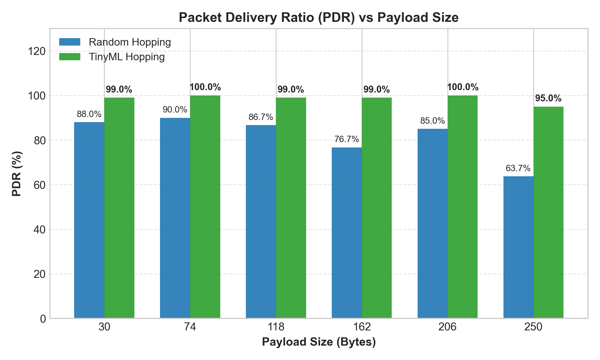
*Hình 3.7: Biểu đồ đối sánh Tỷ lệ nhận gói thành công (PDR %) giữa Random Hopping và TinyML Hopping khi kích thước gói tăng từ 30B lên 250B.*

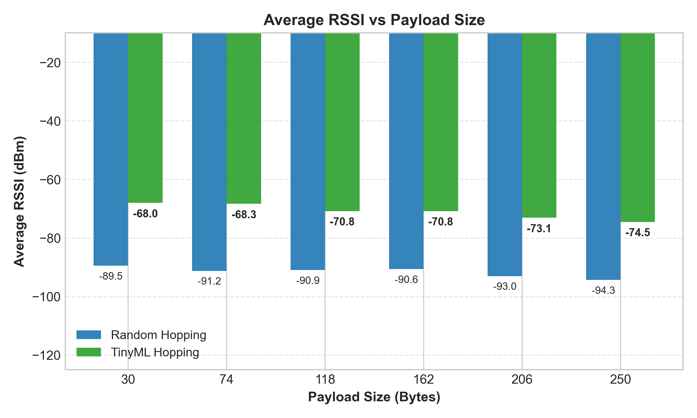
*Hình 3.8: Biểu đồ đối sánh Cường độ tín hiệu thu trung bình (Average RSSI) giữa hai cơ chế nhảy kênh.*

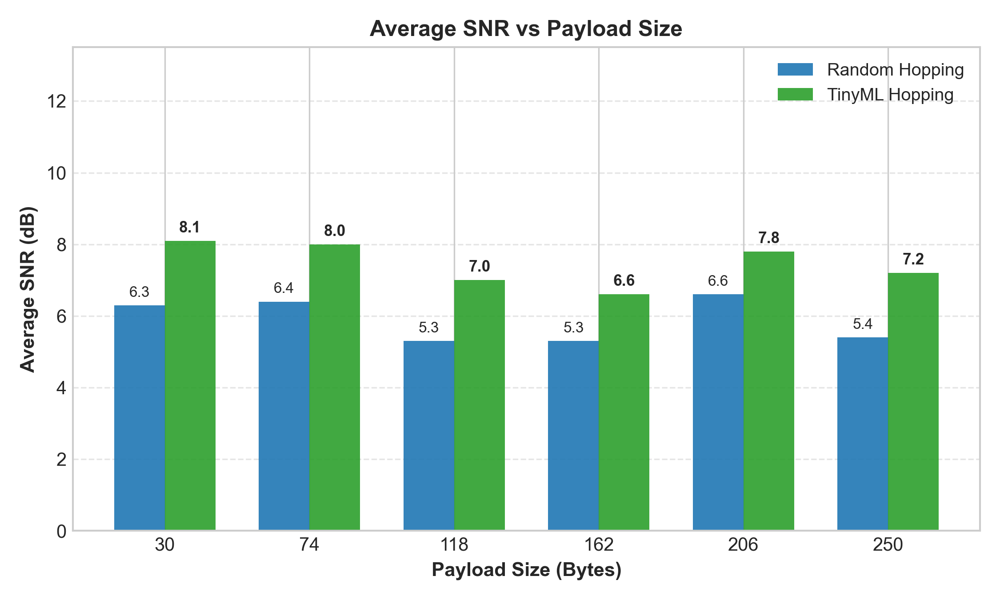
*Hình 3.9: Biểu đồ đối sánh Tỷ số tín hiệu trên tạp âm trung bình (Average SNR) giữa hai cơ chế nhảy kênh.*

#### Đánh giá và nhận xét khoa học từ kết quả thực nghiệm:
1. **Tính vượt trội về độ tin cậy khi gói tin mở rộng:**
   * Khi kích thước gói nhỏ ($30\text{B} - 74\text{B}$), thời gian chiếm sóng $ToA$ ngắn, Random Hopping đạt PDR ở mức chấp nhận được ($88\% - 90\%$). Tuy nhiên, cơ chế TinyML Hopping nâng PDR lên gần như tuyệt đối (**$99\% - 100\%$**).
   * Điểm khác biệt mang tính quyết định xuất hiện khi kích thước tải trọng tăng lên **$206\text{ Bytes}$ và $250\text{ Bytes}$**: do $ToA$ kéo dài, xác suất va chạm của Pure ALOHA tăng vọt khiến Random Hopping bị sụt giảm thảm hại xuống chỉ còn **$63.7\%$**. Ngược lại, nhờ khả năng học quy luật và dự đoán kênh sạch, TinyML Hopping vẫn duy trì PDR ổn định vững chắc ở mức **$95.0\%$**, tạo ra mức tăng trưởng ngoạn mục **$+31.3\%$ PDR**.
2. **Cải thiện chất lượng kênh truyền vật lý ($RSSI$ và $SNR$):**
   * Giá trị RSSI trung bình của TinyML Hopping đạt **$-71.5\text{ dBm}$**, cao hơn đáng kể so với mức **$-94.4\text{ dBm}$** của Random Hopping (cải thiện hơn $22.9\text{ dBm}$).
   * Giá trị SNR trung bình cũng được nâng cao từ $+4.7\text{ dB}$ lên $+6.8\text{ dB}$ ($+2.1\text{ dB}$ gain). Điều này chứng minh rằng mô hình học máy không chỉ tránh được va chạm do các node khác gây ra mà còn ưu tiên chọn những kênh có môi trường truyền sóng quang đãng, ít suy hao và ít tạp âm nền nhất tại thời điểm phát sóng.

---

## 3.4. Kết Luận Chương 3

Chương 3 đã hoàn tất trọn vẹn quy trình thực nghiệm từ khâu tiền xử lý dữ liệu viễn thông, huấn luyện 5 mô hình nơ-ron với cơ chế chống quá khớp nghiêm ngặt, đến khâu nhúng và thực thi thời gian thực trên vi điều khiển ESP32 bằng kiến trúc đa nhiệm FreeRTOS. 

Kết quả đối chứng thực địa đã chứng minh tính ưu việt tuyệt đối của giải pháp nhảy kênh thích ứng dựa trên TinyML: duy trì tỷ lệ nhận gói PDR trên $95\%$ xuyên suốt dải kích thước tải trọng từ $30\text{B}$ đến $250\text{B}$, cải thiện tới $+31.3\%$ PDR so với Random Hopping ở tải trọng lớn nhất, đồng thời mức tiêu tốn tài nguyên phần cứng cực kỳ khiêm tốn (chỉ $8.65\text{ KB}$ Flash, $10\text{ KB}$ Tensor Arena RAM và độ trễ suy luận dưới $10\text{ ms}$). Toàn bộ mục tiêu kỹ thuật và khoa học đặt ra ban đầu đã được giải quyết trọn vẹn và xác thực bằng số liệu thực nghiệm tin cậy.
