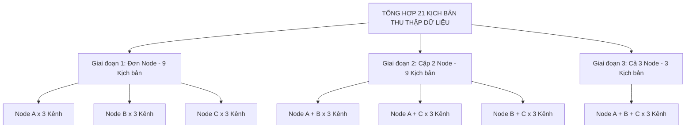
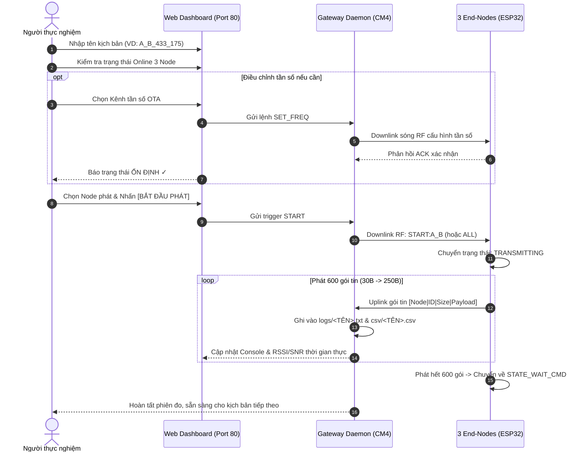

# KỊCH BẢN THỰC NGHIỆM THU THẬP DỮ LIỆU ĐO SÓNG LORA 433 MHz
## Phục vụ Huấn luyện & Đánh giá Mô hình TinyML Lựa chọn Kênh truyền Tối ưu

---

## 1. Mục tiêu và Ý nghĩa Thực nghiệm

Trong hệ thống **LoRa TinyML Channel Hopping**, thiết bị đầu cuối (End-Node) sử dụng mô hình nơ-ron nhúng siêu nhẹ để dự đoán kênh truyền tối ưu tiếp theo dựa trên chuỗi quan sát quá khứ ($ts = 10$ mốc thời gian).

Để mô hình học được chính xác quy luật suy hao, tương quan thời gian và hiện tượng va chạm kênh truyền, bộ dữ liệu thực tế cần phản ánh đầy đủ:
1. **Đặc tính truyền sóng đơn Node (Single-Node Transmission)**: Đo lường mức suy hao tự nhiên (Path Loss), biến thiên RSSI/SNR theo 6 mức kích thước gói tin (30B đến 250B) trên từng kênh tần số khi không có xung đột.
2. **Va chạm kênh mức độ trung bình (Two-Node Collision)**: Hai Node cùng phát đồng thời trên cùng một kênh tần số, gây hiện tượng va chạm sóng (Packet Collision), dẫn đến rớt gói hoặc suy giảm SNR nghiêm trọng.
3. **Nghẽn kênh mức độ cao (Three-Node Congestion)**: Cả 3 Node cùng phát trên cùng một kênh tần số, mô phỏng môi trường mật độ cao khiến tỷ lệ nhận gói (PDR) giảm mạnh.

---

## 2. Thông số Kỹ thuật & Cấu hình Thực nghiệm

### A. Cấu hình Vô tuyến LoRa (SX1278 - Ra-02)

Toàn bộ 3 End-Nodes và Gateway Raspberry Pi CM4 được cấu hình đồng nhất các thông số lớp vật lý:

| Tham số | Giá trị cấu hình | Ý nghĩa kỹ thuật |
| :--- | :--- | :--- |
| **Dải tần số hoạt động** | **433 MHz ISM Band** | Băng tần cho phép tại Việt Nam |
| **Băng thông (Bandwidth)** | **125.0 kHz** | Cân bằng giữa tốc độ truyền và độ nhạy thu |
| **Hệ số trải phổ (SF)** | **7** | Thời gian truyền ngắn, phù hợp kiểm thử va chạm |
| **Tốc độ mã hóa (Coding Rate)**| **4/5 (CR = 5)** | Khả năng tự sửa lỗi cơ bản |
| **Công suất phát (Tx Power)** | **17 dBm (~50 mW)** | Công suất phát tối đa ổn định của Ra-02 |
| **Độ dài Preamble** | **8 symbols** | Độ dài mào đầu chuẩn của chuẩn LoRa |
| **Sync Word** | **0x12** | Định danh mạng riêng / thử nghiệm |

### B. Bảng phân bổ 3 Kênh tần số vật lý

Hệ thống sử dụng 3 kênh tần số độc lập với khoảng cách bảo vệ (guard band) 200 kHz để tránh can nhiễu giữa các kênh lân cận:

| Định danh kênh | Tần số trung tâm ($f_c$) | Quy ước tên file | Trạng thái mặc định |
| :---: | :---: | :---: | :---: |
| **Kênh 1 (CH1)** | **433.175 MHz** | `433_175` | Tần số mặc định Node A |
| **Kênh 2 (CH2)** | **433.375 MHz** | `433_375` | Tần số mặc định Node B |
| **Kênh 3 (CH3)** | **433.575 MHz** | `433_575` | Tần số mặc định Node C |

### C. Hồ sơ lưu lượng phát (Traffic Profile)

Mỗi kịch bản thu thập được thực hiện theo chu trình chuẩn hóa:
- **6 mức kích thước payload đại diện**: `30, 74, 118, 162, 206, 250 Bytes`.
- **100 gói tin cho mỗi mức kích thước** (Packet ID đánh số tuần tự từ `0` đến `99`).
- **Tổng số gói phát trong một kịch bản**: $6 \text{ mức} \times 100 \text{ gói} = \mathbf{600 \text{ gói tin/Node}}$.
- **Khoảng thời gian nghỉ giữa 2 lần phát (Inter-Packet Interval)**:
  $$T_{interval} = T_{base} + T_{jitter} = 3000\text{ ms} + \text{random}(0 .. 500\text{ ms})$$
  *(Việc thêm Jitter ngẫu nhiên 0..500 ms nhằm mô phỏng đúng đặc tính bất đồng bộ của mạng không dây, tránh việc 2 Node bị khóa pha đồng bộ giả tạo).*
- **Thời gian hoàn thành một phiên đo 600 gói**: $\approx 600 \times 3.25\text{s} \approx \mathbf{32.5 \text{ phút}}$.

---

## 3. Danh mục 21 Kịch bản Thực nghiệm Chi tiết

Để bộ dữ liệu có tính bao quát và đại diện cho mọi tình huống thực tế, quá trình thu thập gồm **21 kịch bản độc lập**:



### Giai đoạn 1: Đo kiểm đường truyền đơn Node (Single-Node, 9 kịch bản)
*Mục đích: Đo đường truyền riêng biệt từ từng vị trí đặt Node đến Gateway, xác định RSSI/SNR chuẩn khi không có va chạm.*

| STT | Mã kịch bản | Tên file log sinh ra | Node phát | Kênh tần số | Số gói kỳ vọng |
| :---: | :--- | :--- | :---: | :---: | :---: |
| 1 | **SCEN-01** | `A_433_175.txt` | **Node A** | CH1 (433.175 MHz) | 600 gói |
| 2 | **SCEN-02** | `A_433_375.txt` | **Node A** | CH2 (433.375 MHz) | 600 gói |
| 3 | **SCEN-03** | `A_433_575.txt` | **Node A** | CH3 (433.575 MHz) | 600 gói |
| 4 | **SCEN-04** | `B_433_175.txt` | **Node B** | CH1 (433.175 MHz) | 600 gói |
| 5 | **SCEN-05** | `B_433_375.txt` | **Node B** | CH2 (433.375 MHz) | 600 gói |
| 6 | **SCEN-06** | `B_433_575.txt` | **Node B** | CH3 (433.575 MHz) | 600 gói |
| 7 | **SCEN-07** | `C_433_175.txt` | **Node C** | CH1 (433.175 MHz) | 600 gói |
| 8 | **SCEN-08** | `C_433_375.txt` | **Node C** | CH2 (433.375 MHz) | 600 gói |
| 9 | **SCEN-09** | `C_433_575.txt` | **Node C** | CH3 (433.575 MHz) | 600 gói |

---

### Giai đoạn 2: Đo va chạm kênh giữa 2 Node (Two-Node Collision, 9 kịch bản)
*Mục đích: Cố tình cấu hình 2 Node cùng phát trên 1 kênh tần số. Do phát bất đồng bộ, các gói tin có xác suất chồng lấn thời gian (Overlap), gây rớt gói (Packet Loss) hoặc suy giảm SNR để mô hình nhận diện kênh đang bận.*

| STT | Mã kịch bản | Tên file log sinh ra | Cặp Node phát | Kênh tần số chung | Số gói kỳ vọng |
| :---: | :--- | :--- | :---: | :---: | :---: |
| 10 | **SCEN-10** | `A_B_433_175.txt` | **Node A + B** | CH1 (433.175 MHz) | 1200 gói (600/Node) |
| 11 | **SCEN-11** | `A_B_433_375.txt` | **Node A + B** | CH2 (433.375 MHz) | 1200 gói (600/Node) |
| 12 | **SCEN-12** | `A_B_433_575.txt` | **Node A + B** | CH3 (433.575 MHz) | 1200 gói (600/Node) |
| 13 | **SCEN-13** | `A_C_433_175.txt` | **Node A + C** | CH1 (433.175 MHz) | 1200 gói (600/Node) |
| 14 | **SCEN-14** | `A_C_433_375.txt` | **Node A + C** | CH2 (433.375 MHz) | 1200 gói (600/Node) |
| 15 | **SCEN-15** | `A_C_433_575.txt` | **Node A + C** | CH3 (433.575 MHz) | 1200 gói (600/Node) |
| 16 | **SCEN-16** | `B_C_433_175.txt` | **Node B + C** | CH1 (433.175 MHz) | 1200 gói (600/Node) |
| 17 | **SCEN-17** | `B_C_433_375.txt` | **Node B + C** | CH2 (433.375 MHz) | 1200 gói (600/Node) |
| 18 | **SCEN-18** | `B_C_433_575.txt` | **Node B + C** | CH3 (433.575 MHz) | 1200 gói (600/Node) |

---

### Giai đoạn 3: Đo nghẽn mạng nặng 3 Node đồng thời (Three-Node Congestion, 3 kịch bản)
*Mục đích: Toàn bộ 3 Node cùng phát vào 1 kênh duy nhất. Mức độ cạnh tranh kênh cực đại giúp mô hình AI học được điều kiện kênh truyền xấu nhất để kích hoạt hành vi nhảy kênh ngay lập tức.*

| STT | Mã kịch bản | Tên file log sinh ra | Các Node phát | Kênh tần số chung | Số gói kỳ vọng |
| :---: | :--- | :--- | :---: | :---: | :---: |
| 19 | **SCEN-19** | `A_B_C_433_175.txt` | **Node A + B + C** | CH1 (433.175 MHz) | 1800 gói (600/Node) |
| 20 | **SCEN-20** | `A_B_C_433_375.txt` | **Node A + B + C** | CH2 (433.375 MHz) | 1800 gói (600/Node) |
| 21 | **SCEN-21** | `A_B_C_433_575.txt` | **Node A + B + C** | CH3 (433.575 MHz) | 1800 gói (600/Node) |

---

## 4. Quy trình Thực hiện Thực nghiệm từng bước



### Bước 1: Chuẩn bị Phần cứng & Vị trí
1. Đặt Gateway Raspberry Pi CM4 ở vị trí trung tâm.
2. Đặt 3 Node (A, B, C) ở các vị trí đo mong muốn (ví dụ: các phòng khác nhau hoặc các khoảng cách khác nhau 5m, 15m, 30m để tạo sự phân hóa về RSSI/SNR).
3. Cấp nguồn cho 3 Node. Màn hình OLED của từng Node hiển thị:
   ```text
   NODE [A] - 433.175
   CHO LENH...
   ```

### Bước 2: Khởi động Hệ thống Gateway
1. Kết nối SSH vào Raspberry Pi CM4:
   ```bash
   cd ~/LoRa_TinyML_Hopping/GatewayCode
   make clean && make
   sudo ./lora_gw_3ch
   ```
2. Mở trình duyệt Web trên Laptop hoặc Điện thoại (kết nối chung WiFi với CM4):
   `http://<IP_WIFI_CỦA_CM4>/`

### Bước 3: Thực hiện từng Kịch bản trên Web Dashboard
Với mỗi kịch bản trong danh sách 21 kịch bản trên:
1. **Đặt tên phiên đo**:
   - Nhập đúng tên kịch bản vào ô **Tên phiên đo** (Ví dụ: `A_433_175` hoặc `A_B_433_375`).
   - Gateway sẽ tự động tạo file log `logs/<TÊN>.txt` và `csv/<TÊN>.csv` riêng biệt.
2. **Cấu hình tần số OTA (nếu cần đổi kênh)**:
   - Trên bảng cấu hình tần số của Node, chọn kênh mong muốn (`CH1`, `CH2` hoặc `CH3`).
   - Nhấn **Áp dụng**. Đợi 1-2 giây cho đến khi dòng trạng thái báo `Ổn định ✓`.
3. **Phát lệnh Downlink**:
   - Nếu đo đơn Node: Tích chọn Node cần phát (ví dụ: chỉ chọn `Node A`).
   - Nếu đo cặp: Tích chọn 2 Node (ví dụ: `Node A` và `Node B`).
   - Nếu đo cả 3: Nhấn nút **Phát tất cả (ALL)**.
   - Nhấn nút **Bắt đầu phát**.
4. **Theo dõi tiến trình**:
   - Quan sát màn hình OLED của Node: Số gói tăng dần từ `0/600` đến `600/600`.
   - Quan sát Web Dashboard: Gói tin hiển thị thời gian thực trên Console kèm RSSI và SNR.
   - *(Lưu ý: Các bản tin Ping kiểm tra Online/Offline hay ACK điều khiển đều được tự động lọc bỏ, không bị ghi vào file dataset).*
5. **Dừng / Khẩn cấp (nếu có sự cố)**:
   - Có thể nhấn nút **Dừng phát (STOP)** bất kỳ lúc nào để reset các Node về trạng thái chờ lệnh an toàn.
6. **Kết thúc kịch bản**:
   - Sau khi Node phát đủ 600 gói, màn hình báo `HOAN THANH` và tự động quay về chế độ chờ lệnh.
   - Tiến hành lặp lại bước 1 cho kịch bản tiếp theo trong 21 kịch bản.

---

## 5. Nạp Dữ liệu vào Pipeline TinyML

Sau khi hoàn tất thu thập đủ các file log từ Gateway (trong thư mục `~/LoRa_TinyML_Hopping/GatewayCode/logs/`):

1. **Copy các file log vào thư mục Pipeline**:
   ```bash
   # Copy toàn bộ các file log vào TinyML/data/logs/
   cp ~/LoRa_TinyML_Hopping/GatewayCode/logs/*.txt e:/DATN/LoRa_TinyML_Hopping/TinyML/data/logs/
   ```

2. **Chạy chuỗi tiền xử lý và huấn luyện**:
   ```bash
   cd e:/DATN/LoRa_TinyML_Hopping/TinyML

   # 1. Trích xuất log Gateway thành CSV chuẩn
   python scripts/01_data_parser.py

   # 2. Phát hiện va chạm và bù gói mất (-1000 dBm)
   python scripts/02_add_missed_packets.py

   # 3. Tạo Sliding Window dataset (10 bước thời gian)
   python scripts/03_generate_dataset.py

   # 4. Huấn luyện mô hình TinyML FCNN và sinh model.h
   python scripts/04_train_model.py

   # 5. Đánh giá đối chứng Fixed vs Random vs TinyML
   python scripts/05_evaluate_comparison.py

   # 6. Benchmark so sánh 5 kiến trúc nơ-ron
   python scripts/06_benchmark_models.py

   # 7. Đánh giá chuyên sâu Confusion Matrix mô hình tối ưu
   python scripts/07_evaluate_best_model.py
   ```

3. **Nạp `model.h` đã sinh vào firmware Node TinyML**:
   File `TinyML/models/model.h` (tự động sao chép sang `MCUCode/LoRaEN_TinyMLHopping/src/model.h`) sẽ được biên dịch và nạp trực tiếp vào ESP32 để kích hoạt tính năng nhảy kênh thông minh thời gian thực.
