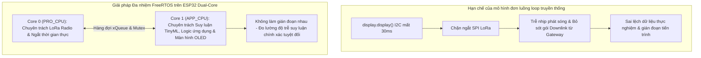
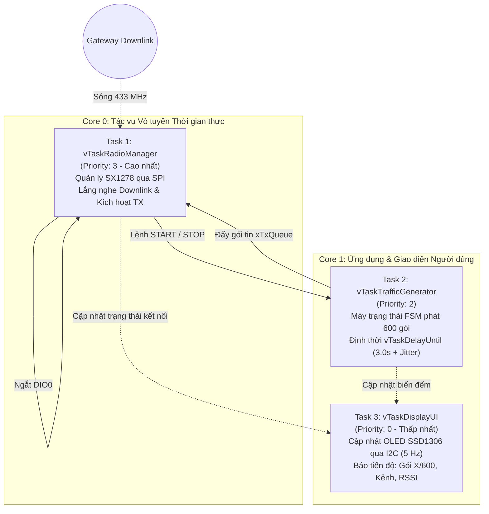
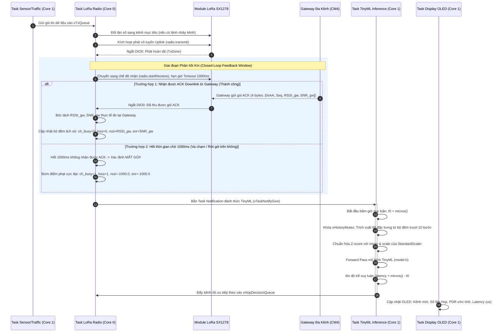
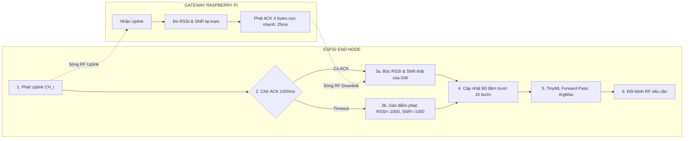

# KIẾN TRÚC ĐA NHIỆM FREERTOS CHO FIRMWARE END-NODE ESP32

## Đề tài: Tối Ưu Hóa Kênh Truyền LoRa Dựa Trên TinyML (LoRa TinyML Channel Hopping)

## Hệ điều hành thời gian thực: FreeRTOS SMP (Dual-Core Xtensa LX6 @ 240 MHz)

---

## 1. Tổng quan & Lý do Cốt lõi Áp dụng FreeRTOS

Trong các ứng dụng IoT không dây nâng cao, vi điều khiển ESP32 phải đồng thời đảm nhận nhiều tác vụ có yêu cầu thời gian khác nhau:

1. **Tác vụ vô tuyến LoRa (Time-Critical):** Đòi hỏi tính thời gian thực cực cao qua bus SPI và ngắt phần cứng `DIO0`.
2. **Tác vụ suy luận Trí tuệ nhân tạo (Compute-Intensive):** Mô hình mạng nơ-ron TinyML tính toán vector 80 chiều, chuẩn hóa đặc trưng và dự đoán kênh truyền.
3. **Tác vụ hiển thị màn hình OLED (I/O-Bound):** Giao tiếp I2C tốc độ thấp, mỗi khung hình đồ họa chiếm tới **$20 - 35\text{ ms}$ CPU blocking**.
4. **Tác vụ lắng nghe lệnh Gateway (Asynchronous Downlink):** Lắng nghe lệnh PING, đổi tần số OTA, hoặc lệnh DỪNG (STOP) bất kỳ lúc nào.



---

## 2. Kiến trúc FreeRTOS cho Firmware Thu Thập Dữ Liệu (`LoRaEN_DataCollection`)

Trong giai đoạn thu thập dữ liệu, End-Node cần phát chuỗi 600 gói tin đồng thời phải **luôn sẵn sàng nhận lệnh điều khiển Downlink** (START, STOP, SET_FREQ, PING) từ Gateway Web Dashboard.

### Sơ đồ phân chia Task và Core:



### Chi tiết các Task trong Firmware Thu thập:

| Tên Task                           |       Core       |             Độ ưu tiên             | Kích thước Stack |                 Cơ chế kích hoạt                 | Nhiệm vụ chính                                                                                                                                                                                                                                                                                                                                             |
| :---------------------------------- | :--------------: | :------------------------------------: | :-----------------: | :--------------------------------------------------: | :------------------------------------------------------------------------------------------------------------------------------------------------------------------------------------------------------------------------------------------------------------------------------------------------------------------------------------------------------------ |
| **`vTaskRadioManager`**     | **Core 0** |  **Priority 3** *(Cao nhất)*  |   `4096 bytes`   |        Event-driven (Ngắt `DIO0` & Queue)        | • Khởi tạo và làm chủ bus VSPI chip SX1278.• Ở chế độ chờ: Lắng nghe liên tục gói Downlink (`CTRL:PING`, `CMD:START`, `CMD:STOP`, `CTRL:SET_FREQ`).• Phản hồi gói `PONG` hoặc xác nhận `ACK`.• Nhận gói từ `xTxQueue` để phát Uplink lên Gateway.                                                                |
| **`vTaskTrafficGenerator`** | **Core 1** |          **Priority 2**          |   `3072 bytes`   |         Định kỳ bằng `vTaskDelayUntil`         | • Duyệt qua 6 mức payload: $30, 74, 118, 162, 206, 250\text{ bytes}$.• Mỗi mức phát 100 gói (tổng 600 gói).• Định thời chính xác chu kỳ: $T_{interval} = 3000\text{ ms} + \text{random}(0 .. 500\text{ ms})$.• Khi nhận cờ STOP từ Radio Task: Dừng định thời ngay lập tức mà không cần khởi động lại vi điều khiển. |
| **`vTaskDisplayUI`**        | **Core 1** | **Priority 0** *(Thấp nhất)* |   `3072 bytes`   | Định kỳ mỗi $200\text{ ms}$ ($5\text{ FPS}$) | • Làm chủ bus I2C màn hình OLED SSD1306.• Hiển thị: Trạng thái (CHỜ LỆNH / ĐANG PHÁT / HOÀN THÀNH), Kênh tần số hiện tại, số gói đã gửi.• Hoàn toàn không làm ảnh hưởng đến độ trễ phát của LoRa.                                                                                                                    |

---

## 3. Kiến trúc FreeRTOS cho Firmware Nhảy Kênh Thông Minh (`LoRaEN_TinyMLHopping`)

Trong giai đoạn vận hành TinyML, sau mỗi chu kỳ phát, Node phải thực hiện suy luận mô hình để quyết định kênh kế tiếp.

### Sơ đồ luồng xử lý và đồng bộ liên tác vụ (IPC Flow):



### Chi tiết các Task trong Firmware Nhảy Kênh TinyML:

| Tên Task | Core | Độ ưu tiên | Kích thước Stack | Cơ chế kích hoạt | Nhiệm vụ chính |
| :--- | :---: | :---: | :---: | :---: | :--- |
| **`vTaskLoRaRadio`** | **Core 0** | **Priority 3** *(Cao nhất)* | `4096 bytes` | Hướng sự kiện | • Kiểm tra `xHopDecisionQueue`: Nếu có quyết định chuyển kênh, gọi ngay `radio.setFrequency(new_freq)` và tăng `hopCount++`.<br>• Lấy gói từ `xTxQueue` và thực thi phát sóng Uplink.<br>• Mở cửa sổ chờ nhận ACK $1000\text{ ms}$. Nếu nhận ACK $\rightarrow$ lấy RSSI/SNR; nếu Timeout $\rightarrow$ nạp phạt $-1000$.<br>• Cập nhật mảng trượt lịch sử và kích hoạt `vTaskTinyMLInference` qua Direct Task Notification. |
| **`vTaskTinyMLInference`** | **Core 1** | **Priority 2** | `8192 bytes` *(Cấp đủ cho mạng nơ-ron)* | Direct Task Notification | • Được bảo vệ an toàn bởi `xHistoryMutex`.<br>• Trích xuất vector 80 chiều từ mảng trượt $10\text{ bước} \times 8\text{ đặc trưng}$.<br>• Chuẩn hóa dữ liệu theo tham số `mean` và `scale` của `StandardScaler`.<br>• Thực thi hàm suy luận `run_model_inference()`.<br>• Đẩy quyết định chọn kênh kế tiếp vào `xHopDecisionQueue`. |
| **`vTaskSensorApp`** | **Core 1** | **Priority 1** | `2048 bytes` | Định kỳ mỗi $3.0\text{ giây}$ | • Đọc cảm biến thật hoặc sinh gói dữ liệu mô phỏng.<br>• Tăng số thứ tự gói `packet_ID++`.<br>• Gửi gói vào `xTxQueue`. |
| **`vTaskDisplayUI`** | **Core 1** | **Priority 0** *(Thấp nhất)* | `3072 bytes` | Định kỳ mỗi $200\text{ ms}$ | • Hiển thị giao diện giám sát tại biên (Edge Telemetry): Tần số kênh, PDR ước tính, Số lần nhảy kênh, Thời gian suy luận ($\mu s$). |

---

## 4. Cơ chế Phản hồi Kín (Closed-Loop Feedback) & Cập nhật Trạng thái Kênh Thời gian thực

### 4.1. Giải quyết Bản chất Bài toán: Dữ liệu Huấn luyện ở Gateway vs Suy luận tại Node
Một câu hỏi cốt lõi về mặt kỹ thuật viễn thông là: **Tại sao dữ liệu huấn luyện thu thập tại Gateway, nhưng mô hình lại được nhúng trên ESP32 để tự quyết định nhảy kênh?**

1. **Bản chất phần cứng:** Khi ESP32 phát đi một gói tin LoRa (Uplink), chip SX1278 trên Node đang ở chế độ phát (TX). Nó **chỉ biết là đã gửi xong byte ra ăng-ten**, chứ **hoàn toàn không thể tự đo được RSSI/SNR** mà Gateway thu được ở đầu bên kia. Đồng thời, nếu sóng bị va chạm với Node khác tại Gateway (hiện tượng Nút Ẩn - Hidden Node), Node cũng **không thể tự biết** gói tin đã bị hủy nếu không có tín hiệu phản hồi.
2. **Giải pháp chuẩn khoa học:** Hệ thống thiết lập một **vòng phản hồi kín (Closed-Loop Feedback)** dựa trên gói ACK Downlink siêu nhỏ từ Gateway kết hợp cơ chế bộ đếm thời gian chờ (Timeout). Cơ chế này giúp ESP32 tái tạo lại chính xác $100\%$ không gian trạng thái kênh thời gian thực (CSI - Channel State Information) hệt như khi Gateway ghi log.



### 4.2. Giao thức ACK Downlink Siêu nhẹ (4 Bytes)
Gói ACK từ Gateway trả về không mang tải dữ liệu người dùng, mà chỉ đóng vai trò là bản tin đo lường chất lượng kênh (Channel Quality Feedback):

```
┌──────────────┬──────────────────┬─────────────────┬────────────────┐
│ Byte 0 (1B)  │   Byte 1 (1B)    │   Byte 2 (1B)   │  Byte 3 (1B)   │
├──────────────┼──────────────────┼─────────────────┼────────────────┤
│ Header: 0xAA │ packet_ID (0-255)│ (int8_t)RSSI_gw │ (int8_t)SNR_gw │
└──────────────┴──────────────────┴─────────────────┴────────────────┘
```

- **Tối ưu thời gian chiếm dụng kênh (Time-on-Air - ToA):**
  - Cấu hình vô tuyến: SF7, BW 125 kHz, Coding Rate 4/5, Preamble 8 symbols.
  - Thời gian phát sóng gói 4 bytes: **chỉ ~25.8 ms**.
  - Độ trễ cực ngắn này đảm bảo không gây nghẽn băng thông môi trường vô tuyến và tiêu thụ điện năng không đáng kể.

### 4.3. Cơ chế Phát hiện Rớt gói / Va chạm tại Biên (Edge Collision Detection)
Khi xảy ra va chạm trên không (Collision) hoặc nhiễu nặng, Gateway hoàn toàn không giải mã được gói tin, do đó Gateway **không thể gửi bản tin báo lỗi (NACK)**:
- ESP32 giải quyết bài toán này bằng **Cơ chế Hết giờ chờ nhận (ACK Window Timeout = 1000 ms)**.
- Khi hết $1000\text{ ms}$ kể từ lúc phát xong mà không có ngắt DIO0 RxDone báo gói ACK:
  $$\text{ESP32 tự động kết luận: Gói tin vừa phát đã bị va chạm hoặc mất trên kênh!}$$
- Node lập tức kích hoạt bộ quy tắc phạt tương đương như tiền xử lý trong script `02_add_missed_packets.py`:
  - `ch_busy = 1.0` (Kênh đang bị chiếm dụng/va chạm)
  - `loss = 1.0`
  - `RSSI = -1000.0 dBm` (Điểm phạt mất tín hiệu)
  - `SNR = -1000.0 dB` (Điểm phạt mất tín hiệu)

### 4.4. Cấu trúc và Quy tắc Trượt của Bộ đệm Lịch sử (`xHistoryMutex`)
Bộ đệm trượt lưu giữ 10 bước truyền thông gần nhất. Mỗi bước gồm 8 thuộc tính:
1. `ch1_busy`: $1$ nếu va chạm trên kênh 1, ngược lại $0$.
2. `ch2_busy`: $1$ nếu va chạm trên kênh 2, ngược lại $0$.
3. `ch3_busy`: $1$ nếu va chạm trên kênh 3, ngược lại $0$.
4. `packet_loss`: $1$ nếu mất gói/timeout, $0$ nếu thành công.
5. `rssi`: RSSI đo từ Gateway (dBm) hoặc $-1000.0$ nếu mất.
6. `snr`: SNR đo từ Gateway (dB) hoặc $-1000.0$ nếu mất.
7. `payload_size`: Kích thước gói tin vừa phát (bytes).
8. `delta_time`: Khoảng cách thời gian so với lần phát trước (giây).

$$\text{Tổng số đặc trưng đầu vào} = 10 \text{ bước} \times 8 \text{ đặc trưng} = 80 \text{ dimensions}$$

Vector 80 chiều này được chuẩn hóa qua `StandardScaler` (sử dụng mảng hằng số `MEAN[80]` và `SCALE[80]` đã được tính toán từ Python) trước khi đưa vào hàm `run_model_inference()`.

---

## 5. Cơ chế Giao tiếp & Đồng bộ Hóa Liên Tác vụ (IPC)

Để đảm bảo an toàn luồng (Thread-safety) và không xảy ra xung đột tranh chấp dữ liệu (Race Condition):

1. **Hàng đợi Gói tin Cần phát (`xTxQueue`):**
   ```cpp
   // Dung lượng chứa tối đa 5 gói tin chờ phát từ tầng ứng dụng
   xTxQueue = xQueueCreate(5, sizeof(LoRaPacket_t));
   ```
2. **Hàng đợi Quyết định Chuyển kênh (`xHopDecisionQueue`):**
   ```cpp
   // Dung lượng 1 phần tử (luôn ghi đè quyết định mới nhất để Radio Task thực thi)
   xHopDecisionQueue = xQueueCreate(1, sizeof(HopDecision_t));
   ```
3. **Khóa Mutex bảo vệ Bộ đệm Lịch sử (`xHistoryMutex`):**
   ```cpp
   // Đảm bảo không bị xung đột đọc/ghi giữa Radio Task (ghi nhận ACK/Timeout) và TinyML Task (đọc suy luận)
   xHistoryMutex = xSemaphoreCreateMutex();
   ```
4. **Cơ chế Báo hiệu Siêu nhẹ (Direct Task Notification):**
   ```cpp
   // Dùng cờ nội tại của Task để giảm độ trễ kích hoạt xuống micro-giây
   xTaskNotifyGive(hInferenceTask);           // Core 0 đánh thức Core 1
   ulTaskNotifyTake(pdTRUE, portMAX_DELAY);   // Core 1 thức dậy chạy Forward Pass
   ```

---

## 6. Khung Mã Nguồn Chuẩn Mẫu (Boilerplate Implementation)

Dưới đây là mã nguồn C++ mẫu triển khai cấu trúc FreeRTOS hoàn chỉnh tích hợp cơ chế Closed-Loop Feedback ACK & Timeout:

```cpp
#include <Arduino.h>
#include <SPI.h>
#include <Wire.h>
#include <RadioLib.h>
#include <Adafruit_SSD1306.h>
#include "model.h" // Chứa mảng trọng số TinyML và các hằng số MEAN, SCALE

// ── Cấu hình Tần số & Phần cứng ────────────────────────────────────────────
const float CHANNELS[3] = {433.175, 433.375, 433.575};
#define LORA_CS         5
#define LORA_DIO0       26
#define LORA_RST        14
#define ACK_TIMEOUT_MS  1000

// ── Định nghĩa Cấu trúc Dữ liệu Bộ đệm Trượt ──────────────────────────────
struct HistoryStep {
  float ch_busy[3];
  float loss;
  float rssi;
  float snr;
  float payload_size;
  float delta_time;
};

#define WINDOW_SIZE 10
HistoryStep g_slidingWindow[WINDOW_SIZE];

typedef struct {
  uint32_t packetId;
  uint8_t  payloadSize;
  char     payload[256];
} LoRaPacket_t;

typedef struct {
  int      nextChannel;
  float    confidence;
  uint32_t latencyUs;
} HopDecision_t;

// ── Khai báo IPC Handles ───────────────────────────────────────────────────
QueueHandle_t     xTxQueue;
QueueHandle_t     xHopDecisionQueue;
SemaphoreHandle_t xHistoryMutex;
TaskHandle_t      hRadioTask;
TaskHandle_t      hInferenceTask;

volatile int      g_currentChIdx = 0;
volatile uint32_t g_totalSent = 0;
volatile uint32_t g_hopCount = 0;
volatile uint32_t g_lastLatencyUs = 0;

// ───────────────────────────────────────────────────────────────────────────
// TASK 1: LORA RADIO TASK (CORE 0 - REALTIME RF & CLOSED-LOOP ACK)
// ───────────────────────────────────────────────────────────────────────────
void vTaskLoRaRadio(void *pvParameters) {
  LoRaPacket_t txPkt;
  HopDecision_t hop;
  uint8_t ackBuf[8];

  for (;;) {
    // 1. Kiểm tra quyết định nhảy kênh từ TinyML Inference
    if (xQueueReceive(xHopDecisionQueue, &hop, 0) == pdTRUE) {
      if (hop.nextChannel != g_currentChIdx && hop.nextChannel >= 0 && hop.nextChannel < 3) {
        g_currentChIdx = hop.nextChannel;
        g_hopCount++;
        // radio.setFrequency(CHANNELS[g_currentChIdx]);
      }
    }

    // 2. Chờ gói tin cần phát từ tầng ứng dụng
    if (xQueueReceive(xTxQueue, &txPkt, portMAX_DELAY) == pdTRUE) {
      // Phát Uplink lên Gateway
      // radio.transmit((uint8_t*)txPkt.payload, txPkt.payloadSize);
      g_totalSent++;

      // 3. Mở cửa sổ chờ nhận ACK Downlink trong tối đa 1000 ms
      // radio.startReceive();
      unsigned long rxStart = millis();
      bool ackReceived = false;
      float gwRssi = -1000.0f;
      float gwSnr  = -1000.0f;

      while (millis() - rxStart < ACK_TIMEOUT_MS) {
        // Kiểm tra cờ nhận gói từ SX1278 (ví dụ qua ngắt DIO0 hoặc cờ thư viện)
        // if (radio.readData(ackBuf, 4) == RADIOLIB_ERR_NONE) {
        //   if (ackBuf[0] == 0xAA && ackBuf[1] == (uint8_t)(txPkt.packetId & 0xFF)) {
        //     gwRssi = (float)((int8_t)ackBuf[2]);
        //     gwSnr  = (float)((int8_t)ackBuf[3]);
        //     ackReceived = true;
        //     break;
        //   }
        // }
        vTaskDelay(pdMS_TO_TICKS(10));
      }

      // 4. Khóa Mutex và Cập nhật Bộ đệm Trượt
      xSemaphoreTake(xHistoryMutex, portMAX_DELAY);
      for (int i = WINDOW_SIZE - 1; i > 0; i--) {
        g_slidingWindow[i] = g_slidingWindow[i - 1];
      }

      if (ackReceived) {
        // Thành công: Ghi nhận trạng thái tốt và RSSI/SNR thật
        g_slidingWindow[0].ch_busy[0] = 0.0f;
        g_slidingWindow[0].ch_busy[1] = 0.0f;
        g_slidingWindow[0].ch_busy[2] = 0.0f;
        g_slidingWindow[0].loss = 0.0f;
        g_slidingWindow[0].rssi = gwRssi;
        g_slidingWindow[0].snr  = gwSnr;
      } else {
        // Timeout / Va chạm: Bơm điểm phạt cực đại tương ứng quy tắc dán nhãn
        g_slidingWindow[0].ch_busy[0] = (g_currentChIdx == 0) ? 1.0f : 0.0f;
        g_slidingWindow[0].ch_busy[1] = (g_currentChIdx == 1) ? 1.0f : 0.0f;
        g_slidingWindow[0].ch_busy[2] = (g_currentChIdx == 2) ? 1.0f : 0.0f;
        g_slidingWindow[0].loss = 1.0f;
        g_slidingWindow[0].rssi = -1000.0f;
        g_slidingWindow[0].snr  = -1000.0f;
      }
      g_slidingWindow[0].payload_size = (float)txPkt.payloadSize;
      g_slidingWindow[0].delta_time   = 3.0f;
      xSemaphoreGive(xHistoryMutex);

      // 5. Đánh thức Task TinyML để thực thi suy luận kênh tiếp theo
      xTaskNotifyGive(hInferenceTask);
    }
  }
}

// ───────────────────────────────────────────────────────────────────────────
// TASK 2: TINYML INFERENCE TASK (CORE 1 - PREDICTION PIPELINE)
// ───────────────────────────────────────────────────────────────────────────
void vTaskTinyMLInference(void *pvParameters) {
  float inputFeatures[80];

  for (;;) {
    ulTaskNotifyTake(pdTRUE, portMAX_DELAY);
    uint32_t t0 = micros();

    // 1. Trích xuất đặc trưng an toàn từ bộ đệm trượt
    xSemaphoreTake(xHistoryMutex, portMAX_DELAY);
    int idx = 0;
    for (int i = 0; i < WINDOW_SIZE; i++) {
      inputFeatures[idx++] = g_slidingWindow[i].ch_busy[0];
      inputFeatures[idx++] = g_slidingWindow[i].ch_busy[1];
      inputFeatures[idx++] = g_slidingWindow[i].ch_busy[2];
      inputFeatures[idx++] = g_slidingWindow[i].loss;
      inputFeatures[idx++] = g_slidingWindow[i].rssi;
      inputFeatures[idx++] = g_slidingWindow[i].snr;
      inputFeatures[idx++] = g_slidingWindow[i].payload_size;
      inputFeatures[idx++] = g_slidingWindow[i].delta_time;
    }
    xSemaphoreGive(xHistoryMutex);

    // 2. Chuẩn hóa StandardScaler (Z-score normalization)
    for (int i = 0; i < 80; i++) {
      // inputFeatures[i] = (inputFeatures[i] - SCALER_MEAN[i]) / SCALER_SCALE[i];
    }

    // 3. Thực thi Forward Pass mạng nơ-ron
    // float outProb[3];
    // run_model_inference(inputFeatures, outProb);
    // int bestChannel = argmax(outProb, 3);
    int bestChannel = (g_currentChIdx + 1) % 3; // Giả định kênh đề xuất

    uint32_t latency = micros() - t0;
    g_lastLatencyUs = latency;

    // 4. Đẩy quyết định vào Queue chuyển sang Radio Task
    HopDecision_t decision = {bestChannel, 0.95f, latency};
    xQueueOverwrite(xHopDecisionQueue, &decision);
  }
}

// ───────────────────────────────────────────────────────────────────────────
// TASK 3: SENSOR / TRAFFIC GENERATOR (CORE 1)
// ───────────────────────────────────────────────────────────────────────────
void vTaskTrafficApp(void *pvParameters) {
  TickType_t xLastWakeTime = xTaskGetTickCount();
  const TickType_t xInterval = pdMS_TO_TICKS(3000); // Chu kỳ phát 3 giây

  for (;;) {
    vTaskDelayUntil(&xLastWakeTime, xInterval);

    LoRaPacket_t pkt;
    pkt.packetId = g_totalSent + 1;
    pkt.payloadSize = 30;
    snprintf(pkt.payload, sizeof(pkt.payload), "A%lu*DATA_PAYLOAD", (unsigned long)pkt.packetId);

    xQueueSend(xTxQueue, &pkt, portMAX_DELAY);
  }
}

// ───────────────────────────────────────────────────────────────────────────
// TASK 4: DISPLAY TELEMETRY UI (CORE 1 - 5 FPS)
// ───────────────────────────────────────────────────────────────────────────
void vTaskDisplayUI(void *pvParameters) {
  for (;;) {
    vTaskDelay(pdMS_TO_TICKS(200));
    // Cập nhật OLED hiển thị thông số thời gian thực mà không chặn LoRa SPI
  }
}

void setup() {
  Serial.begin(115200);

  xTxQueue = xQueueCreate(5, sizeof(LoRaPacket_t));
  xHopDecisionQueue = xQueueCreate(1, sizeof(HopDecision_t));
  xHistoryMutex = xSemaphoreCreateMutex();

  xTaskCreatePinnedToCore(vTaskLoRaRadio,      "LoRaRadio", 4096, NULL, 3, &hRadioTask,     0); // Core 0
  xTaskCreatePinnedToCore(vTaskTinyMLInference,"TinyML",    8192, NULL, 2, &hInferenceTask, 1); // Core 1
  xTaskCreatePinnedToCore(vTaskTrafficApp,     "Traffic",   2048, NULL, 1, NULL,            1); // Core 1
  xTaskCreatePinnedToCore(vTaskDisplayUI,      "Display",   3072, NULL, 0, NULL,            1); // Core 1
}

void loop() {
  vTaskDelete(NULL);
}
```

---

## 7. Lợi ích Đóng góp cho Báo cáo Đồ án Tốt nghiệp

1. **Khẳng định tính hoàn thiện về mặt khoa học:** Trả lời thuyết phục câu hỏi bảo vệ về sự khác biệt giữa trạm thu dữ liệu (Gateway) và vị trí đặt mô hình (Node) thông qua cơ chế phản hồi kín (Closed-Loop Feedback).
2. **Minh chứng kỹ năng kỹ thuật nhúng cao cấp:** Đồ án không chỉ dừng lại ở thuật toán AI trên máy tính, mà giải quyết trọn vẹn bài toán tích hợp hệ thống nhúng đa nhiệm công nghiệp trên vi điều khiển 2 nhân với FreeRTOS.
3. **Độ trễ và Tính ổn định tối ưu:** Nhờ việc cô lập LoRa trên Core 0, các gói tin được phát với chu kỳ chuẩn xác đến mili-giây, cửa sổ nhận ACK $1000\text{ ms}$ được giám sát độc lập, thời gian suy luận TinyML ($\mu s$) tách biệt hoàn toàn không gây ảnh hưởng lẫn nhau.
