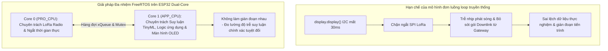
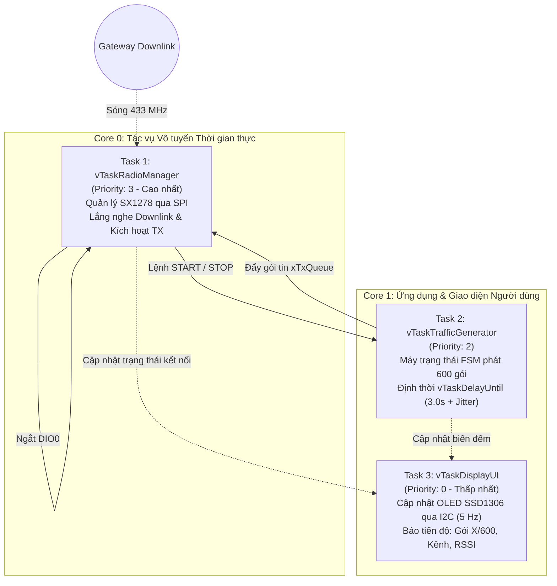
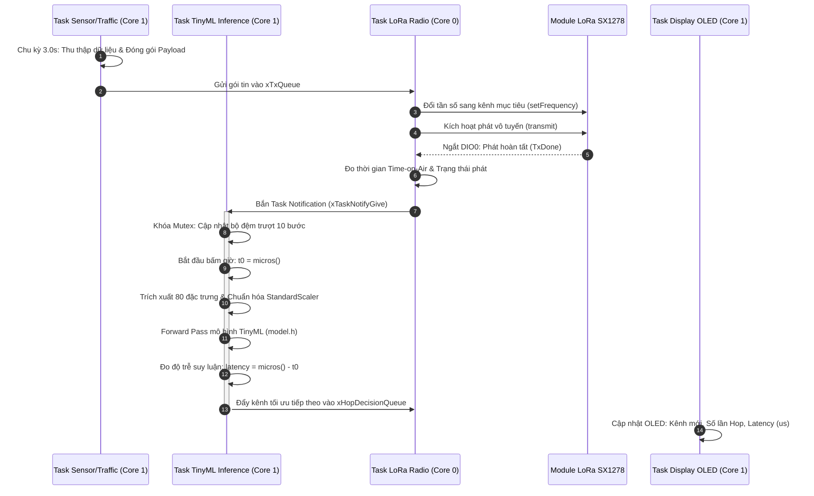

# KIẾN TRÚC ĐA NHIỆM FREERTOS CHO FIRMWARE END-NODE ESP32

## Đề tài: Tối Ưu Hóa Kênh Truyền LoRa Dựa Trên TinyML (LoRa TinyML Channel Hopping)
## Hệ điều hành thời gian thực: FreeRTOS SMP (Dual-Core Xtensa LX6 @ 240 MHz)

---

## 1. Tổng quan & Lý do Cốt lõi Áp dụng FreeRTOS

Trong các ứng dụng IoT không dây nâng cao, vi điều khiển ESP32 phải đồng thời đảm nhận nhiều tác vụ có yêu cầu thời gian khác nhau:
1. **Tác vụ vô tuyến LoRa (Time-Critical):** Đòi hỏi tính thời gian thực cực cao qua bus SPI và ngắt phần cứng `DIO0`.
2. **Tác vụ suy luận Trí tuệ nhân tạo (Compute-Intensive):** Mô hình mạng nơ-ron TinyML tính toán vector 80 chiều, chuẩn hóa đặc trưng và dự đoán kênh truyền.
3. **Tác vụ hiển thị màn hình OLED (I/O-Bound):** Giao tiếp I2C tốc độ thấp, mỗi khung hình đồ họa chiếm tới **$20 - 35\text{ ms}$ CPU blocking**.
4. **Tác vụ lắng nghe lệnh Gateway (Asynchronous Downlink):** Lắng nghe lệnh PING, đổi tần số OTA, hoặc lệnh DỪNG (STOP) bất kỳ lúc nào.



---

## 2. Kiến trúc FreeRTOS cho Firmware Thu Thập Dữ Liệu (`LoRaEN_DataCollection`)

Trong giai đoạn thu thập dữ liệu, End-Node cần phát chuỗi 600 gói tin đồng thời phải **luôn sẵn sàng nhận lệnh điều khiển Downlink** (START, STOP, SET_FREQ, PING) từ Gateway Web Dashboard.

### Sơ đồ phân chia Task và Core:



### Chi tiết các Task trong Firmware Thu thập:

| Tên Task | Core | Độ ưu tiên | Kích thước Stack | Cơ chế kích hoạt | Nhiệm vụ chính |
| :--- | :---: | :---: | :---: | :---: | :--- |
| **`vTaskRadioManager`** | **Core 0** | **Priority 3** *(Cao nhất)* | `4096 bytes` | Event-driven (Ngắt `DIO0` & Queue) | • Khởi tạo và làm chủ bus VSPI chip SX1278.<br>• Ở chế độ chờ: Lắng nghe liên tục gói Downlink (`CTRL:PING`, `CMD:START`, `CMD:STOP`, `CTRL:SET_FREQ`).<br>• Phản hồi gói `PONG` hoặc xác nhận `ACK`.<br>• Nhận gói từ `xTxQueue` để phát Uplink lên Gateway. |
| **`vTaskTrafficGenerator`** | **Core 1** | **Priority 2** | `3072 bytes` | Định kỳ bằng `vTaskDelayUntil` | • Duyệt qua 6 mức payload: $30, 74, 118, 162, 206, 250\text{ bytes}$.<br>• Mỗi mức phát 100 gói (tổng 600 gói).<br>• Định thời chính xác chu kỳ: $T_{interval} = 3000\text{ ms} + \text{random}(0 .. 500\text{ ms})$.<br>• Khi nhận cờ STOP từ Radio Task: Dừng định thời ngay lập tức mà không cần khởi động lại vi điều khiển. |
| **`vTaskDisplayUI`** | **Core 1** | **Priority 0** *(Thấp nhất)* | `3072 bytes` | Định kỳ mỗi $200\text{ ms}$ ($5\text{ FPS}$) | • Làm chủ bus I2C màn hình OLED SSD1306.<br>• Hiển thị: Trạng thái (CHỜ LỆNH / ĐANG PHÁT / HOÀN THÀNH), Kênh tần số hiện tại, số gói đã gửi.<br>• Hoàn toàn không làm ảnh hưởng đến độ trễ phát của LoRa. |

---

## 3. Kiến trúc FreeRTOS cho Firmware Nhảy Kênh Thông Minh (`LoRaEN_TinyMLHopping`)

Trong giai đoạn vận hành TinyML, sau mỗi chu kỳ phát, Node phải thực hiện suy luận mô hình để quyết định kênh kế tiếp.

### Sơ đồ luồng xử lý và đồng bộ liên tác vụ (IPC Flow):



### Chi tiết các Task trong Firmware Nhảy Kênh TinyML:

| Tên Task | Core | Độ ưu tiên | Kích thước Stack | Cơ chế kích hoạt | Nhiệm vụ chính |
| :--- | :---: | :---: | :---: | :---: | :--- |
| **`vTaskLoRaRadio`** | **Core 0** | **Priority 3** *(Cao nhất)* | `4096 bytes` | Hướng sự kiện | • Kiểm tra `xHopDecisionQueue`: Nếu có quyết định chuyển kênh, gọi ngay `radio.setFrequency(new_freq)` và tăng `hopCount++`.<br>• Lấy gói từ `xTxQueue` và thực thi phát sóng.<br>• Khi phát xong: Kích hoạt `vTaskTinyMLInference` qua Direct Task Notification. |
| **`vTaskTinyMLInference`** | **Core 1** | **Priority 2** | `8192 bytes` *(Cấp đủ cho mạng nơ-ron)* | Direct Task Notification | • Được bảo vệ bởi `xHistoryMutex`.<br>• Quản lý mảng trượt `history[10][8]`.<br>• Chuẩn hóa dữ liệu theo tham số `mean` và `scale` của `StandardScaler`.<br>• Thực thi hàm suy luận `run_model_inference()`.<br>• Đẩy quyết định vào `xHopDecisionQueue`. |
| **`vTaskSensorApp`** | **Core 1** | **Priority 1** | `2048 bytes` | Định kỳ mỗi $3.0\text{ giây}$ | • Đọc cảm biến thật hoặc sinh gói dữ liệu mô phỏng.<br>• Tăng số thứ tự gói `packet_ID++`.<br>• Gửi gói vào `xTxQueue`. |
| **`vTaskDisplayUI`** | **Core 1** | **Priority 0** | `3072 bytes` | Định kỳ mỗi $200\text{ ms}$ | • Hiển thị giao diện giám sát tại biên (Edge Telemetry): Tần số kênh, PDR ước tính, Số lần nhảy kênh, Thời gian suy luận ($\mu s$). |

---

## 4. Cơ chế Giao tiếp & Đồng bộ Hóa Liên Tác vụ (IPC)

Để đảm bảo an toàn luồng (Thread-safety) và không xảy ra xung đột tranh chấp dữ liệu (Race Condition):

1. **Hàng đợi Gói tin Cần phát (`xTxQueue`):**
   ```cpp
   // Dung lượng chứa tối đa 5 gói tin chờ phát
   xTxQueue = xQueueCreate(5, sizeof(LoRaPacket_t));
   ```
2. **Hàng đợi Quyết định Chuyển kênh (`xHopDecisionQueue`):**
   ```cpp
   // Dung lượng 1 phần tử (luôn ghi đè quyết định mới nhất)
   xHopDecisionQueue = xQueueCreate(1, sizeof(HopDecision_t));
   ```
3. **Khóa Mutex bảo vệ Bộ đệm Lịch sử (`xHistoryMutex`):**
   ```cpp
   // Đảm bảo không bị đọc/ghi đồng thời giữa Radio Task và TinyML Task
   xHistoryMutex = xSemaphoreCreateMutex();
   ```
4. **Cơ chế Báo hiệu Siêu nhẹ (Direct Task Notification):**
   ```cpp
   // Thay vì dùng Semaphore, dùng trực tiếp cờ nội tại của Task để giảm trễ xuống nano-giây
   xTaskNotifyGive(hInferenceTask); // Từ Core 0 đánh thức Core 1
   ulTaskNotifyTake(pdTRUE, portMAX_DELAY); // Core 1 nhận và chạy suy luận
   ```

---

## 5. Khung Mã Nguồn Chuẩn Mẫu (Boilerplate Implementation)

Dưới đây là mã nguồn C++ mẫu triển khai cấu trúc FreeRTOS hoàn chỉnh cho End-Node:

```cpp
#include <Arduino.h>
#include <SPI.h>
#include <Wire.h>
#include <RadioLib.h>
#include <Adafruit_SSD1306.h>
#include "model.h" // Nhúng mảng C chứa trọng số mô hình TinyML

// ── Cấu hình Kênh & Phần cứng ──────────────────────────────────────────────
const float CHANNELS[3] = {433.175, 433.375, 433.575};
#define LORA_CS    5
#define LORA_DIO0  26
#define LORA_RST   14

// ── Kiểu dữ liệu IPC ────────────────────────────────────────────────────────
typedef struct {
  uint32_t packetId;
  uint8_t  payloadSize;
  char     payload[256];
} LoRaPacket_t;

typedef struct {
  int      nextChannel;
  float    confidence;
  uint32_t latencyUs;
} HopDecision_t;

// ── Khai báo IPC Handles ───────────────────────────────────────────────────
QueueHandle_t     xTxQueue;
QueueHandle_t     xHopDecisionQueue;
SemaphoreHandle_t xHistoryMutex;
TaskHandle_t      hRadioTask;
TaskHandle_t      hInferenceTask;

// ── Biến trạng thái toàn cục hiển thị ──────────────────────────────────────
volatile int      g_currentChIdx = 0;
volatile uint32_t g_totalSent = 0;
volatile uint32_t g_hopCount = 0;
volatile uint32_t g_lastLatencyUs = 0;

// ───────────────────────────────────────────────────────────────────────────
// TASK 1: LORA RADIO TASK (CORE 0 - REALTIME)
// ───────────────────────────────────────────────────────────────────────────
void vTaskLoRaRadio(void *pvParameters) {
  LoRaPacket_t txPkt;
  HopDecision_t hop;

  for (;;) {
    // 1. Kiểm tra quyết định nhảy kênh từ TinyML
    if (xQueueReceive(xHopDecisionQueue, &hop, 0) == pdTRUE) {
      if (hop.nextChannel != g_currentChIdx) {
        g_currentChIdx = hop.nextChannel;
        g_hopCount++;
        // Thực hiện đổi tần số RF tức thời
        // radio.setFrequency(CHANNELS[g_currentChIdx]);
      }
    }

    // 2. Chờ bản tin cần phát
    if (xQueueReceive(xTxQueue, &txPkt, portMAX_DELAY) == pdTRUE) {
      // Bắt đầu phát sóng LoRa
      // int state = radio.transmit((uint8_t*)txPkt.payload, txPkt.payloadSize);
      g_totalSent++;

      // Phát xong, đánh thức Task TinyML trên Core 1 tính toán tiếp theo
      xTaskNotifyGive(hInferenceTask);
    }
  }
}

// ───────────────────────────────────────────────────────────────────────────
// TASK 2: TINYML INFERENCE TASK (CORE 1 - COMPUTE)
// ───────────────────────────────────────────────────────────────────────────
void vTaskTinyMLInference(void *pvParameters) {
  for (;;) {
    // Chờ tín hiệu từ Radio Task sau khi phát xong gói
    ulTaskNotifyTake(pdTRUE, portMAX_DELAY);

    uint32_t t0 = micros();

    // 1. Truy xuất an toàn bộ đệm lịch sử
    xSemaphoreTake(xHistoryMutex, portMAX_DELAY);
    // [Trích xuất 80 đặc trưng & chuẩn hóa StandardScaler...]
    xSemaphoreGive(xHistoryMutex);

    // 2. Chạy suy luận Forward Pass mô hình TinyML
    // float outProb[3];
    // run_model_inference(input_tensor, outProb);
    // int bestChannel = argmax(outProb);
    int bestChannel = (g_currentChIdx + 1) % 3; // Giả lập dự đoán kênh tiếp theo

    uint32_t latency = micros() - t0;
    g_lastLatencyUs = latency;

    // 3. Đẩy quyết định sang Radio Task
    HopDecision_t decision = {bestChannel, 0.98f, latency};
    xQueueOverwrite(xHopDecisionQueue, &decision);
  }
}

// ───────────────────────────────────────────────────────────────────────────
// TASK 3: TRAFFIC / SENSOR GENERATOR (CORE 1 - APP)
// ───────────────────────────────────────────────────────────────────────────
void vTaskTrafficApp(void *pvParameters) {
  TickType_t xLastWakeTime = xTaskGetTickCount();
  const TickType_t xInterval = pdMS_TO_TICKS(3000); // 3 giây/gói

  for (;;) {
    vTaskDelayUntil(&xLastWakeTime, xInterval);

    LoRaPacket_t pkt;
    pkt.packetId = g_totalSent;
    pkt.payloadSize = 30;
    snprintf(pkt.payload, sizeof(pkt.payload), "A%d*PAYLOAD_TEST", pkt.packetId);

    xQueueSend(xTxQueue, &pkt, portMAX_DELAY);
  }
}

// ───────────────────────────────────────────────────────────────────────────
// TASK 4: DISPLAY TELEMETRY UI (CORE 1 - BACKGROUND)
// ───────────────────────────────────────────────────────────────────────────
void vTaskDisplayUI(void *pvParameters) {
  for (;;) {
    vTaskDelay(pdMS_TO_TICKS(200)); // 5 FPS
    // Cập nhật OLED SSD1306 qua I2C an toàn, hoàn toàn không chặn LoRa SPI
    // display.printf("CH: %.3f | Sent: %d\n", CHANNELS[g_currentChIdx], g_totalSent);
    // display.printf("Hops: %d | AI Lat: %d us\n", g_hopCount, g_lastLatencyUs);
  }
}

void setup() {
  Serial.begin(115200);

  // Tạo Queues & Mutex
  xTxQueue = xQueueCreate(5, sizeof(LoRaPacket_t));
  xHopDecisionQueue = xQueueCreate(1, sizeof(HopDecision_t));
  xHistoryMutex = xSemaphoreCreateMutex();

  // Khởi tạo các Task gắn vào đúng Core vật lý
  xTaskCreatePinnedToCore(vTaskLoRaRadio,      "LoRaRadio", 4096, NULL, 3, &hRadioTask,     0); // Core 0
  xTaskCreatePinnedToCore(vTaskTinyMLInference,"TinyML",    8192, NULL, 2, &hInferenceTask, 1); // Core 1
  xTaskCreatePinnedToCore(vTaskTrafficApp,     "Traffic",   2048, NULL, 1, NULL,            1); // Core 1
  xTaskCreatePinnedToCore(vTaskDisplayUI,      "Display",   3072, NULL, 0, NULL,            1); // Core 1
}

void loop() {
  // FreeRTOS Scheduler làm chủ toàn bộ, luồng Arduino loop không cần dùng
  vTaskDelete(NULL);
}
```

---

## 6. Lợi ích Đóng góp cho Báo cáo Đồ án Tốt nghiệp

1. **Minh chứng kỹ năng kỹ thuật nhúng cao cấp:** Đồ án không chỉ dừng lại ở thuật toán AI trên máy tính, mà giải quyết trọn vẹn bài toán tích hợp hệ thống nhúng đa nhiệm công nghiệp trên vi điều khiển 2 nhân.
2. **Khẳng định tính ổn định của dữ liệu thực nghiệm:** Nhờ việc cô lập LoRa trên Core 0, các gói tin được phát với chu kỳ chuẩn xác đến mili-giây, không bị dao động (jitter ngoài ý muốn) do màn hình hoặc tính toán AI.
3. **Số liệu độ trễ khách quan:** Tách riêng phép đo thời gian suy luận ($\mu s$) để chứng minh mô hình TinyML đáp ứng hoàn hảo yêu cầu tính toán tức thời (Real-time Edge Inference) của mạng truyền thông IoT.
