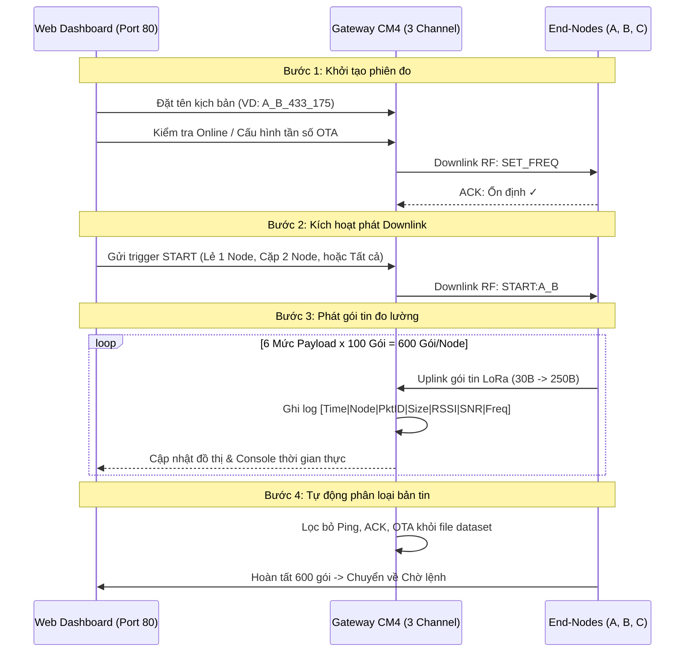
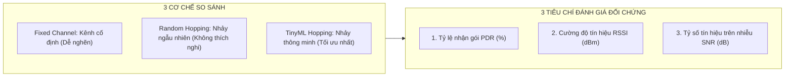

# PIPELINE TỔNG THỂ THỰC HIỆN ĐỒ ÁN TỐT NGHIỆP

## Đề tài: Tối Ưu Hóa Kênh Truyền LoRa Dựa Trên TinyML (LoRa TinyML Channel Hopping)

---

## 1. Sơ đồ Tổng quan Pipeline 6 Giai đoạn

```mermaid
flowchart TD
    subgraph G1 [GIAI ĐOẠN 1: PHẦN CỨNG & HẠ TẦNG]
        HW1[3 End-Nodes: ESP32 + Ra-02 433MHz + OLED]
        HW2[Multi-Channel Gateway: CM4 + 3x Ra-02]
        GW_SRV[Nginx Port 80 + C++ REST API Daemon]
    end

    subgraph G2 [GIAI ĐOẠN 2: THU THẬP DỮ LIỆU ĐO SÓNG]
        SCEN[21 Kịch bản Thực nghiệm: Đơn Node, 2 Node, 3 Node]
        OTA[Web Dashboard: Cấu hình tần số OTA & Lệnh Downlink START/STOP]
        RAW_LOGS[Thu thập 21 file log thô .txt / .csv]
    end

    subgraph G3 [GIAI ĐOẠN 3: TIỀN XỬ LÝ & GÁN NHÃN]
        P1["01_data_parser.py: Trích xuất chuẩn hóa log"]
        P2["02_add_missed_packets.py: Bù gói mất RSSI/SNR = -1000"]
        P3["03_generate_dataset.py: Sliding Window ts=10, 80 đặc trưng"]
    end

    subgraph G4 [GIAI ĐOẠN 4: HUẤN LUYỆN & BENCHMARK AI]
        M1["04_train_model.py: FCNN Baseline + EarlyStopping"]
        M2["06_benchmark_models.py: So sánh 5 kiến trúc FCNN/CNN/GRU/SepCNN/ResNet"]
        M3["07_evaluate_best_model.py: Confusion Matrix, Precision, Recall, F1"]
    end

    subgraph G5 [GIAI ĐOẠN 5: TỐI ƯU HÓA & XUẤT MÃ NHÚNG]
        OPT1[TFLite FlatBuffer Quantization ~5.8 KB]
        OPT2["Tự động sinh model.h byte array cho ESP32"]
    end

    subgraph G6 [GIAI ĐOẠN 6: TRIỂN KHAI & ĐÁNH GIÁ ĐỐI CHỨNG]
        EMB[Nạp firmware LoRaEN_TinyMLHopping lên ESP32]
        COMP["05_evaluate_comparison.py: Fixed vs Random vs TinyML"]
        REPORT[Đồ thị PDR, RSSI, SNR, Confusion Matrix]
    end

    G1 --> G2
    G2 --> G3
    G3 --> G4
    G4 --> G5
    G5 --> G6
```



---

## 2. Chi tiết Từng Giai đoạn Thực hiện

### Giai đoạn 1: Xây dựng & Tích hợp Phần cứng (Hardware Integration)

#### 1. Trạm Gateway Đa Kênh (Multi-Channel Gateway)

- **Phần cứng**: Raspberry Pi Compute Module 4 (CM4) gắn 3 module LoRa Ra-02 (SX1278 433 MHz).
- **Giao tiếp SPI**: Dùng chung bus phần cứng `SPI0` (`MOSI Pin 19`, `MISO Pin 21`, `SCLK Pin 23`), tách biệt 3 đường Chip Select độc lập (`CE0`, `CE1`, `GPIO 25`), 3 chân Reset và 3 chân ngắt `DIO0`.
- **Phần mềm Gateway**:
  - Biên dịch bằng C++ đa luồng (WiringPi + POSIX Threads). 3 luồng lắng nghe song song không chặn trên 3 kênh tần số:
    - Kênh 1 (`CH1`): `433.175 MHz`
    - Kênh 2 (`CH2`): `433.375 MHz`
    - Kênh 3 (`CH3`): `433.575 MHz`
  - Tích hợp Embedded HTTP/REST Daemon cổng `8080` kết hợp Nginx Reverse Proxy cổng `80`.
  - Giao diện Web Dashboard Router-style điều khiển trực quan qua mạng Wi-Fi.

#### 2. Các Thiết bị Đầu cuối (End-Nodes)

- **Phần cứng**: 3 mạch ESP32 DevKit V1 gắn module Ra-02 433 MHz và màn hình OLED 0.96" SSD1306 (giao tiếp I2C).
- **Firmware kiến trúc FSM (Máy trạng thái hữu hạn)**:
  - `STATE_WAIT_CMD`: Ở chế độ chờ lệnh từ Gateway, liên tục lắng nghe Downlink hoặc Ping kiểm tra Online/Offline.
  - `STATE_TRANSMITTING`: Nhận lệnh `START`, phát dữ liệu theo hồ sơ lưu lượng chuẩn.
  - `STATE_FINISHED`: Hoàn thành đợt phát, quay lại trạng thái lắng nghe an toàn.

---

### Giai đoạn 2: Thu thập Dữ liệu Đo sóng Thực tế (Data Collection Pipeline)

Quy trình thu thập được vận hành hoàn toàn qua Web Dashboard Gateway:



#### Danh mục 21 kịch bản đo kiểm:

1. **9 kịch bản đơn Node** (`A_433_175.txt` .. `C_433_575.txt`): Đo Path Loss tự nhiên, RSSI/SNR chuẩn khi không có xung đột.
2. **9 kịch bản cặp 2 Node** (`A_B_433_175.txt` .. `B_C_433_575.txt`): Tạo va chạm kênh ngẫu nhiên giữa 2 Node.
3. **3 kịch bản cả 3 Node** (`A_B_C_433_175.txt` .. `A_B_C_575.txt`): Môi trường nghẽn kênh cực đại.

---

### Giai đoạn 3: Tiền Xử Lý Dữ Liệu & Gán Nhãn Kênh (Preprocessing Pipeline)

Sau khi đưa 21 file log từ Gateway vào thư mục `TinyML/data/logs/`, chuỗi script tiền xử lý tự động thực hiện:

#### 1. Bước 1: Trích xuất log Gateway (`01_data_parser.py`)

- Quét toàn bộ log thô (hỗ trợ cả định dạng pipe-separated của `main_gw` và text log).
- Chuẩn hóa thành các cột dữ liệu:
  $$
  \text{Record} = \{\text{time\_slot}, \text{source}, \text{packet\_ID}, \text{size\_of\_message}, \text{RSSI}, \text{SNR}, \text{frequency}\}
  $$
- Lưu vào `TinyML/data/parsed/`.

#### 2. Bước 2: Phát hiện va chạm & Gán nhãn gói mất (`02_add_missed_packets.py`)

- Quét dải `packet_ID` kỳ vọng (từ 0 đến 99 cho mỗi mức kích thước).
- Bổ sung các bản ghi bị rớt do va chạm sóng hoặc suy hao nghiêm trọng với giá trị phạt:
  $$
  \text{RSSI} = -1000\text{ dBm}, \quad \text{SNR} = -1000\text{ dB}
  $$
- Lưu vào `TinyML/data/imputed/`.

#### 3. Bước 3: Tạo Sliding Window & Gán nhãn tối ưu (`03_generate_dataset.py`)

- **Gán vector cờ kênh $[CH1, CH2, CH3]$**:
  - Kênh đang phát và thu tốt: flag = 0.
  - Kênh đang phát nhưng mất gói: flag = 1.
  - Kênh không phát ở slot này: flag = 1.
- **Tạo cửa sổ trượt bộ nhớ thời gian ($ts = 10$ bước)**:
  - Mỗi bước gồm 8 đặc trưng: $(CH1, CH2, CH3, SNR, RSSI, Size, PktID, Frequency)$.
  - Kích thước vector đầu vào: $10 \text{ bước} \times 8 \text{ đặc trưng} = \mathbf{80 \text{ chiều}}$.
- **Gán nhãn học giám sát ($y \in \{0, 1, 2\}$)**:
  - Nhãn là kênh tần số có RSSI cao nhất tại mốc thời gian tiếp theo $t + 1$.
- Xuất dataset hoàn chỉnh: `TinyML/data/ready/dataset_ready.csv`.

---

### Giai đoạn 4: Thiết kế, Huấn luyện & Benchmark Mô hình AI (Modeling Pipeline)

#### 1. Chuẩn hóa & Chia tập dữ liệu

- Chuẩn hóa phân phối dữ liệu đầu vào bằng `StandardScaler`.
- Phân chia tập mẫu: **60% Train**, **20% Validation**, **20% Test** (random seed = 1337 cố định).

#### 2. Huấn luyện FCNN Baseline (`04_train_model.py`)

- **Kiến trúc mạng nơ-ron**:
  - Layer 1: `Dense(10, activation='relu')`
  - Layer 2: `Dense(10, activation='relu', kernel_regularizer=L1(1e-4))`
  - Output Layer: `Dense(3, activation='softmax')`
- **Tối ưu hóa**: Adam Optimizer ($lr = 0.005$), Categorical Crossentropy Loss.
- **Kiểm soát hội tụ**: `EarlyStopping(monitor='val_loss', patience=25, restore_best_weights=True)`.

#### 3. So sánh 5 Kiến trúc Mạng Nơ-ron (`06_benchmark_models.py`)

| Kiến trúc                | Đặc điểm mô hình            | Ưu điểm đối với TinyML                                | Nhược điểm                                           |
| :------------------------- | :-------------------------------- | :---------------------------------------------------------- | :------------------------------------------------------- |
| **FCNN (MLP)**       | 2 lớp Dense (10 nơ-ron)         | Kích thước siêu nhẹ (~5.8 KB), suy luận nhanh (<2 ms) | Không học được trực tiếp tương quan không gian |
| **1D-CNN**           | Conv1D(16) + Conv1D(32) + GAP     | Nắm bắt đặc trưng cục bộ theo trục thời gian       | Tham số lớn hơn FCNN                                  |
| **GRU-RNN**          | GRU(16) + Dense(16)               | Nắm bắt phụ thuộc thời gian dài hạn                  | Phức tạp trong lượng hóa MCU                        |
| **Separable 1D-CNN** | Depthwise Separable Conv1D        | Giảm 60% tham số so với CNN thường, MobileNet-style    | Cần thư viện TFLite Micro tương thích              |
| **Residual 1D-CNN**  | ResNet Block với skip connection | Hội tụ ổn định, tránh triệt tiêu gradient           | Dung lượng bộ nhớ lớn hơn                          |

#### 4. Đánh giá Chuyên sâu Mô hình Tốt nhất (`07_evaluate_best_model.py`)

- Xuất Ma trận nhầm lẫn (Confusion Matrix).
- Đo lường Precision, Recall, F1-Score trên từng kênh `433.175`, `433.375`, `433.575 MHz`.

---

### Giai đoạn 5: Tối ưu hóa TinyML & Xuất Mã Nhúng C (Embedded Deployment)

1. **Chuyển đổi TFLite FlatBuffer**:

   - Sử dụng `TFLiteConverter` tối ưu hóa mặc định (`tf.lite.Optimize.DEFAULT`).
   - Kích thước FlatBuffer đạt **~5.8 KB**, hoàn toàn phù hợp với bộ nhớ SRAM hạn chế của vi điều khiển.
2. **Tự động sinh mảng C Header (`model.h`)**:

   - Trích xuất mảng byte thô:
     ```c
     const unsigned char model[] = {
       0x1c, 0x00, 0x00, 0x00, 0x54, 0x46, 0x4c, 0x33, ...
     };
     const unsigned int model_len = 5792;
     ```
   - Tự động sao chép sang thư mục mã nguồn ESP32: [MCUCode/LoRaEN_TinyMLHopping/src/model.h](file:///e:/DATN/LoRa_TinyML_Hopping/MCUCode/LoRaEN_TinyMLHopping/src/model.h).

---

### Giai đoạn 6: Triển khai Real-time trên ESP32 & Đánh giá Đối chứng (Evaluation)

#### 1. Suy luận Nhảy kênh Thời gian thực trên Node

- ESP32 duy trì một bộ đệm vòng (Ring Buffer) lưu trữ 10 gói tin đã phát/nhận gần nhất.
- Trước mỗi gói tin mới:
  1. Trích xuất vector đặc trưng $1 \times 80$.
  2. Nạp vào bộ suy luận `tflite::MicroInterpreter`.
  3. Lấy phân phối xác suất đầu ra $[p_{CH1}, p_{CH2}, p_{CH3}]$.
  4. Đổi tần số vô tuyến của SX1278 sang kênh có xác suất chất lượng cao nhất:
     $$
     \text{Selected Channel} = \arg\max_{i} (p_i)
     $$
  5. Phát gói tin và hiển thị kết quả kênh nhảy trên OLED.

#### 2. Đánh giá Đối chứng 3 Cơ chế (`05_evaluate_comparison.py`)

Đánh giá định lượng trên 3 tiêu chí khoa học cốt lõi:



1. **PDR (Packet Delivery Ratio)**: Minh chứng TinyML duy trì tỷ lệ nhận gói cao ($95\% - 99\%$), khắc phục tình trạng sụt giảm nghiêm trọng của Kênh cố định khi có va chạm ($< 50\%$).
2. **Average RSSI**: TinyML luôn hướng Node sang kênh có mức thu tín hiệu mạnh nhất.
3. **Average SNR**: Đảm bảo đường truyền có biên độ chống nhiễu cao và ổn định.

---

## 3. Bảng Tóm tắt Lệnh Thực thi Toàn bộ Pipeline

|    Bước    | Lệnh thực thi                                 | Mục tiêu                                                 |
| :----------: | :---------------------------------------------- | :--------------------------------------------------------- |
| **1** | `cd GatewayCode && sudo ./lora_gw_3ch`        | Khởi động Gateway & Web Dashboard thu thập dữ liệu   |
| **2** | `cp GatewayCode/logs/*.txt TinyML/data/logs/` | Nạp file log thực nghiệm vào pipeline                  |
| **3** | `python scripts/01_data_parser.py`            | Chuẩn hóa dữ liệu thô sang CSV                        |
| **4** | `python scripts/02_add_missed_packets.py`     | Phát hiện va chạm và gán nhãn gói mất              |
| **5** | `python scripts/03_generate_dataset.py`       | Tạo sliding window 80 đặc trưng & gán nhãn kênh     |
| **6** | `python scripts/04_train_model.py`            | Huấn luyện FCNN Baseline & sinh `model.h` cho ESP32    |
| **7** | `python scripts/05_evaluate_comparison.py`    | Đánh giá so sánh Fixed vs Random vs TinyML             |
| **8** | `python scripts/06_benchmark_models.py`       | Benchmark 5 kiến trúc nơ-ron                            |
| **9** | `python scripts/07_evaluate_best_model.py`    | Xuất ma trận nhầm lẫn & đánh giá mô hình tối ưu |
| **10** | `python scripts/build_notebook.py`            | Cập nhật Notebook `LoRa_TinyML_Pipeline.ipynb`         |
