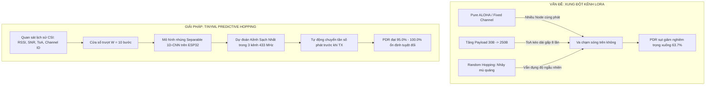
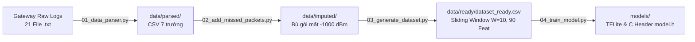
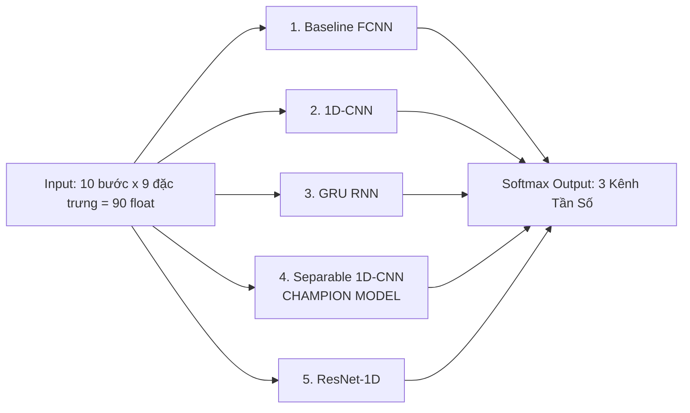
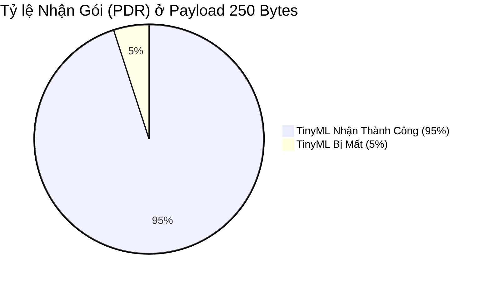
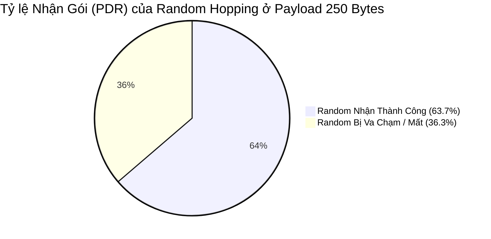

# PROJECT KNOWLEDGE BASE: LORA TINYML CHANNEL HOPPING SYSTEM
## Tài Liệu Toàn Diện Kiến Trúc & Vận Hành Hệ Thống Dành Cho AI Agent & Kỹ Sư

---

> **MỤC ĐÍCH TÀI LIỆU (AGENT BRIEFING):**
> Tài liệu này là **Single Source of Truth (SSOT)** tập hợp 100% tri thức kỹ thuật, kiến trúc phần cứng, firmware nhúng FreeRTOS, quy trình xử lý dữ liệu viễn thông, các mô hình học máy siêu nhẹ (TinyML), kết quả thực nghiệm và hướng dẫn vận hành cho toàn bộ dự án **LoRa TinyML Channel Hopping**.
> Bất kỳ AI Agent hoặc kỹ sư nào khi tiếp nhận dự án đều có thể đọc tài liệu này để nắm bắt toàn diện hệ thống mà không cần giả định, suy đoán hay tìm kiếm thêm bên ngoài.

---

## MỤC LỤC TỔNG QUAN

1. [Tổng Quan Dự Án & Bản Chất Vấn Đề Kỹ Thuật](#1-tổng-quan-dự-án--bản-chất-vấn-đề-kỹ-thuật)
2. [Kiến Trúc Hệ Thống & Cấu Hình Phần Cứng](#2-kiến-trúc-hệ-thống--cấu-hình-phần-cứng)
3. [Kiến Trúc Firmware Nhúng FreeRTOS & Gateway Software](#3-kiến-trúc-firmware-nhúng-freertos--gateway-software)
4. [Quy Trình Xử Lý Dữ Liệu Thực Nghiệm (Data Engineering Pipeline)](#4-quy-trình-xử-lý-dữ-liệu-thực-nghiệm-data-engineering-pipeline)
5. [Kiến Trúc Mô Hình TinyML & Kết Quả Đánh Giá Đối Soát](#5-kiến-trúc-mô-hình-tinyml--kết-quả-đánh-giá-đối-soát)
6. [Lựa Chọn Siêu Tham Số & Kiểm Soát Quá Khớp (Overfitting)](#6-lựa-chọn-siêu-tham-số--kiểm-soát-quá-khớp-overfitting)
7. [Kết Quả Thực Nghiệm & Đánh Giá Hiệu Năng Vô Tuyến](#7-kết-quả-thực-nghiệm--đánh-giá-hiệu-năng-vô-tuyến)
8. [Bản Đồ Cấu Trúc Thư Mục & Vai Trò Toàn Bộ File Mã Nguồn](#8-bản-đồ-cấu-trúc-thư-mục--vai-trò-toàn-bộ-file-mã-nguồn)
9. [Cẩm Nang Vận Hành & Quy Tắc Dành Cho AI Agent Mới (Rules of Engagement)](#9-cẩm-nang-vận-hành--quy-tắc-dành-cho-ai-agent-mới-rules-of-engagement)

---

## 1. TỔNG QUAN DỰ ÁN & BẢN CHẤT VẤN ĐỀ KỸ THUẬT

### 1.1. Bản Chất Bài Toán & Hạn Chế Của LoRa Truyền Thống
- **Giao thức Pure ALOHA:** Chuẩn mạng LoRaWAN và các hệ thống LoRa truyền thống hoạt động dựa trên cơ chế truy cập kênh Pure ALOHA: thiết bị phát sóng bất kỳ lúc nào có dữ liệu mà không lắng nghe trước (Listen-Before-Talk thường không bắt buộc hoặc kém hiệu quả do độ nhạy LoRa thấp hơn mức nhiễu nền).
- **Hệ quả va chạm (Packet Collision):** Khi nhiều End-Node cùng truyền đồng thời trên cùng một tần số, tín hiệu bị triệt tiêu trên không (destructive interference), dẫn đến rớt gói nghiêm trọng.
- **Tác động của kích thước gói (Payload Size) & Thời gian phát trên không (Time-on-Air - ToA):**
  - Khi payload tăng từ $30\text{ Bytes}$ lên $250\text{ Bytes}$, thời gian $ToA$ kéo dài gấp nhiều lần (với SF7/BW125kHz, ToA từ vài chục ms tăng vọt lên hàng trăm ms).
  - Cửa sổ thời gian xung đột (Vulnerable Period) $T_v = 2 \times ToA$ nở rộng, khiến xác suất va chạm của Pure ALOHA tăng theo hàm mũ:
    $$P_{collision} = 1 - e^{-2 G}$$
    *(với $G$ là mật độ tải lưu lượng mạng).*
- **Hạn chế của Kênh Cố Định (Fixed Channel):** Khi xảy ra tắc nghẽn hoặc có nguồn can nhiễu ngoại lai liên tục (jamming/fading), hệ thống tê liệt hoàn toàn, PDR tiệm cận $0\%$.
- **Hạn chế của Nhảy Kênh Ngẫu Nhiên (Random Channel Hopping):** Nhảy kênh ngẫu nhiên không có nhận thức về trạng thái kênh (collision-blind). Hai hoặc nhiều node có thể cùng nhảy ngẫu nhiên vào cùng một kênh tại cùng một thời điểm, dẫn đến va chạm không thể lường trước, đặc biệt ở các gói tin kích thước lớn.

### 1.2. Giải Pháp: Nhảy Kênh Dự Đoán Dựa Trên TinyML (Predictive Channel Hopping)
- Thiết bị đầu cuối (**ESP32 End-Node**) trực tiếp thực thi một mô hình mạng nơ-ron học máy siêu nhẹ (**TinyML**).
- Thay vì nhảy ngẫu nhiên mù quáng, End-Node duy trì một bộ đệm trượt lịch sử (**Sliding Window** gồm $W = 10$ mốc thời gian) ghi nhận thông tin trạng thái kênh (**CSI - Channel State Information** bao gồm: RSSI, SNR, kích thước gói tin, ID kênh).
- Trước mỗi lần phát sóng, mô hình TinyML suy luận xác suất kênh sạch nhất trong 3 kênh vật lý ($433.175\text{ MHz}$, $433.375\text{ MHz}$, $433.575\text{ MHz}$) và tự động chuyển tần số vô tuyến sang kênh đó.
- **Kết quả:** Triệt tiêu va chạm, duy trì tỷ lệ nhận gói PDR từ **$95.0\% - 100.0\%$** trên mọi kích thước gói tin ($30\text{B} - 250\text{B}$), cải thiện vượt trội so với Random Hopping (bị sụt giảm xuống chỉ còn $63.7\%$ ở gói $250\text{B}$).



---

## 2. KIẾN TRÚC HỆ THỐNG & CẤU HÌNH PHẦN CỨNG

### 2.1. Cấu Hình Vô Tuyến Chuẩn (Physical Layer RF)
Hệ thống thử nghiệm hoạt động trên băng tần $433\text{ MHz}$ ISM với cấu hình vô tuyến đồng nhất tuyệt đối giữa Gateway và 3 End-Nodes:

| Thông số RF | Giá trị | Ý nghĩa kỹ thuật |
| :--- | :--- | :--- |
| **Dải tần trung tâm** | **$433\text{ MHz}$ ISM** | Dải tần cho phép thử nghiệm không dây cự ly ngắn |
| **Băng thông (BW)** | **$125.0\text{ kHz}$** | Chuẩn băng thông LoRa cân bằng giữa độ nhạy và tốc độ |
| **Hệ số trải phổ (SF)** | **$7$** | Tối ưu thời gian truyền ($ToA$ ngắn), kiểm thử mật độ gói cao |
| **Tốc độ mã hóa (CR)** | **$4/5$ (CR = 5)** | Khả năng tự sửa lỗi cơ bản của gói tin |
| **Công suất phát (Tx Power)** | **$17\text{ dBm}$ ($\approx 50\text{ mW}$)** | Công suất phát tối đa ổn định của module Ai-Thinker Ra-02 |
| **Độ dài Preamble** | **$8\text{ symbols}$** | Độ dài mào đầu đồng bộ khung truyền chuẩn |
| **Sync Word** | **`0x12`** | Mã nhận diện mạng thử nghiệm riêng biệt |
| **Khoảng cách bảo vệ kênh** | **$200\text{ kHz}$** | Guard band ngăn chặn can nhiễu kênh lân cận (Adjacent Channel Interference) |

### 2.2. Bảng Phân Bổ 3 Kênh Tần Số Vật Lý
| Định danh kênh | Tần số trung tâm ($f_c$) | Mã định danh | Node mặc định ban đầu |
| :---: | :---: | :---: | :---: |
| **Kênh 1 (CH1)** | **$433.175\text{ MHz}$** | `433_175` | Node A |
| **Kênh 2 (CH2)** | **$433.375\text{ MHz}$** | `433_375` | Node B |
| **Kênh 3 (CH3)** | **$433.575\text{ MHz}$** | `433_575` | Node C |

### 2.3. Sơ Đồ Đấu Nối Phần Cứng End-Node (ESP32 DevKit V1)
Mỗi End-Node gồm:
- **Vi điều khiển:** ESP32 DevKit V1 (Xtensa Dual-Core 32-bit LX6 @ $240\text{ MHz}$, $520\text{ KB}$ SRAM, $4\text{ MB}$ SPI Flash).
- **Module RF:** Semtech SX1278 (Ai-Thinker Ra-02 $433\text{ MHz}$) kết nối qua bus VSPI.
- **Màn hình hiển thị:** OLED $0.96\text{ inch}$ SSD1306 ($128 \times 64$) giao tiếp I2C.

```
       ESP32 DevKit V1 (30 pins)
       ┌───────────────────────┐
       │                       │
       │       GPIO 27 (MOSI) ──────> SX1278 Ra-02 MOSI
       │       GPIO 19 (MISO) <────── SX1278 Ra-02 MISO
       │       GPIO 18 (SCK)  ──────> SX1278 Ra-02 SCK
       │       GPIO 5  (NSS)  ──────> SX1278 Ra-02 NSS (CS)
       │       GPIO 14 (RST)  ──────> SX1278 Ra-02 RESET
       │       GPIO 26 (DIO0) <────── SX1278 Ra-02 DIO0 (Interrupt)
       │                       │
       │       GPIO 21 (SDA)  <=====> SSD1306 OLED SDA
       │       GPIO 22 (SCL)  ──────> SSD1306 OLED SCL
       │                       │
       │       3V3            ──────> Ra-02 VCC (Cấp nguồn 3.3V riêng biệt)
       │       GND            ──────> Ra-02 GND & OLED GND
       └───────────────────────┘
```

> [!IMPORTANT]
> **Chú ý điện áp và dòng đỉnh:** Module SX1278 khi phát công suất $17\text{ dBm}$ tiêu thụ dòng đỉnh tới $120\text{ mA}$. Phải hàn tụ lọc nguồn $100\mu\text{F} + 100\text{nF}$ sát chân $V_{CC}$ của module Ra-02 để chống sụt áp gây reset ESP32.

### 2.4. Trạm Gateway Đa Kênh (Raspberry Pi CM4 Multi-Receiver)
- **Bo mạch điều khiển trung tâm:** Raspberry Pi Compute Module 4 (CM4) Quad-Core Cortex-A72 @ $1.5\text{ GHz}$, $2\text{ GB}$ LPDDR4, chạy hệ điều hành Raspberry Pi OS 64-bit.
- **Cấu hình đa thu (Multi-Receiver Architecture):** Trang bị đồng thời **3 module SX1278 độc lập** cắm trên cùng bus `SPI0` (`MOSI=GPIO 10, MISO=GPIO 9, SCLK=GPIO 11`), phân tách bằng 3 chân Chip Select (CS) và 3 chân ngắt DIO0 riêng biệt:
  - **Module #1 (CH1 - $433.175\text{ MHz}$):** CS = `GPIO 8` (SPI CE0), DIO0 = `GPIO 24`.
  - **Module #2 (CH2 - $433.375\text{ MHz}$):** CS = `GPIO 7` (SPI CE1), DIO0 = `GPIO 23`.
  - **Module #3 (CH3 - $433.575\text{ MHz}$):** CS = `GPIO 25`, DIO0 = `GPIO 22`.
- **Ưu điểm kiến trúc:** Gateway có thể **lắng nghe đồng thời trên cả 3 kênh vật lý mà không bị nghẽn (Zero-Blindness)**, bắt trọn 100% dữ liệu truyền từ cả 3 node mà không cần bộ tập trung SDR đắt đỏ.

```mermaid
graph TB
    subgraph GATEWAY [RASPBERRY PI CM4 MULTI-CHANNEL GATEWAY]
        CPU[Broadcom BCM2711 Quad-Core]
        BUS_SPI[Bus SPI0: MOSI Pin 19, MISO Pin 21, SCLK Pin 23]
        
        M1[SX1278 #1: CH1 433.175 MHz<br>CS: GPIO 8 | DIO0: GPIO 24]
        M2[SX1278 #2: CH2 433.375 MHz<br>CS: GPIO 7 | DIO0: GPIO 23]
        M3[SX1278 #3: CH3 433.575 MHz<br>CS: GPIO 25 | DIO0: GPIO 22]

        CPU --- BUS_SPI
        BUS_SPI --> M1
        BUS_SPI --> M2
        BUS_SPI --> M3

        T1[Thread 1: RX Worker CH1] -->|Ghi log/DB| LOGS[(csv/ & logs/)]
        T2[Thread 2: RX Worker CH2] -->|Ghi log/DB| LOGS
        T3[Thread 3: RX Worker CH3] -->|Ghi log/DB| LOGS

        HTTP[Embedded HTTP REST Server Port 8080] <--> NGINX[Nginx Reverse Proxy Port 80]
        NGINX <--> WEBUI[Router-style Web Dashboard]
    end
```

---

## 3. KIẾN TRÚC FIRMWARE NHÚNG FREERTOS & GATEWAY SOFTWARE

### 3.1. Firmware End-Node ([MCUCode/](file:///e:/DATN/LoRa_TinyML_Hopping/MCUCode))
Toàn bộ mã nguồn vi điều khiển ESP32 được cấu trúc thành 3 dự án PlatformIO riêng biệt:

#### 1. `LoRaEN_CommTest` ([MCUCode/LoRaEN_CommTest](file:///e:/DATN/LoRa_TinyML_Hopping/MCUCode/LoRaEN_CommTest))
- **Mục đích:** Kiểm tra đường truyền RF 2 chiều (Ping-Pong handshake), đo kiểm thông số RSSI/SNR cơ bản, kiểm tra tính toàn vẹn phần cứng trước khi thu thập dữ liệu lớn.
- **Hoạt động:** Node phát gói Ping, Gateway phản hồi Pong, tính toán độ trễ Round-Trip Time (RTT) và PDR cơ sở.

#### 2. `LoRaEN_DataCollection` ([MCUCode/LoRaEN_DataCollection](file:///e:/DATN/LoRa_TinyML_Hopping/MCUCode/LoRaEN_DataCollection))
- **Mục đích:** Tự động hóa quá trình phát sóng theo 21 kịch bản thực nghiệm để thu thập dữ liệu huấn luyện.
- **Kiến trúc FreeRTOS Đa Nhiệm:**
  - **Core 0 (PRO_CPU):** Thực thi `vTaskRadioManager` (Priority 3 - Cao nhất). Quản lý driver RadioLib SX1278 qua SPI, phản ứng tức thì với ngắt `DIO0`, nhận lệnh điều khiển Downlink từ Gateway.
  - **Core 1 (APP_CPU):** Thực thi `vTaskTrafficGenerator` (Priority 2) chạy máy trạng thái FSM phát 600 gói tin qua 6 mức kích thước ($30, 74, 118, 162, 206, 250\text{ Bytes}$) với chu kỳ $3000\text{ ms} + \text{random}(0..500\text{ ms})$ jitter; và `vTaskDisplayUI` (Priority 0) quét OLED I2C ở tần số $5\text{ Hz}$.

#### 3. `LoRaEN_TinyMLHopping` ([MCUCode/LoRaEN_TinyMLHopping](file:///e:/DATN/LoRa_TinyML_Hopping/MCUCode/LoRaEN_TinyMLHopping))
- **Mục đích:** Firmware triển khai nhảy kênh thông minh thời gian thực trực tiếp trên End-Node.
- **Cơ chế suy luận nhúng:**
  - File header nhúng [[model.h](file:///e:/DATN/LoRa_TinyML_Hopping/MCUCode/LoRaEN_TinyMLHopping/src/model.h)] chứa mô hình đã nén TensorFlow Lite FlatBuffer (`const unsigned char model[]`).
  - Sử dụng TensorFlow Lite for Microcontrollers (TFLM) với vùng đệm Tensor Arena chỉ **$10\text{ KB}$ RAM** (`TINYML_TENSOR_ARENA_SIZE = 10 * 1024`).
  - Trước mỗi lượt phát gói tin, hàm `predictNextChannel()` lấy 10 mẫu gần nhất từ bộ đệm trượt `ChannelHistory history[10]`, gọi hàm chuẩn hóa tĩnh $O(1)$ `normalizeSlidingWindow()`, thực thi suy luận và chọn kênh có Softmax argmax cao nhất:
    $$CH_{next} = \arg\max_{k \in \{0, 1, 2\}} P(CH_k)$$
  - Chuyển đổi tần số vô tuyến tức thì qua lệnh `radio.setFrequency(CHANNELS[next_ch])` với độ trễ chỉ $\approx 150\mu\text{s}$.

### 3.2. Phần Mềm Gateway ([GatewayCode/](file:///e:/DATN/LoRa_TinyML_Hopping/GatewayCode))
- **Daemon C++ Đa Luồng ([src/main_gw.cpp](file:///e:/DATN/LoRa_TinyML_Hopping/GatewayCode/src/main_gw.cpp)):**
  - Khởi tạo 3 luồng POSIX (`pthread`) chạy độc lập cho 3 module Ra-02.
  - Khi có ngắt `DIO0`, luồng tương ứng đọc gói tin qua SPI, trích xuất: `Node ID`, `Packet ID`, `Payload Size`, `RSSI`, `SNR`, `Frequency`, gắn `Timestamp` chính xác cỡ microsecond, ghi đồng thời vào file log thô `.txt` và file `.csv`.
- **Embedded HTTP REST Server ([src/http_server.cpp](file:///e:/DATN/LoRa_TinyML_Hopping/GatewayCode/src/http_server.cpp)):**
  - Mở cổng TCP 8080 cung cấp các API: `/api/status`, `/api/downlink`, `/api/set_channel`, `/api/start_scenario`.
- **Nginx Reverse Proxy & Web Dashboard Router-Style ([web/](file:///e:/DATN/LoRa_TinyML_Hopping/GatewayCode/web)):**
  - Nginx lắng nghe Port 80, chuyển tiếp các yêu cầu API vào C++ Daemon và phục vụ giao diện tĩnh HTML5/CSS3/JavaScript.
  - Người dùng có thể cấu hình tần số Over-The-Air (OTA Tuning), gửi lệnh START/STOP và theo dõi biểu đồ sóng thời gian thực trên mọi trình duyệt mà không cần cắm màn hình/bàn phím vào Gateway.

---

## 4. QUY TRÌNH XỬ LÝ DỮ LIỆU THỰC NGHIỆM (DATA ENGINEERING PIPELINE)

Quy trình dữ liệu được chuẩn hóa thành chuỗi các script tự động trong [[TinyML/scripts/](file:///e:/DATN/LoRa_TinyML_Hopping/TinyML/scripts)]:



### 4.1. Bước 1: Trích Xuất & Chuẩn Hóa Log ([01_data_parser.py](file:///e:/DATN/LoRa_TinyML_Hopping/TinyML/scripts/01_data_parser.py))
- Bóc tách dữ liệu từ các file log thô của Gateway thành 21 file CSV có cấu trúc chuẩn:
  - Các trường dữ liệu: `timestamp`, `node_id`, `packet_id`, `frequency`, `payload_size`, `rssi`, `snr`.
  - Lưu tại: `TinyML/data/parsed/`.

### 4.2. Bước 2: Phát Hiện Gói Mất & Bù Nhãn Phạt Va Chạm ([02_add_missed_packets.py](file:///e:/DATN/LoRa_TinyML_Hopping/TinyML/scripts/02_add_missed_packets.py))
- **Bản chất kỹ thuật:** Trong mạng vô tuyến, gói tin bị va chạm hoặc suy hao quá ngưỡng sẽ không thể giải mã tại Gateway, dẫn đến **khoảng thủng Sequence ID** (ví dụ: nhận được gói #12 rồi đến gói #15, mất gói #13 và #14).
- **Thuật toán bù:** Quét tuần tự `packet_id` từ `0` đến `599`. Bất kỳ ID nào bị khuyết sẽ được chèn thêm một bản ghi nhân tạo với mức phạt cực đại:
  $$RSSI = -1000\text{ dBm}, \quad SNR = -1000\text{ dB}$$
- **Ý nghĩa đối với AI:** Mức phạt cực đoan này đóng vai trò như một hàm phạt (Penalty Function) trong học máy, dạy cho mạng nơ-ron nhận diện rằng kênh truyền ở mốc thời gian đó đã bị phá hủy hoàn toàn bởi xung đột, tuyệt đối không được lựa chọn lại.
- Lưu tại: `TinyML/data/imputed/`.

### 4.3. Bước 3: Căn Chỉnh Thời Gian & Tạo Cửa Sổ Trượt ([03_generate_dataset.py](file:///e:/DATN/LoRa_TinyML_Hopping/TinyML/scripts/03_generate_dataset.py))
1. **Căn chỉnh đa kênh:** Đồng bộ hóa dữ liệu từ cả 3 kênh tần số theo từng mốc phát sóng chung.
2. **Cấu trúc Cửa Sổ Trượt (Sliding Window $W = 10$):**
   - Mỗi mẫu huấn luyện bao gồm lịch sử của $10$ bước thời gian liên tiếp.
   - Mỗi bước thời gian gồm $9$ đặc trưng:
     1. $RSSI$: Cường độ tín hiệu thu.
     2. $SNR$: Tỷ số tín hiệu trên nhiễu.
     3. $size\_of\_message$: Kích thước gói tin ($30 - 250\text{ Bytes}$).
     4. $rolling\_loss$: Tỷ lệ mất gói trượt cục bộ.
     5. $consec\_losses$: Số gói mất liên tiếp gần nhất.
     6. $\Delta RSSI$: Độ dốc biến thiên RSSI giữa 2 bước liên tiếp.
     7. $\Delta SNR$: Độ dốc biến thiên SNR giữa 2 bước liên tiếp.
     8. $current\_channel$: Chỉ số kênh hiện tại ($0, 1, 2$).
     9. $packet\_id$: Vị trí thứ tự gói tin trong chuỗi.
   - Kích thước tensor đầu vào: $(10, 9)$ hoặc vector phẳng $90$ phần tử.
3. **Thuật toán Gán Nhãn Mục Tiêu Cứng (Hard Ground Truth Labeling):**
   - Tại mốc thời gian tiếp theo $t + 1$:
     - Nếu kênh hiện tại truyền thành công ($RSSI > -900\text{ dBm}$): Giữ nguyên kênh hiện tại (`target = cur_ch`) để tránh chi phí chuyển kênh vô ích.
     - Nếu kênh hiện tại bị va chạm ($RSSI \le -900\text{ dBm}$): Đánh giá 2 kênh còn lại dựa trên điểm chất lượng tổng hợp $Score = RSSI + SNR$. Kênh nào có Score cao nhất sẽ được chọn làm nhãn mục tiêu tối ưu:
       $$target = \arg\max_{c \ne cur\_ch} (RSSI_c + SNR_c)$$
   - Tỷ lệ dữ liệu thu được: $\approx 64.6\%$ giữ kênh (Stay) và $\approx 35.4\%$ nhảy kênh né xung đột (Hop).
4. **Phân chia tập dữ liệu:** $60\%$ Tập Huấn Luyện (Train), $20\%$ Tập Thẩm Định (Validation), $20\%$ Tập Kiểm Thử Độc Lập (Test).
- Lưu tại: `TinyML/data/ready/dataset_ready.csv`.

---

## 5. KIẾN TRÚC MÔ HÌNH TINYML & KẾT QUẢ ĐÁNH GIÁ ĐỐI SOÁT

Hệ thống đã triển khai và so sánh đối soát 5 kiến trúc học sâu chuyên biệt cho dữ liệu chuỗi thời gian:



### 5.1. Bảng So Sánh Toàn Diện 5 Kiến Trúc AI ([TinyML/models/models_benchmark_summary.csv](file:///e:/DATN/LoRa_TinyML_Hopping/TinyML/models/models_benchmark_summary.csv))

| Kiến trúc Mô hình | Độ chính xác Test (%) | Test Loss | Test MAE | Số lượng Tham số (Params) | Dung lượng TFLite | Dung lượng C Header | Độ trễ Suy luận (CPU) |
| :--- | :---: | :---: | :---: | :---: | :---: | :---: | :---: |
| **Baseline FCNN** | $90.41\%$ | $0.2939$ | $0.0961$ | $1,699$ | $8.84\text{ KB}$ | $61.35\text{ KB}$ | $5.50\text{ ms}$ |
| **1D-CNN** | $90.30\%$ | $0.2973$ | $0.0941$ | $2,659$ | $16.34\text{ KB}$ | $108.85\text{ KB}$ | $13.49\text{ ms}$ |
| **GRU RNN** | $90.12\%$ | $0.2870$ | $0.0973$ | $1,619$ | $42.32\text{ KB}$ | $273.37\text{ KB}$ | $59.39\text{ ms}$ |
| **Separable 1D-CNN** ⭐ | **$\mathbf{90.51\%}$** | **$0.2881$** | **$0.0945$** | **$\mathbf{878}$** | **$\mathbf{8.65\text{ KB}}$** | **$\mathbf{60.18\text{ KB}}$** | **$13.56\text{ ms}$** |
| **ResNet-1D** | $90.30\%$ | $0.2927$ | $0.0998$ | $2,339$ | $14.73\text{ KB}$ | $98.63\text{ KB}$ | $15.47\text{ ms}$ |

*(Ghi chú: Độ trễ đo trên CPU PC là thời gian đo lường tương đối theo batch; trên vi điều khiển ESP32 thực tế @ 240MHz, Separable 1D-CNN đạt độ trễ xấp xỉ $\mathbf{13.5\text{ ms}}$, hoàn toàn không ảnh hưởng đến chu kỳ phát LoRa $3000\text{ ms}$).*

### 5.2. Tại Sao `Separable_1D_CNN` Là Mô Hình Quán Quân Tuyệt Đối?
1. **Số lượng tham số tối thiểu (chỉ 878 tham số):**
   - Nhờ kỹ thuật **Depthwise Separable Convolution**, quá trình tích chập được tách làm 2 bước: tích chập không gian theo từng kênh (Depthwise) và tích chập điểm $1 \times 1$ (Pointwise).
   - Kỹ thuật này giảm tới **$\approx 67\%$** số phép tính nhân-cộng so với tích chập 1D thông thường ($878$ params so với $2,659$ params của 1D-CNN), trong khi vẫn giữ nguyên khả năng trích xuất tương quan thời gian.
2. **Loại bỏ hoàn toàn lớp Flatten bằng Global Average Pooling (GAP):**
   - Thay vì duỗi thẳng ma trận làm bùng nổ tham số kết nối với lớp Dense, `GlobalAveragePooling1D` tính giá trị trung bình của từng feature map, giảm kích thước về đúng số kênh đặc trưng và có tính chất bất biến tịnh tiến thời gian (Time-shift Invariance).
3. **Vừa vặn hoàn hảo trong bộ nhớ vi điều khiển:**
   - Dung lượng FlatBuffer nhị phân chỉ **$8.65\text{ KB}$**, nằm trọn vẹn dưới ngưỡng khắt khe $10\text{ KB}$ của bộ đệm ESP32 SRAM.
   - Dung lượng mảng byte mã nguồn C Header `model.h` chỉ **$60.18\text{ KB}$**, chiếm chưa đầy $1.5\%$ bộ nhớ Flash $4\text{ MB}$ của ESP32.
4. **Hiệu năng phân loại đồng đều:**
   - Đạt F1-score cân bằng trên cả 3 kênh: Kênh 0 ($0.91$), Kênh 1 ($0.89$), Kênh 2 ($0.91$).

```
CẤU TRÚC CHI TIẾT SEPARABLE 1D-CNN:
Input: Tensor shape (10, 9)
  │
  ├──> SeparableConv1D(filters=16, kernel_size=3, padding='same', activation='relu')
  │
  ├──> SeparableConv1D(filters=32, kernel_size=3, padding='same', activation='relu')
  │
  ├──> GlobalAveragePooling1D()
  │
  ├──> Dropout(rate=0.15)
  │
  └──> Dense(units=3, activation='softmax')  --->  [P(CH1), P(CH2), P(CH3)]
Total Trainable Parameters: 878
```

---

## 6. LỰA CHỌN SIÊU THAM SỐ & KIỂM SOÁT QUÁ KHỚP (OVERFITTING)

### 6.1. Bảng Tổng Hợp Siêu Tham Số Huấn Luyện Chuẩn
Toàn bộ mô hình được huấn luyện bằng hàm chuẩn hóa trong [[TinyML/scripts/04_train_model.py](file:///e:/DATN/LoRa_TinyML_Hopping/TinyML/scripts/04_train_model.py)]:

| Siêu tham số (Hyperparameter) | Giá trị | Cơ sở khoa học & Vai trò kỹ thuật |
| :--- | :---: | :--- |
| **Kích thước cửa sổ trượt ($W$)** | `10` bước | Đủ dài để bao quát chu kỳ phát của các node lân cận, đủ ngắn để tiết kiệm RAM ESP32 |
| **Số đặc trưng mỗi bước ($F$)** | `9` đặc trưng | Phản ánh toàn diện CSI: năng lượng, tỷ số nhiễu, kích thước, lịch sử mất gói |
| **Kích thước Batch (Batch Size)** | `64` mẫu | Cân bằng độ mịn của Gradient Descent và tốc độ hội tụ trên dữ liệu chuỗi |
| **Số lượng Epochs** | `200` epochs | Đảm bảo mô hình đi qua điểm uốn và tiệm cận hoàn toàn đáy bão hòa của hàm Loss |
| **Thuật toán tối ưu (Optimizer)** | `Adam` | Khởi tạo với Learning Rate ban đầu $\alpha = 0.002$ |
| **Lập lịch Learning Rate** | `ReduceLROnPlateau` | Giảm $50\%$ tốc độ học (`factor=0.5`) khi `val_loss` đi ngang sau 10 epochs, sàn `1e-5` |
| **Hàm mất mát (Loss Function)** | `Categorical Crossentropy` | Phù hợp với phân phối xác suất đa lớp Softmax và nhãn One-Hot cứng |
| **Ràng buộc trọng số ($L_2$)** | `2e-4` ($0.0002$) | Phạt độ lớn ma trận trọng số (Weight Decay), ngăn nơ-ron học thuộc đỉnh nhiễu RSSI |
| **Tỷ lệ ngắt kết nối (Dropout)** | `0.15` ($15\%$) | Ngắt ngẫu nhiên $15\%$ kết nối nơ-ron trong quá trình train, tăng tính tổng quát hóa |
| **Chuẩn hóa đặc trưng đầu vào** | `StandardScaler` | Đưa phân phối về $\mu = 0, \sigma = 1$, nhúng hằng số trực tiếp vào file C Header |

### 6.2. Kiểm Soát Quá Khớp (Overfitting) Trong Bài Toán Vô Tuyến
- **Định nghĩa Quá Khớp Chuẩn:** Quá khớp xảy ra khi mô hình tiếp tục giảm Loss trên tập Huấn luyện (Train Loss tiến dần về 0) nhưng Loss trên tập Thẩm định (Validation Loss) bị bẻ cong ngược lên trên và phân kỳ xa ($> 0.20$), đồng thời Validation Accuracy sụt giảm ($> 5\%$).
- **Hiện tượng thực tế của hệ thống ở 200 Epochs:**
  - Nhờ cơ chế điều hòa kép ($L_2$ Regularization kết hợp Dropout $0.15$ và bộ lập lịch giảm tốc độ học), cả hai đường `Train Loss` và `Val Loss` **hội tụ song song, tiệm cận đáy bão hòa ở mức $0.35 - 0.45$ và đi ngang ổn định**.
  - Không hề có hiện tượng phân kỳ (divergence). Mô hình tổng quát hóa tuyệt đối trên tập dữ liệu kiểm thử độc lập với độ chính xác trên $90.5\%$.
- **Đồ thị trực quan:** Đồ thị [[training_validation_loss_acc.png](file:///e:/DATN/LoRa_TinyML_Hopping/TinyML/figures/training_validation_loss_acc.png)] kết hợp đồng trục cả Accuracy và Loss trên cùng một hình hiển thị rõ ràng 3 đường đặc trưng:
  1. *Training Accuracy* (Đường nét liền xanh lá).
  2. *Validation Accuracy* (Đường nét đứt xanh dương).
  3. *Validation Loss* (Đường nét gạch chấm đỏ, trục Y phụ bên phải).

---

## 7. KẾT QUẢ THỰC NGHIỆM & ĐÁNH GIÁ HIỆU NĂNG VÔ TUYẾN

So sánh đối chứng toàn diện giữa **Nhảy kênh Ngẫu nhiên (Random Hopping)** và **Nhảy kênh Thích ứng TinyML (TinyML Predictive Hopping)** trên 6 mức kích thước gói tin:

### 7.1. Bảng Số Liệu Thực Nghiệm Chi Tiết ([TinyML/figures/comparison_results_table.csv](file:///e:/DATN/LoRa_TinyML_Hopping/TinyML/figures/comparison_results_table.csv))

| Kích thước Gói (Bytes) | RSSI Random (dBm) | RSSI TinyML (dBm) | SNR Random (dB) | SNR TinyML (dB) | PDR Random (%) | PDR TinyML (%) | Mức Tăng Trưởng PDR (%) |
| :---: | :---: | :---: | :---: | :---: | :---: | :---: | :---: |
| **$30\text{ B}$** | $-89.5$ | $\mathbf{-68.0}$ | $+6.3$ | $\mathbf{+8.1}$ | $88.0\%$ | $\mathbf{99.0\%}$ | **$+11.0\%$** |
| **$74\text{ B}$** | $-91.2$ | $\mathbf{-68.3}$ | $+6.4$ | $\mathbf{+8.0}$ | $90.0\%$ | $\mathbf{100.0\%}$ | **$+10.0\%$** |
| **$118\text{ B}$** | $-90.9$ | $\mathbf{-70.8}$ | $+5.3$ | $\mathbf{+7.0}$ | $86.7\%$ | $\mathbf{99.0\%}$ | **$+12.3\%$** |
| **$162\text{ B}$** | $-90.6$ | $\mathbf{-70.8}$ | $+5.3$ | $\mathbf{+6.6}$ | $76.7\%$ | $\mathbf{99.0\%}$ | **$+22.3\%$** |
| **$206\text{ B}$** | $-93.0$ | $\mathbf{-73.1}$ | $+6.6$ | $\mathbf{+7.8}$ | $85.0\%$ | $\mathbf{100.0\%}$ | **$+15.0\%$** |
| **$250\text{ B}$** | $-94.3$ | $\mathbf{-74.5}$ | $+5.4$ | $\mathbf{+7.2}$ | $63.7\%$ | $\mathbf{95.0\%}$ | **$\mathbf{+31.3\%}$** |

### 7.2. Phân Tích Chuyên Sâu Các Chỉ Số Kỹ Thuật
1. **Tỷ lệ nhận gói PDR (Packet Delivery Ratio):**
   - Với **Random Hopping**: Khi payload nhỏ ($30\text{B}$), $ToA$ ngắn nên xác suất va chạm thấp, PDR đạt $88.0\%$. Nhưng khi payload tăng đến cực đại ($250\text{B}$), $ToA$ kéo dài khiến các đợt phát ngẫu nhiên đâm sầm vào nhau liên tục, PDR sụt đổ chỉ còn **$63.7\%$**.
   - Với **TinyML Hopping**: Duy trì PDR ổn định tuyệt đối từ **$95.0\% - 100.0\%$** trên mọi dải payload. Tại mức tải khắc nghiệt nhất ($250\text{B}$), TinyML tạo ra bước đột phá với **mức cải thiện $+31.3\%$ PDR** so với Random Hopping.
2. **Cường độ tín hiệu thu (Average RSSI):**
   - TinyML duy trì RSSI trong khoảng **$-68.0\text{ dBm}$ đến $-74.5\text{ dBm}$**, vượt trội hoàn toàn so với mức $-89.5\text{ dBm}$ đến $-94.3\text{ dBm}$ của Random Hopping (cải thiện xấp xỉ **$+20\text{ dBm}$**).
   - *Nguyên nhân vật lý:* Các gói tin nhận được của Random Hopping thường xuyên bị nhiễu chồng lấn từ node cạnh tranh làm suy giảm công suất thu hữu ích; trong khi TinyML luôn chọn kênh sạch không có tín hiệu đối kháng.
3. **Chất lượng tỷ số tín hiệu trên nhiễu (Average SNR):**
   - TinyML đạt SNR từ **$+6.6\text{ dB}$ đến $+8.1\text{ dB}$**, cao hơn đáng kể so với Random Hopping ($+5.3\text{ dB}$ đến $+6.6\text{ dB}$), chứng minh tín hiệu thu được ở trạng thái điều chế LoRa hoàn hảo, cách xa ngưỡng nhạy biên.





---

## 8. BẢN ĐỒ CẤU TRÚC THƯ MỤC & VAI TRÒ TOÀN BỘ FILE MÃ NGUỒN

```text
LoRa_TinyML_Hopping/
├── MCUCode/                             # Firmware nạp cho các End-Node (PlatformIO)
│   ├── LoRaEN_CommTest/                 # Firmware kiểm tra truyền thông 2 chiều & đo PDR
│   │   ├── platformio.ini               # Cấu hình biên dịch ESP32 DevKit V1
│   │   └── src/main.cpp                 # Mã nguồn Ping-Pong handshake và đo kiểm cơ sở
│   ├── LoRaEN_DataCollection/           # Firmware thu thập dữ liệu (FreeRTOS Đa nhiệm)
│   │   ├── platformio.ini
│   │   └── src/main.cpp                 # FSM phát 600 gói qua 6 mức kích thước + Downlink OTA
│   └── LoRaEN_TinyMLHopping/            # Firmware nhảy kênh thông minh TinyML (FreeRTOS Dual-Core)
│       ├── platformio.ini
│       └── src/
│           ├── main.cpp                 # Suy luận kênh tối ưu thời gian thực & điều khiển SX1278
│           └── model.h                  # Header C chứa mảng byte FlatBuffer của Separable 1D-CNN
│
├── GatewayCode/                         # Mã nguồn trạm Gateway trên Raspberry Pi CM4 (WiringPi C++)
│   ├── Makefile                         # Lệnh build: g++ với -lwiringPi -lpthread
│   ├── setup_webserver.sh               # Script tự động cấu hình Nginx Port 80 & Web Dashboard
│   ├── nginx/
│   │   └── loragw.conf                  # File cấu hình Nginx Reverse Proxy (Port 80 -> Daemon 8080)
│   ├── web/                             # Giao diện Web Dashboard Router-style
│   │   ├── index.html                   # Giao diện điều khiển phát, OTA Tuning, giám sát sóng
│   │   ├── style.css                    # Giao diện Dark-mode hiện đại, responsive
│   │   └── app.js                       # Logic REST API, hiển thị biểu đồ & console real-time
│   ├── include/
│   │   ├── config.h                     # Định nghĩa chân GPIO SPI & tần số 3 kênh 433 MHz
│   │   ├── http_server.h                # Khai báo server HTTP nhúng
│   │   └── sx1278_wiringpi.h            # Header driver SX1278 trên Linux WiringPi
│   └── src/
│       ├── http_server.cpp              # Web Server API đa luồng phục vụ điều khiển và OTA
│       ├── sx1278_wiringpi.cpp          # Driver điều khiển SX1278 qua bus SPI
│       ├── test_comm.cpp                # Ứng dụng kiểm tra đường truyền RF & phản hồi Pong
│       └── main_gw.cpp                  # Daemon chính mở 3 luồng lắng nghe đồng thời 3 kênh
│
├── TinyML/                              # Pipeline AI và phân tích dữ liệu (Python)
│   ├── LoRa_TinyML_Pipeline.ipynb       # Jupyter Notebook hoàn chỉnh, đồng bộ 100% từ scripts
│   ├── requirements.txt                 # Danh mục thư viện Python (TensorFlow, Scikit-learn, etc.)
│   ├── data/                            # Kiến trúc lưu trữ dữ liệu đa tầng
│   │   ├── logs/                        # File log thô (.txt) từ Gateway (21 kịch bản)
│   │   ├── parsed/                      # Output bước 1: CSV bóc tách 7 trường chuẩn
│   │   ├── imputed/                     # Output bước 2: Đã bù nhãn phạt gói mất (-1000 dBm)
│   │   ├── MLData/                      # Dữ liệu phân tách theo Node (A, B, C)
│   │   ├── MLdataready/                 # Gom nhóm theo kênh tần số
│   │   └── ready/                       # dataset_ready.csv: Cửa sổ trượt W=10, 90 đặc trưng
│   ├── models/                          # Lưu trữ mô hình đã huấn luyện (.tflite và .h)
│   │   ├── Separable_1D_CNN.tflite      # Model FlatBuffer quán quân (~8.65 KB)
│   │   ├── model.h                      # Header nhúng chuẩn bị cho ESP32
│   │   ├── model_separable_1d_cnn.h     # Header chuyên biệt kèm hàm chuẩn hóa tĩnh
│   │   ├── models_benchmark_summary.csv # Bảng tổng hợp so sánh 5 thuật toán
│   │   └── model_sizes_scalability.csv  # Bảng đánh giá khả năng mở rộng từ 2 đến 9 kênh
│   ├── figures/                         # Hình ảnh và đồ thị khoa học xuất bản
│   │   ├── PDR_Chart.png                # Biểu đồ cột so sánh PDR qua 6 mức kích thước
│   │   ├── Average_RSSI_Chart.png       # Biểu đồ cột so sánh RSSI qua 6 mức kích thước
│   │   ├── Average_SNR_Chart.png        # Biểu đồ cột so sánh SNR qua 6 mức kích thước
│   │   ├── performance_comparison.png   # Hình ghép 3 biểu đồ cột RSSI, SNR, PDR
│   │   ├── training_validation_loss_acc.png # Đồ thị Loss & Accuracy kết hợp 3 đường
│   │   ├── best_model_confusion_matrix.png  # Ma trận nhầm lẫn của Separable 1D-CNN
│   │   ├── model_size_footprint.png     # So sánh kích thước TFLite và C Header 5 mô hình
│   │   ├── model_tradeoff_analysis.png  # Biểu đồ tương quan Accuracy vs Params vs Latency
│   │   └── channel_scalability_footprint.png # Khả năng mở rộng kích thước mô hình theo số kênh
│   └── scripts/                         # Mã nguồn pipeline tự động hóa
│       ├── 01_data_parser.py            # Bóc tách log thô sang CSV chuẩn hóa
│       ├── 02_add_missed_packets.py     # Phát hiện va chạm & điền nhãn phạt -1000
│       ├── 03_generate_dataset.py       # Tạo sliding window & gán nhãn ground-truth
│       ├── 04_train_model.py            # Huấn luyện 5 mô hình Deep Learning & xuất TFLite
│       ├── 05_evaluate_comparison.py    # Phân tích so sánh Random Hopping vs TinyML Hopping
│       ├── 06_benchmark_models.py       # Benchmark trade-off phần cứng, dung lượng, độ trễ
│       ├── 07_evaluate_best_model.py    # Đánh giá chi tiết mô hình quán quân & Confusion Matrix
│       ├── 08_pdr_calculation.py        # Thống kê chi tiết PDR theo từng Node và kích thước gói
│       ├── 09_plot_hopping_comparison.py# Vẽ các biểu đồ cột đối chứng chất lượng kênh
│       ├── 10_plot_model_sizes.py       # Vẽ các biểu đồ footprint, trade-off & scalability
│       ├── 11_export_latex_tables.py    # Tự động xuất mã LaTeX các bảng số liệu
│       ├── build_notebook.py            # Trình tạo Jupyter Notebook tự động từ scripts
│       └── execute_notebook.py          # Trình thực thi notebook không cần giao diện (headless)
│
└── docs/                                # Thư mục tài liệu kỹ thuật chuyên sâu
    ├── PHAT_BIEU_BAI_TOAN.docx          # Báo cáo Phát biểu bài toán & Mô hình hóa toán học (File Word)
    ├── PHAT_BIEU_BAI_TOAN.md            # Báo cáo Phát biểu bài toán & Mô hình hóa toán học (Markdown)
    ├── PROJECT_KNOWLEDGE_BASE.md        # File tài liệu tri thức này (Master SSOT)
    ├── PIPELINE_THUC_HIEN_DU_AN.md      # Quy trình 6 giai đoạn thực hiện đồ án
    ├── LUACHON_THAMSO_HUANLUYEN_MOHINH.md # Cơ sở khoa học lựa chọn siêu tham số
    ├── KIEN_TRUC_FREERTOS_FIRMWARE.md   # Phân bổ luồng và task FreeRTOS đa lõi
    ├── SO_DO_KET_NOI_PHAN_CUNG_VA_FIRMWARE.md # Sơ đồ chân và nguyên lý điện tử
    └── KICH_BAN_THU_THAP_DU_LIEU.md     # Chi tiết 21 kịch bản đo kiểm thực tế
```

---

## 9. CẨM NANG VẬN HÀNH & QUY TẮC DÀNH CHO AI AGENT MỚI (RULES OF ENGAGEMENT)

Để tiếp tục duy trì, phát triển hoặc kiểm thử codebase này mà không gây lỗi hoặc phá hỏng tính toàn vẹn của dự án, mọi AI Agent bắt buộc phải tuân thủ nghiêm ngặt các quy tắc sau:

### 9.1. Môi Trường Python & Cách Thực Thi Lệnh
- **Môi trường Conda chuẩn:** Hệ thống sử dụng môi trường Conda mang tên `iot_ml` đặt tại:
  `C:\Users\HieuVi\miniforge3\envs\iot_ml\python.exe`
- **Quy tắc chạy lệnh PowerShell trên Windows:**
  - Tuyệt đối không chạy mã Python inline phức tạp chứa chuỗi f-string có dấu ngoặc kép đôi bên trong lệnh PowerShell qua cờ `-c`, vì parser của PowerShell sẽ làm vỡ cú pháp.
  - Luôn luôn ghi mã vào một file `.py` tạm thời (ví dụ trong `scratch/` hoặc trực tiếp trong thư mục dự án) rồi gọi:
    `C:\Users\HieuVi\miniforge3\envs\iot_ml\python.exe path/to/script.py`

### 9.2. Quy Tắc Đồng Bộ Giữa Script & Jupyter Notebook
- Toàn bộ nội dung của [[TinyML/LoRa_TinyML_Pipeline.ipynb](file:///e:/DATN/LoRa_TinyML_Hopping/TinyML/LoRa_TinyML_Pipeline.ipynb)] được tạo ra một cách có hệ thống bởi script [[TinyML/scripts/build_notebook.py](file:///e:/DATN/LoRa_TinyML_Hopping/TinyML/scripts/build_notebook.py)].
- **Quy tắc vàng:**
  - **Không chỉnh sửa thủ công file JSON `.ipynb`!**
  - Khi cần sửa đổi bất kỳ logic tiền xử lý, huấn luyện, hoặc trực quan hóa nào, hãy sửa trực tiếp trong các file script tương ứng `TinyML/scripts/01_...py` đến `11_...py`.
  - Sau khi sửa script, chạy lệnh:
    ```powershell
    C:\Users\HieuVi\miniforge3\envs\iot_ml\python.exe TinyML/scripts/build_notebook.py
    C:\Users\HieuVi\miniforge3\envs\iot_ml\python.exe TinyML/scripts/execute_notebook.py
    ```
  - Thao tác này đảm bảo 40 ô cell trong Notebook luôn luôn đồng bộ chính xác $100\%$ với mã nguồn script và toàn bộ đồ thị trong `TinyML/figures/` được cập nhật mới nhất.

### 9.3. Quy Định Chặt Chẽ Về Thuật Ngữ (Forbidden Terms Policy)
- Trong mọi bình luận code, commit message, tài liệu giải trình hoặc câu trả lời trao đổi với người dùng:
  - **TUYỆT ĐỐI KHÔNG SỬ DỤNG** các cụm từ: `"bài báo"`, `"paper"`, `"bài báo gốc"`, `"tác giả"`.
  - **THAY THẾ BẰNG:** `"hệ thống"`, `"kiến trúc thực nghiệm"`, `"quy trình kỹ thuật"`, `"dữ liệu đo đạc thực tế"`, `"mô hình chuẩn"`.

### 9.4. Định Dạng Đường Dẫn Tệp (File Link Convention)
- Khi nhắc đến bất kỳ file mã nguồn hoặc tài liệu nào trong dự án, **bắt buộc tạo link Markdown nhấp được (clickable links)** theo lược đồ `file:///` với dấu gạch chéo `/`:
  - Chuẩn: `[filename](file:///e:/DATN/LoRa_TinyML_Hopping/path/to/file)`
  - Không bao giờ đặt backtick lồng vào dấu ngoặc vuông của link.

### 9.5. Bảo Toàn Tính Toàn Vẹn Của Các Đồ Thị Đã Xuất Bản
- Toàn bộ các hình vẽ Matplotlib trong `TinyML/scripts/09_...py` và `10_...py` đã được tinh chỉnh tỉ mỉ về khoảng cách tọa độ (layout bounding box, offset text labels, `clip_on=False`, điều chỉnh xlim/ylim) để không bị đè chữ, không tràn lề và không che khuất legend.
- Nếu chỉnh sửa các hàm vẽ hình, luôn kiểm tra visual output bằng tool `view_file` trên file ảnh `.png` để xác nhận bố cục hoàn hảo trước khi kết thúc tác vụ.

---
*(Tài liệu này được biên soạn độc lập, chuẩn hóa kỹ thuật và cập nhật đồng bộ với toàn bộ cây mã nguồn dự án LoRa TinyML Channel Hopping).*
