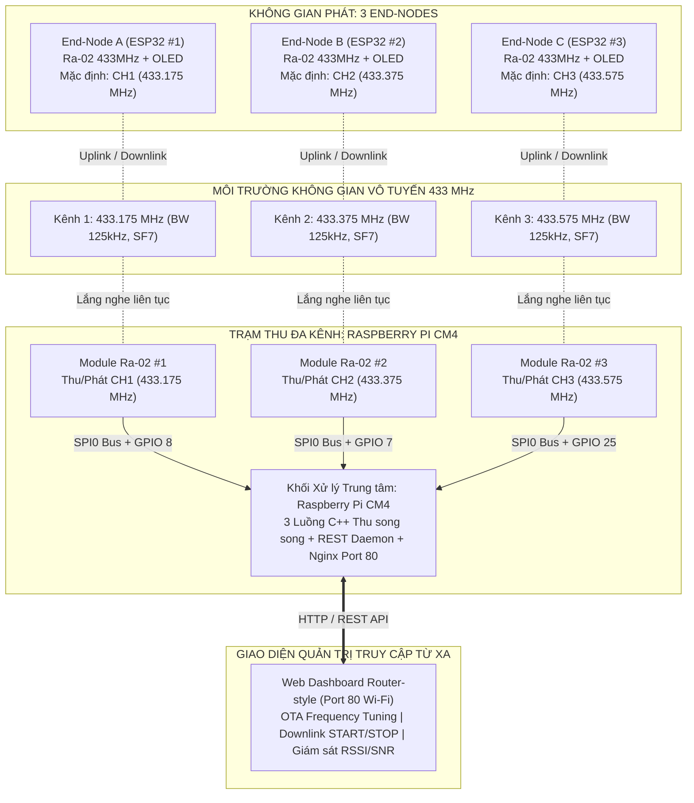
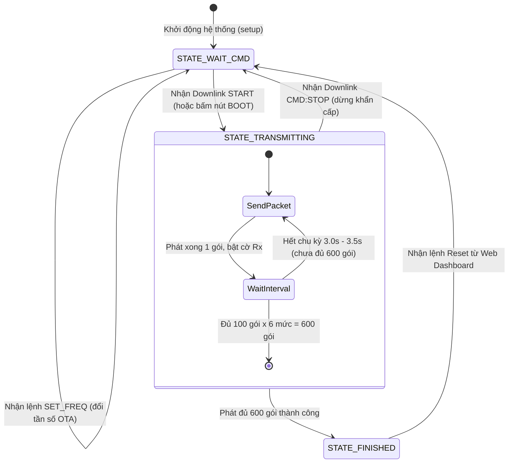
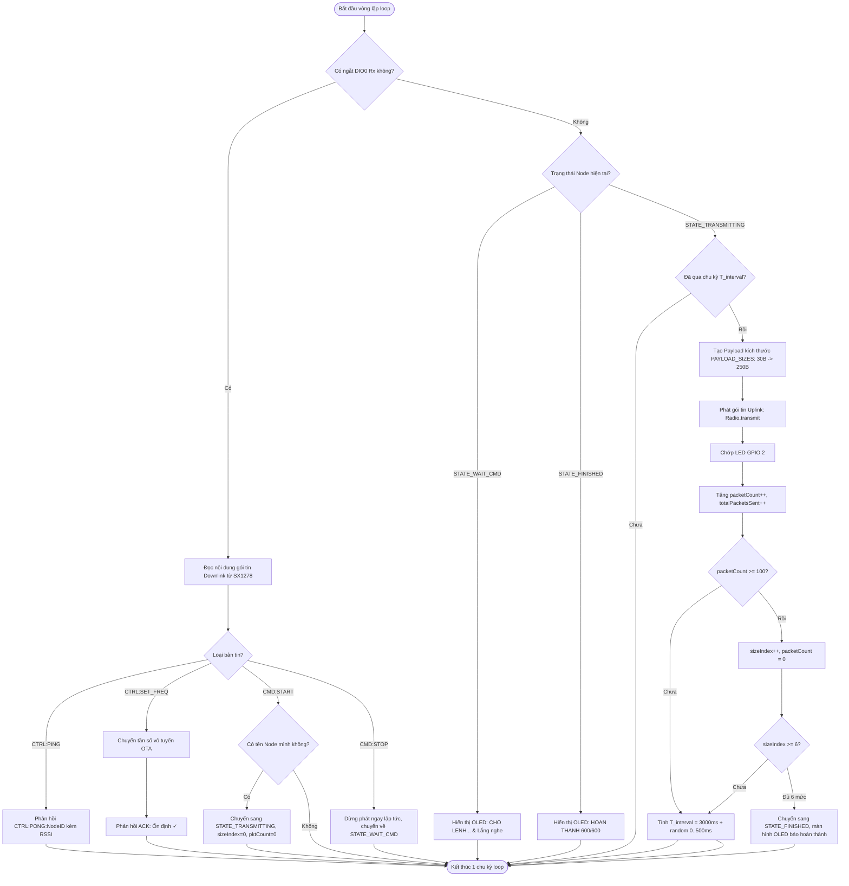
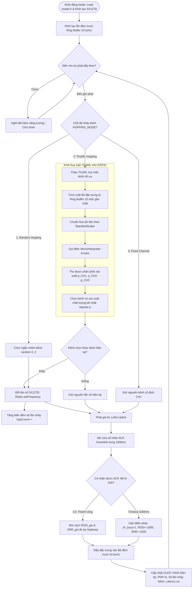

# SƠ ĐỒ KẾT NỐI PHẦN CỨNG & NGUYÊN LÝ HOẠT ĐỘNG FIRMWARE

## Đề tài: Tối Ưu Hóa Kênh Truyền LoRa Dựa Trên TinyML (LoRa TinyML Channel Hopping)

---

## 1. Kiến trúc Tổng thể Hệ thống

Hệ thống gồm **3 Thiết bị Đầu cuối (End-Nodes)** và **1 Trạm Thu thập Đa Kênh (Multi-Channel Gateway)** hoạt động trên dải tần số **433 MHz**:



---

## 2. Sơ đồ Đấu nối Phần cứng Chi tiết

### A. Thiết bị Đầu cuối: End-Node (ESP32 DevKit V1 + Ra-02 433MHz + OLED SSD1306)

<p align="center">
  
  <br><em>Hình: Sơ đồ đấu nối phần cứng thực tế của End-Node (ESP32 DevKit V1 + Module LoRa SX1278 Ra-02 + Màn hình OLED SSD1306)</em>
</p>

Mỗi End-Node bao gồm:

1. **Vi điều khiển trung tâm**: ESP32 DevKit V1 (30 chân / 38 chân).
2. **Module thu phát vô tuyến LoRa**: AI-Thinker Ra-02 (SX1278 433 MHz).
3. **Màn hình hiển thị tại chỗ**: OLED 0.96 inch SSD1306 (Giao tiếp I2C).
4. **Nút bấm & LED**: Nút BOOT (GPIO 0) kích hoạt phát thủ công, LED tích hợp (GPIO 2) báo hiệu trạng thái truyền thông.

```mermaid
graph LR
    subgraph ESP32_BOARD [ESP32 DevKit V1]
        G27[GPIO 27 - MOSI]
        G19[GPIO 19 - MISO]
        G18[GPIO 18 - SCK]
        G5[GPIO 5 - NSS]
        G14[GPIO 14 - RST]
        G26[GPIO 26 - DIO0]
        G21[GPIO 21 - SDA]
        G22[GPIO 22 - SCL]
        V33[3.3V Power]
        GND[GND Common]
    end

    subgraph LORA_MODULE [Module LoRa Ra-02 - SX1278]
        MOSI[MOSI]
        MISO[MISO]
        SCK[SCK]
        NSS[NSS / CS]
        RST[RST]
        DIO0[DIO0]
        L_VCC[VCC - 3.3V]
        L_GND[GND]
    end

    subgraph OLED_DISPLAY [Màn hình OLED 0.96 inch SSD1306]
        O_SDA[SDA]
        O_SCL[SCL]
        O_VCC[VCC - 3.3V]
        O_GND[GND]
    end

    G27 -->|SPI VSPI| MOSI
    G19 <--|SPI VSPI| MISO
    G18 -->|SPI Clock| SCK
    G5 -->|Chip Select| NSS
    G14 -->|Reset| RST
    G26 <--|Ngắt thu/phát| DIO0

    G21 <-->|I2C Data| O_SDA
    G22 -->|I2C Clock| O_SCL

    V33 --- L_VCC
    V33 --- O_VCC
    GND --- L_GND
    GND --- O_GND
```

#### Bảng ánh xạ chân End-Node (ESP32):

| STT | Thiết bị ngoại vi          | Chân Module | Chân ESP32 (GPIO) |   Loại tín hiệu   | Vai trò kỹ thuật                              |
| :-: | :---------------------------- | :----------- | :----------------: | :------------------: | :----------------------------------------------- |
|  1  | **LoRa Ra-02 (SX1278)** | `MOSI`     | **GPIO 27** |     Digital Out     | Master Out Slave In (SPI cứng VSPI)             |
|  2  |                               | `MISO`     | **GPIO 19** |      Digital In      | Master In Slave Out (SPI cứng VSPI)             |
|  3  |                               | `SCK`      | **GPIO 18** |     Digital Out     | Xung nhịp SPI Clock                             |
|  4  |                               | `NSS` (CS) |  **GPIO 5**  |     Digital Out     | Chọn chip SPI (Tích cực mức thấp)           |
|  5  |                               | `RST`      | **GPIO 14** |     Digital Out     | Chân Reset phần cứng Module LoRa              |
|  6  |                               | `DIO0`     | **GPIO 26** |     Interrupt In     | Chân ngắt ngoài (Báo gói Rx Done / Tx Done) |
|  7  |                               | `VCC`      |   **3.3V**   |        Power        | Cấp nguồn 3.3V (Dòng đỉnh phát ~120mA)     |
|  8  |                               | `GND`      |   **GND**   |        Ground        | Mass chung hệ thống                            |
|  9  | **OLED 0.96" SSD1306**  | `SDA`      | **GPIO 21** |  I2C Bidirectional  | Tuyến truyền dữ liệu màn hình OLED         |
| 10 |                               | `SCL`      | **GPIO 22** |      I2C Output      | Tuyến xung đồng hồ I2C                       |
| 11 |                               | `VCC`      |   **3.3V**   |        Power        | Nguồn nuôi mạch điều khiển màn hình      |
| 12 |                               | `GND`      |   **GND**   |        Ground        | Mass chung                                       |
| 13 | **LED Trạng thái**    | Onboard      |  **GPIO 2**  |     Digital Out     | Sáng khi phát sóng, chớp khi nhận lệnh     |
| 14 | **Nút BOOT**           | Onboard      |  **GPIO 0**  | Digital In (Pull-up) | Kích hoạt phát khẩn cấp tại chỗ           |

---

### B. Trạm Gateway Đa Kênh (Raspberry Pi CM4 + 3 Module Ra-02 433MHz)

<p align="center">
  
  <br><em>Hình: Sơ đồ đấu nối phần cứng thực tế của trạm Gateway 3 kênh (Raspberry Pi CM4 + 3 Module LoRa SX1278 Ra-02 433 MHz)</em>
</p>

Trạm Gateway sử dụng Raspberry Pi Compute Module 4 (CM4) kết nối với 3 module Ra-02 thông qua bus `SPI0` dùng chung, phân kênh bằng 3 đường Chip Select độc lập:

```mermaid
graph LR
    subgraph RPI_CM4 [Raspberry Pi CM4 - 40 Pin Header]
        MOSI_P[BCM GPIO 10 / Pin 19 - MOSI]
        MISO_P[BCM GPIO 9 / Pin 21 - MISO]
        SCLK_P[BCM GPIO 11 / Pin 23 - SCLK]
      
        CS1[BCM GPIO 8 / Pin 24 / wPi 10 - CE0]
        RST1[BCM GPIO 27 / Pin 13 / wPi 2]
        DIO1[BCM GPIO 22 / Pin 15 / wPi 3]

        CS2[BCM GPIO 7 / Pin 26 / wPi 11 - CE1]
        RST2[BCM GPIO 17 / Pin 11 / wPi 0]
        DIO2[BCM GPIO 18 / Pin 12 / wPi 1]

        CS3[BCM GPIO 25 / Pin 22 / wPi 6]
        RST3[BCM GPIO 24 / Pin 18 / wPi 5]
        DIO3[BCM GPIO 23 / Pin 16 / wPi 4]

        PWR[Chân 3.3V: Pin 1, 17]
        GND_P[Chân GND: Pin 6, 9, 14, 20, 25]
    end

    subgraph MOD1 [Module Ra-02 #1 - CH1: 433.175 MHz]
        M1_MOSI[MOSI]
        M1_MISO[MISO]
        M1_SCLK[SCK]
        M1_CS[NSS]
        M1_RST[RST]
        M1_DIO0[DIO0]
    end

    subgraph MOD2 [Module Ra-02 #2 - CH2: 433.375 MHz]
        M2_MOSI[MOSI]
        M2_MISO[MISO]
        M2_SCLK[SCK]
        M2_CS[NSS]
        M2_RST[RST]
        M2_DIO0[DIO0]
    end

    subgraph MOD3 [Module Ra-02 #3 - CH3: 433.575 MHz]
        M3_MOSI[MOSI]
        M3_MISO[MISO]
        M3_SCLK[SCK]
        M3_CS[NSS]
        M3_RST[RST]
        M3_DIO0[DIO0]
    end

    MOSI_P === M1_MOSI
    MOSI_P === M2_MOSI
    MOSI_P === M3_MOSI

    MISO_P === M1_MISO
    MISO_P === M2_MISO
    MISO_P === M3_MISO

    SCLK_P === M1_SCLK
    SCLK_P === M2_SCLK
    SCLK_P === M3_SCLK

    CS1 --> M1_CS
    RST1 --> M1_RST
    DIO1 <-- M1_DIO0

    CS2 --> M2_CS
    RST2 --> M2_RST
    DIO2 <-- M2_DIO0

    CS3 --> M3_CS
    RST3 --> M3_RST
    DIO3 <-- M3_DIO0
```

#### Bảng tra cứu chân vật lý 40-pin Raspberry Pi Header:

| Tín hiệu kết nối  |     BCM GPIO     | WiringPi Pin |        Pin vật lý        | Kết nối tới Module LoRa    | Chức năng kỹ thuật             |
| :-------------------- | :---------------: | :----------: | :------------------------: | :---------------------------- | :--------------------------------- |
| **SPI0 MOSI**   | **GPIO 10** | **12** |      **Pin 19**      | Chung cả 3 Module (`MOSI`) | Dữ liệu Master gửi xuống Slave |
| **SPI0 MISO**   | **GPIO 9** | **13** |      **Pin 21**      | Chung cả 3 Module (`MISO`) | Dữ liệu Slave gửi về Master    |
| **SPI0 SCLK**   | **GPIO 11** | **14** |      **Pin 23**      | Chung cả 3 Module (`SCK`)  | Xung nhịp đồng bộ SPI (2 MHz)  |
| **Nguồn 3.3V** |       3.3V       |      —      |    **Pin 1, 17**    | Cấp nguồn 3.3V cả 3 Module | Nguồn nuôi SX1278                |
| **Mass (GND)**  |        GND        |      —      | **Pin 6, 9, 14, 20** | Chung cả 3 Module            | Mass nối đất chung              |
| **M1 NSS (CS)** | **GPIO 8** | **10** |      **Pin 24**      | Module 1 (`NSS`)            | Chọn chip Kênh 1 (433.175 MHz)   |
| **M1 RST**      | **GPIO 27** | **2** |      **Pin 13**      | Module 1 (`RST`)            | Reset cứng Module 1               |
| **M1 DIO0**     | **GPIO 22** | **3** |      **Pin 15**      | Module 1 (`DIO0`)           | Báo ngắt nhận gói tin Kênh 1  |
| **M2 NSS (CS)** | **GPIO 7** | **11** |      **Pin 26**      | Module 2 (`NSS`)            | Chọn chip Kênh 2 (433.375 MHz)   |
| **M2 RST**      | **GPIO 17** | **0** |      **Pin 11**      | Module 2 (`RST`)            | Reset cứng Module 2               |
| **M2 DIO0**     | **GPIO 18** | **1** |      **Pin 12**      | Module 2 (`DIO0`)           | Báo ngắt nhận gói tin Kênh 2  |
| **M3 NSS (CS)** | **GPIO 25** | **6** |      **Pin 22**      | Module 3 (`NSS`)            | Chọn chip Kênh 3 (433.575 MHz)   |
| **M3 RST**      | **GPIO 24** | **5** |      **Pin 18**      | Module 3 (`RST`)            | Reset cứng Module 3               |
| **M3 DIO0**     | **GPIO 23** | **4** |      **Pin 16**      | Module 3 (`DIO0`)           | Báo ngắt nhận gói tin Kênh 3  |

---

## 3. Kiến trúc & Nguyên lý Hoạt động của Firmware

> [!NOTE]
> Để đáp ứng tính thời gian thực cao và tận dụng vi xử lý 2 nhân (Dual-Core) của ESP32, toàn bộ thiết kế phân chia đa nhiệm, gán Core và cơ chế đồng bộ hóa IPC bằng FreeRTOS được đặc tả chi tiết tại: [KIEN_TRUC_FREERTOS_FIRMWARE.md](file:///e:/DATN/LoRa_TinyML_Hopping/docs/KIEN_TRUC_FREERTOS_FIRMWARE.md).

### A. Firmware End-Node Thu thập Dữ liệu (`LoRaEN_DataCollection`)

Firmware được xây dựng theo mô hình **Máy trạng thái hữu hạn (FSM)** kết hợp **Xử lý ngắt không chặn**:



#### Lưu đồ hoạt động chi tiết của vòng lặp `loop()` trên Node:



---

### B. Firmware Gateway Lắng nghe Đa kênh (`main_gw.cpp` & `http_server.cpp`)

Gateway hoạt động trên nền tảng **Đa luồng (Multi-threading)** độc lập:

- **3 Luồng RF Receiver**: Mỗi luồng quản lý riêng 1 module Ra-02, đọc thanh ghi FIFO SPI khi có ngắt `DIO0` và ghi log.
- **1 Luồng Web API Server**: Lắng nghe yêu cầu HTTP REST từ Web Dashboard Nginx, cập nhật thông số và phát lệnh Downlink.

```mermaid
flowchart TD
    subgraph GW_THREADS [KIẾN TRÚC ĐA LUỒNG TRÊN GATEWAY CM4]
        subgraph THREAD_RF1 [Luồng Kênh 1: 433.175 MHz]
            T1_WAIT[Chờ ngắt DIO0 chân wPi 3] --> T1_READ[Đọc gói tin SX1278 #1 qua SPI]
            T1_READ --> T1_FILTER{Tiền tố CTRL:?}
            T1_FILTER -- Không: Là DATA --> T1_SAVE[Ghi vào logs/<TÊN>.txt & csv/<TÊN>.csv]
            T1_FILTER -- Có: Là CONTROL --> T1_RAM[Cập nhật RAM: RSSI, SNR, Online Node]
            T1_SAVE --> T1_PIPE[Đẩy gói tin lên Web Console Socket]
            T1_RAM --> T1_PIPE
        end

        subgraph THREAD_RF2 [Luồng Kênh 2: 433.375 MHz]
            T2_WAIT[Chờ ngắt DIO0 chân wPi 1] --> T2_READ[Đọc gói tin SX1278 #2 qua SPI]
            T2_READ --> T2_FILTER{Tiền tố CTRL:?}
            T2_FILTER -- Không: Là DATA --> T2_SAVE[Ghi vào logs/<TÊN>.txt & csv/<TÊN>.csv]
            T2_FILTER -- Có: Là CONTROL --> T2_RAM[Cập nhật RAM: RSSI, SNR, Online Node]
            T2_SAVE --> T2_PIPE[Đẩy gói tin lên Web Console Socket]
            T2_RAM --> T2_PIPE
        end

        subgraph THREAD_RF3 [Luồng Kênh 3: 433.575 MHz]
            T3_WAIT[Chờ ngắt DIO0 chân wPi 4] --> T3_READ[Đọc gói tin SX1278 #3 qua SPI]
            T3_READ --> T3_FILTER{Tiền tố CTRL:?}
            T3_FILTER -- Không: Là DATA --> T3_SAVE[Ghi vào logs/<TÊN>.txt & csv/<TÊN>.csv]
            T3_FILTER -- Có: Là CONTROL --> T3_RAM[Cập nhật RAM: RSSI, SNR, Online Node]
            T3_SAVE --> T3_PIPE[Đẩy gói tin lên Web Console Socket]
            T3_RAM --> T3_PIPE
        end

        subgraph THREAD_WEB [Luồng Web REST Server - Port 8080]
            API_GET[Nhận GET /api/status] --> RET_STATUS[Trả về JSON: Trạng thái 3 Node, RSSI, SNR, Tần số]
            API_START[Nhận POST /api/control start] --> TX_START[Chuyển Module LoRa sang chế độ TX -> Phát Downlink START]
            API_STOP[Nhận POST /api/control stop] --> TX_STOP[Phát Downlink CMD:STOP]
            API_FREQ[Nhận POST /api/config] --> TX_FREQ[Phát Downlink CTRL:SET_FREQ]
        end
    end

    NGINX[Nginx Reverse Proxy Port 80] <==> THREAD_WEB
```



#### Quy tắc Phân loại Dữ liệu (Traffic Filter Rules) của Gateway:

- **Bản tin DATA (Dữ liệu thu thập)**: Gói tin chứa cú pháp `[NodeID][PktID]*[Size]...`. Gateway lưu giữ trực tiếp vào file log để phục vụ huấn luyện TinyML.
- **Bản tin CONTROL (Điều khiển hệ thống)**: Gói tin có tiền tố `CTRL:PING`, `CTRL:PONG`, `CTRL:SET_FREQ`, `CTRL:ACK`. Gateway đọc mức thu tín hiệu để cập nhật giao diện Dashboard nhưng **tuyệt đối không ghi vào dataset**.

---

### C. Firmware End-Node Nhảy Kênh Thông Minh (`LoRaEN_TinyMLHopping`)

Đây là firmware hoàn thiện được nạp cho ESP32 sau khi đã huấn luyện mô hình TinyML và xuất mảng C `model.h`:



#### Cơ chế Phản hồi Kín & Thu nhận CSI Thời gian thực:
- **Nguyên lý:** Mặc dù tập dữ liệu huấn luyện được ghi log tại Gateway, ESP32 vẫn tái tạo trọn vẹn không gian trạng thái kênh nhờ gói **ACK Downlink 4-byte** (`[0xAA, Seq, RSSI, SNR]`, Time-on-Air chỉ ~25ms).
- **Xử lý mất gói / va chạm tại biên:** Khi xảy ra va chạm trên không, Gateway không nhận được gì nên không thể phản hồi. ESP32 phát hiện sự kiện này thông qua cơ chế **Timeout 1000ms**, từ đó tự động nạp hình phạt `RSSI = -1000` và `SNR = -1000` vào bộ đệm trượt theo đúng quy tắc tiền xử lý dữ liệu.
- *Xem chi tiết kiến trúc đa nhân và mã nguồn FreeRTOS tại [KIEN_TRUC_FREERTOS_FIRMWARE.md](file:///e:/DATN/LoRa_TinyML_Hopping/docs/KIEN_TRUC_FREERTOS_FIRMWARE.md).*

#### Đặc tính kỹ thuật khi suy luận nhúng trên ESP32:

- **Thời gian suy luận (Inference Latency)**: $< \mathbf{2.5 \text{ ms}}$ với vi xử lý Xtensa Dual-Core 240 MHz.
- **Dung lượng bộ nhớ RAM tiêu thụ**: $< \mathbf{4 \text{ KB}}$ (bao gồm tensor arena cho mô hình FCNN Baseline).
- **Bộ nhớ Flash**: Chiếm **~5.8 KB** FlatBuffer byte array trong file `model.h`.
